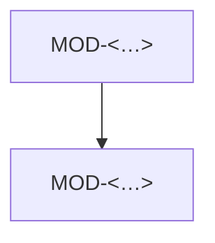

# <Имя компонента>: устройство кода

> Модули верхнего уровня и ключевые классы. Не каждый класс — только те, что видны снаружи
> модуля, и те, где живёт важная логика.

## Модули

### MOD-<компонент>.<имя> — <Зачем модуль>
status: <…> | owner: SVC-<…>

- path: `<путь>/`
- responsibility: <одно предложение>
- public: CLS-<…>, CLS-<…>
- depends on: MOD-<…>
- must not: <ходить в БД напрямую / импортировать MOD-<…> / делать сетевые вызовы>
- implements: API-<…>, INV-<…>

## Ключевые классы и функции

### CLS-<компонент>.<имя> — <Что делает>
status: <…> | owner: SVC-<…> | kind: <class | interface | function | type>

- module: MOD-<…>
- symbol: `<ИмяВКоде>` в `<путь/к/файлу>`
- signature: `<Calculate(items []Item, promo *Promo) (Money, error)>`
- guarantees: <чистая функция, без I/O / потокобезопасен / идемпотентен>
- errors: ERR-<…>
- implementations: <для интерфейсов — кто реализует: CLS-<…>>
- notes: <почему так устроено>
