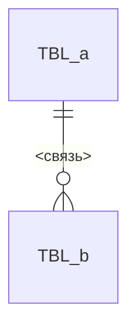

# <Имя компонента>: данные

> Только данные, которыми владеет этот компонент. Чужие таблицы здесь не описываем — ссылаемся по ID.

## Связи

## Таблицы

### TBL-<имя> — <Что хранит>
status: <…> | owner: SVC-<…> | store: RES-<…> | entity: ENT-<…>

- purpose: <одно предложение>
- pk: `<колонка>`
- retention: <бессрочно / удаляем через 90d (JOB-<…>) / soft delete через `deleted_at`>
- pii: <нет / SEC-pii: колонки `<…>`>
- volume: <ожидаемое число строк и рост>

| колонка | тип | null | default | ограничения | смысл |
|---|---|---|---|---|---|
| `id` | uuid | нет | gen | pk | |
| `<x_id>` | uuid | нет | | fk → TBL-<…>#id, on delete <restrict / cascade> | |
| `<status>` | enum(STATE-<…>) | нет | `'<new>'` | | |
| `<amount>` | decimal(12,2) | нет | | ≥ 0 (INV-<…>) | |
| `created_at` | timestamp | нет | now() | | |

- indexes:
  - `(<col>, <col> desc)` — <для какого запроса нужен>
  - unique `(<col>)` — <какое правило обеспечивает>
- written by: API-<…>, JOB-<…>
- read by: API-<…>; <другие сервисы — только через API-<…> или EVT-<…>>

## Кэш и KV

### KV-<компонент>.<имя> — <Что кэширует>
status: <…> | owner: SVC-<…> | store: RES-<…>

- key: `<cart:{user_id}>`, type: <string / hash / set / stream>
- value: DTO-<…>
- ttl: <7d / без TTL>
- invalidation: <кто и когда удаляет или обновляет>
- source of truth: TBL-<…> (кэш можно потерять без последствий: <да / нет>)

## Файлы и объекты

### BKT-<компонент>.<имя> — <Что лежит>
status: <…> | owner: SVC-<…> | store: RES-<…>

- path: `<bucket>/<prefix>/{yyyy}/{mm}/{uuid}.<ext>`
- content: <тип файлов, FMT-<…>, максимальный размер>
- access: <приватно, выдаём presigned URL на 15m через API-<…>>
- lifecycle: <удаляем через 30d>
- pii: <…>
