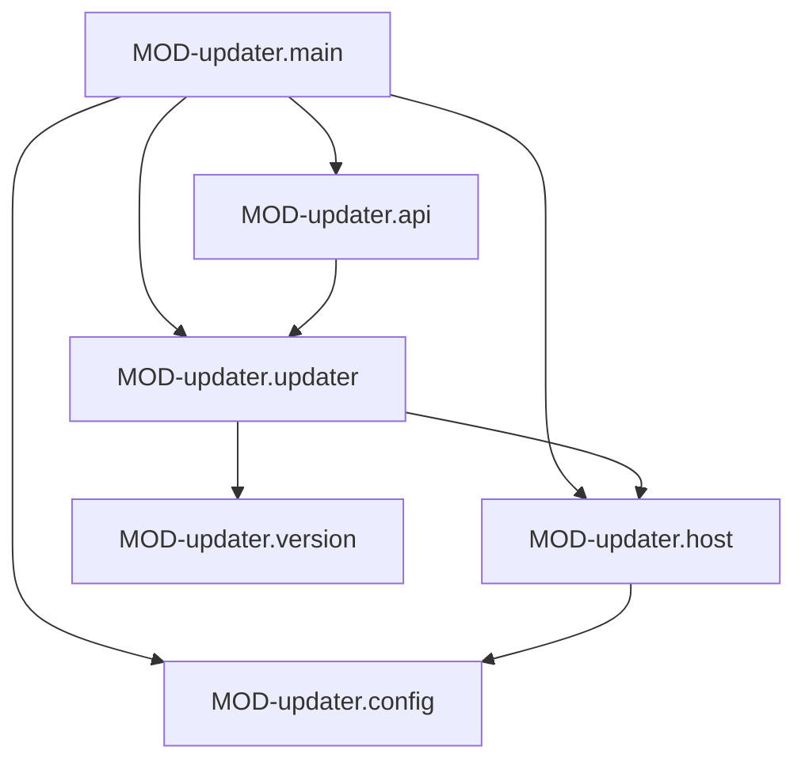

# updater: устройство кода

> Один пакет `main` в `updater/`, шесть файлов — шесть модулей. Сторонних зависимостей нет.

## Модули

### MOD-updater.main — Запуск демона
status: implemented | owner: SVC-updater

- path: `updater/main.go`
- responsibility: разобрать подкоманду `serve`, принять сокет от systemd, собрать зависимости, запустить HTTP-сервер и периодическую проверку, корректно остановиться.
- public: CLI-updater.serve
- depends on: MOD-updater.config, MOD-updater.api, MOD-updater.updater, MOD-updater.host
- implements: JOB-updater.check, rule-deploy-graceful-shutdown
- must not: открывать TCP-порт самостоятельно; стартовать без сокета от `llm-wiki-updater.socket`

### MOD-updater.api — HTTP-слой и авторизация
status: implemented | owner: SVC-updater

- path: `updater/api.go`
- responsibility: четыре маршрута `/v1/*`, проверка вызывающего через wikisvc, формат ошибок как у wikisvc.
- public: CLS-updater.WhoAmI, CLS-updater.admin
- depends on: MOD-updater.updater
- implements: API-updater.status, API-updater.check, API-updater.channel, API-updater.apply
- must not: решать, кто администратор, самостоятельно (решение принимает wikisvc, updater применяет правило «человек и админ»); принимать от клиента имя образа

### MOD-updater.config — Флаги командной строки
status: implemented | owner: SVC-updater

- path: `updater/config.go`
- responsibility: описать и разобрать флаги `serve`; значения по умолчанию соответствуют стандартной установке.
- public: CLS-updater.Config
- must not: читать переменные окружения (кроме сокета в `main.go`) и файлы

### MOD-updater.host — Всё, что обновление делает с машиной
status: implemented | owner: SVC-updater

- path: `updater/host.go`
- responsibility: интерфейс `Host` и его реальная реализация `System`: реестр (skopeo), подпись (cosign), `podman pull`, `systemctl`, `tar`, `llm-wiki-run`, опрос здоровья wikisvc и wiki-ui.
- public: CLS-updater.Host, CLS-updater.System
- depends on: MOD-updater.config
- must not: знать порядок шагов обновления (он в `MOD-updater.updater`); писать секреты в ошибки (ошибка команды несёт последние четыре строки её stderr)
- implements: DTO-updater.Image, DTO-updater.Job

### MOD-updater.updater — Состояние и порядок обновления
status: implemented | owner: SVC-updater

- path: `updater/updater.go`
- responsibility: хранить состояние в `state.json`, искать и проверять предложение, выполнять обновление шагами и откат; единственный владелец блокировок `checking`/`applying`.
- public: CLS-updater.Updater
- depends on: MOD-updater.host, MOD-updater.version
- implements: JOB-updater.apply, DTO-updater.State, DTO-updater.Operation, DTO-updater.Step, FMT-updater.state, FMT-updater.image-env
- must not: вызывать программы напрямую, только через `Host` (иначе порядок и откат нельзя проверить без root)

### MOD-updater.version — Теги и каналы
status: implemented | owner: SVC-updater

- path: `updater/version.go`
- responsibility: разобрать тег релиза, упорядочить по semver, выбрать новейший тег канала.
- public: CLS-updater.Version, CLS-updater.Latest
- must not: ходить в сеть

## Ключевые классы и функции

### CLS-updater.Updater — Состояние и операции обновления
status: implemented | owner: SVC-updater | kind: type

- module: MOD-updater.updater
- symbol: `Updater` (`NewUpdater`, `Status`, `SetChannel`, `Check`, `Apply`, `Wait`) в `updater/updater.go`
- guarantees: потокобезопасен (один `sync.Mutex`); одновременно идёт не более одной проверки или одного обновления, иначе `ErrBusy`; каждое изменение шага пишется в `state.json` атомарно (временный файл, `fsync`, `rename`, режим 0600)
- errors: ErrBusy (409), ErrStale (409), ErrChannel (400)
- notes: при старте операция в состоянии `running` помечается `interrupted` с указанием архива: угадывать, в какой половине обновления остановился демон, хуже, чем сказать об этом человеку. `Apply` принимает только digest, который сам предложила проверка, поэтому клиент может подтвердить обновление, но не назвать образ. `Status` отдаёт копию, а текущий digest берёт из `image.env` (источник истины), а не из `state.json`

### CLS-updater.discover — Поиск и проверка предложения
status: implemented | owner: SVC-updater | kind: function

- module: MOD-updater.updater
- symbol: `(*Updater).discover` в `updater/updater.go`
- signature: `discover(ctx, channel string, current Image) (*Image, string, error)`
- guarantees: предлагает только тег новее запущенного; тот же digest — «обновлений нет» (возвращает имя запущенного тега); смена канала не предлагает понижение версии; предложение выдаётся лишь после успешной проверки подписи
- notes: порядок — теги из реестра, `Latest` по каналу, `Inspect` (digest и ревизия), сравнение, `Verify`. При ошибке старое предложение сбрасывается: тег мог указывать на непроверяемое

### CLS-updater.rollback — Откат после сбоя
status: implemented | owner: SVC-updater | kind: function

- module: MOD-updater.updater
- symbol: `(*Updater).rollback` в `updater/updater.go`
- guarantees: останавливает службы, восстанавливает предварительный архив (вместе с ним возвращается `image.env`, а значит прежний образ), полностью перестраивает индекс прежним образом, запускает службы и ждёт здоровья с прежней версией; итог `rolled_back`, либо `failed` с текстом обеих ошибок
- notes: данные, не прошедшие обновление, не удаляются, а переименовываются в `<путь>.failed-<id операции>` (`System.Restore`). Откат вручную — `image.env.previous`

### CLS-updater.Host — Граница с машиной
status: implemented | owner: SVC-updater | kind: interface

- module: MOD-updater.host
- symbol: `Host` в `updater/host.go`
- signature: `Tags`, `Inspect`, `Verify`, `Pull`, `Jobs`, `Systemctl`, `UnitState`, `Maintenance`, `Archive`, `Restore`, `WikiVersion`, `UIHealthy`
- implementations: CLS-updater.System; в тестах — подставной хост
- notes: интерфейс объявлен рядом с реализацией, потребитель — `Updater`; благодаря ему порядок шагов и откат проверяются тестами без root

### CLS-updater.System — Реальный хост
status: implemented | owner: SVC-updater | kind: type

- module: MOD-updater.host
- symbol: `System` (поля `cfg`, `run Runner`, `http`) в `updater/host.go`
- guarantees: любой внешний процесс запускается через `Runner` с контекстом (отмена и таймаут); `Verify` требует аттестацию SLSA provenance (`verify-attestation --type https://slsa.dev/provenance/v1`) с идентичностью `identity + тег` и эмитентом `issuer`, то есть подпись для другого тега или workflow не подходит; `Inspect` принимает только digest вида `sha256:` и 64 hex; `Archive` удаляет неполный архив; `UnitState` читает вывод `is-active`, а не код возврата
- notes: в архив входят `var/lib/llm-wiki/wiki`, `var/lib/llm-wiki/state`, `var/lib/llm-wiki/agent`, `etc/llm-wiki` (как у ночного бэкапа); индекс не архивируется, а перестраивается

### CLS-updater.admin — Проверка вызывающего
status: implemented | owner: SVC-updater | kind: function

- module: MOD-updater.api
- symbol: `(*API).admin` в `updater/api.go`
- guarantees: пропускает только bearer-токен, который wikisvc опознал как `kind=human` и `role=admin` (INV-human-decides, ROLE-admin); токен не хранится и не логируется; запрос к wikisvc ограничен 10s
- errors: ERR-unauthorized (401), ERR-human_required (403), ERR-forbidden (403), ERR-service_unavailable (503)
- notes: wikisvc недоступен или ответил не 200/401/403 — отказ (503), доступ не выдаётся «по умолчанию»

### CLS-updater.WhoAmI — Вызов wikisvc whoami
status: implemented | owner: SVC-updater | kind: type

- module: MOD-updater.api
- symbol: `WhoAmI`, `wikiWhoAmI` в `updater/api.go`
- signature: `func(ctx, authorization string) (Principal, int, error)`
- notes: тип функции, чтобы тесты подменяли wikisvc; зовёт API-wikisvc.whoami с тем же заголовком `Authorization`

### CLS-updater.Config — Параметры демона
status: implemented | owner: SVC-updater | kind: type

- module: MOD-updater.config
- symbol: `Config`, `parseConfig` в `updater/config.go`
- notes: фиксируется при старте; `Root` всегда `/` (поле нужно тестам, флага нет)

### CLS-updater.Version — Версия релиза
status: implemented | owner: SVC-updater | kind: type

- module: MOD-updater.version
- symbol: `Version`, `ParseVersion`, `Less`, `Base` в `updater/version.go`
- guarantees: принимает только `^vX.Y.Z(-beta.N)?$` без ведущих нулей (та же грамматика, что в `scripts/check-release-tag.sh`); порядок по semver: `X.Y.Z-beta.N` < `X.Y.Z`; `Base()` даёт `X.Y.Z`, который wikisvc должен показать в `/api/v1/health`

### CLS-updater.Latest — Выбор новейшего тега канала
status: implemented | owner: SVC-updater | kind: function

- module: MOD-updater.version
- symbol: `Latest` в `updater/version.go`
- signature: `Latest(tags []string, channel string) (Version, bool)`
- guarantees: канал `release` видит только релизы; канал `beta` видит и беты, и релизы (релиз новее бет той же версии, поэтому бета-канал переходит на вышедший релиз); теги `main`, `sha-…` и прочие игнорируются
