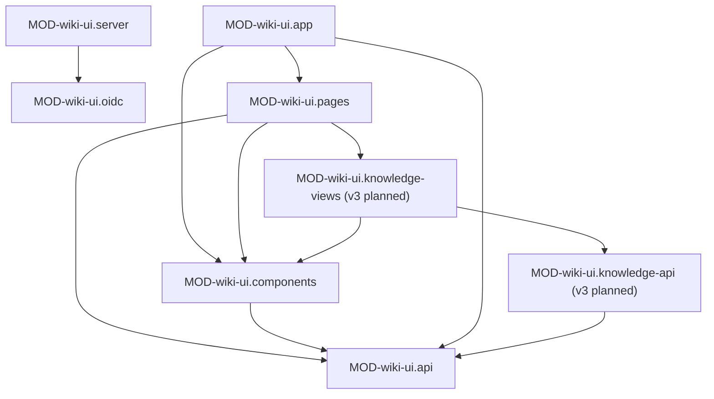

# wiki-ui: устройство кода

> Два слоя: Go-сервер (`ui/*.go`, LANG-go) — вход, прокси, статика; React SPA (`ui/src/`,
> LANG-typescript) — только отображение и вызовы API через прокси.

## Модули

### MOD-wiki-ui.server — HTTP-сервер: маршруты, прокси, статика
status: implemented | owner: SVC-wiki-ui

- path: `ui/main.go`
- responsibility: читает настройки, собирает обработчик, оборачивает его в CLS-wiki-ui.protect и
  слушает CFG-wiki-ui.WIKI_UI_BIND с мягкой остановкой по SIGINT/SIGTERM (15s).
- public: CLS-wiki-ui.handler, CLS-wiki-ui.proxied
- depends on: MOD-wiki-ui.oidc
- must not: передавать upstream браузерные `Cookie`/`Origin`/`Referer` и отдавать браузеру `Set-Cookie` upstream.
- implements: API-wiki-ui.health, API-wiki-ui.proxy.wikisvc, API-wiki-ui.proxy.wikiagent,
  API-wiki-ui.proxy.updater, API-wiki-ui.static
- notes: таймауты сервера — заголовки 10s, чтение 5m, простой 90s; ассеты встроены `go:embed` из `dist/`.

### MOD-wiki-ui.oidc — Вход через OIDC и сессионная cookie
status: implemented | owner: SVC-wiki-ui

- path: `ui/oidc.go`
- responsibility: authorization code + PKCE с EXT-authentik, проверка ID-токена, выпуск сессии
  SVC-wikisvc, cookies `wiki_session`/`wiki_oidc_flow`, отзыв при выходе, допуск запросов по cookie.
- public: CLS-wiki-ui.newOIDC, CLS-wiki-ui.protect, CLS-wiki-ui.VerifySignature
- depends on: DEP-go-go-oidc, DEP-go-oauth2, DEP-go-go-jose
- must not: сопоставлять группы с ролями (это SVC-wikisvc); ходить в IdP при выходе; ходить через
  системный HTTP-прокси (у клиента IdP прокси выключен, редиректы не следуются, таймаут 10s).
- implements: API-wiki-ui.auth.login, API-wiki-ui.auth.callback, API-wiki-ui.auth.logout,
  JOB-wiki-ui.oidc-refresh, FLOW-oidc-login, SEC-session-cookie

### MOD-wiki-ui.app — Корень SPA
status: implemented | owner: SVC-wiki-ui

- path: `ui/src/main.tsx`, `ui/src/auth.tsx`
- responsibility: провайдеры (`QueryClientProvider`, CLS-wiki-ui.AuthProvider, `BrowserRouter`,
  тосты), граница ошибок, ленивые маршруты страниц внутри `Layout`, экран входа при отсутствии актора.
- public: CLS-wiki-ui.AuthProvider
- depends on: MOD-wiki-ui.api, MOD-wiki-ui.pages, MOD-wiki-ui.components
- notes: маршруты — `/`, `/pages`, `/rules`, `/pages/:id`, `/proposals`, `/proposals/:id`, `/chat`,
  `/chat/:id`, `/sources`, `/jobs`, `/graph`, `/policies`, `/settings`, остальное — «Такой страницы здесь нет».
- changed: 2026-10-20 v3 (planned): маршрут `/questions` (CLS-wiki-ui.Questions); `/pages/:id` для типов
  `fact`/`topic`/`tech`/`question` рисует вид по типу из MOD-wiki-ui.knowledge-views (ссылки `[[id]]` не меняются);
  состояние видов — в параметрах адреса (`data.md`).

### MOD-wiki-ui.api — Слой API браузера
status: implemented | owner: SVC-wiki-ui

- path: `ui/src/api.ts`, `ui/src/types.ts`
- responsibility: единая точка `fetch` к `/api/v1`, `/agent-api`, `/updater-api` (CLS-wiki-ui.request),
  хуки TanStack Query (`useAPI`, `useAll` — пагинация курсором по 100, `useUpdater`), `write`,
  поток чата CLS-wiki-ui.streamMessage, общий `queryClient`.
- public: CLS-wiki-ui.request, CLS-wiki-ui.streamMessage
- must not: хранить токен; переопределять контракты — интерфейсы `types.ts` повторяют DTO-wikisvc.*
  и ответы API-wikiagent.*, API-updater.*.
- notes: `queryClient` — `staleTime` 20s, `retry: false`, обновление при фокусе окна.
- changed: 2026-10-20 v3 (planned): `types.ts` += зеркала DTO-wikisvc-core.FactView и DTO-wikisvc-core.EdgeView
  (у `Edge` — `weight`, `note`, `origin`); запросы слоя знаний живут в MOD-wiki-ui.knowledge-api и идут
  только через CLS-wiki-ui.request.

### MOD-wiki-ui.pages — Экраны
status: implemented | owner: SVC-wiki-ui

- path: `ui/src/pages/`
- responsibility: по экрану на маршрут; права показывают через `canWrite`/`canReview`, проверка — на сервере.
- depends on: MOD-wiki-ui.api, MOD-wiki-ui.components
- changed: 2026-10-20 v3 (planned): `Sources.tsx` — форма запуска API-wikiagent.jobs.ingest-book получает выбор
  `mode` (`facts` | `rules`, по умолчанию `facts`; `rules` выбирается явно) и `domain` (список —
  API-wikisvc.knowledge.domains); при `mode=facts` домен обязателен — без него кнопка запуска недоступна.
  Окончательно проверяет SVC-wikiagent (в том числе `mode=facts` только для `kind=human`); решение — Q-kb-ingest-rules-mode.

| экран | файл | что делает |
|---|---|---|
| Обзор | `Dashboard.tsx` | сводка: страницы, правила, предложения на ревью, открытые находки |
| Знания | `Knowledge.tsx` | список страниц (`/pages`) или правил (`/rules`) с фильтрами по схеме, создание через редактор |
| Страница | `PageDetail.tsx` | страница с соседями и историей; правка, «проверено», «устарело», promote/deprecate правила (v3 planned: для `fact`/`topic`/`tech`/`question` — CLS-wiki-ui.FactView, CLS-wiki-ui.TopicView, CLS-wiki-ui.TechView, CLS-wiki-ui.QuestionView) |
| Ревью | `Review.tsx` | очередь предложений и находок, отклонение находки (v3 planned: классы ревью — CLS-wiki-ui.ReviewClassFilter) |
| Предложение | `ProposalDetail.tsx` | diff, влияние, валидация, решения accept / reject / request-changes (v3 planned: вкладка «Факты» — CLS-wiki-ui.ClaimReview; двойное подтверждение — по `needs_double_confirm` с сервера) |
| Вопросы | `Questions.tsx` | (v3 planned) открытые вопросы домена — CLS-wiki-ui.Questions |
| Чат | `Chat.tsx` | история своих сессий чата API-wikiagent.*, потоковые ответы, планы (v3 planned: CLS-wiki-ui.SearchDegradedBanner) |
| Источники | `Sources.tsx` | загрузка, чтение, извлечение и оглавление источника, запуск ingest-book; нужен допуск restricted (v3 planned: выбор `mode` и `domain` при запуске, см. `changed:` выше) |
| Граф | `Graph.tsx` | граф связей (экспорт или соседи страницы), до 350 узлов (v3 planned: веса и провенанс рёбер — CLS-wiki-ui.WeightedGraph) |
| Задачи | `Jobs.tsx` | джобы агента, их управление, запуск heal и сверки документации (`DocsAudit`) |
| Политики | `Policies.tsx` | сборка блока политик по профилю и бюджету токенов |
| Настройки | `Settings.tsx` | профиль, версия и индекс, выход; блок обновлений для ROLE-admin |
| Вход | `Login.tsx` | переход на `/auth/login` |

### MOD-wiki-ui.components — Общие компоненты
status: implemented | owner: SVC-wiki-ui

- path: `ui/src/components/`
- responsibility: `Layout.tsx` — каркас, навигация, поиск, тема, счётчик входящих, индикатор обновления;
  `Editor.tsx` — правка страницы как предложение (создать и отправить); `Updates.tsx` — статус, канал,
  проверка и установка релиза через API-updater.*; `DocsAudit.tsx` — запуск сверки документации проекта;
  `PersonName.tsx` — имя человека по identity (`/people`, при допуске выше public); `common.tsx` —
  подписи, бейджи, модальные окна, тосты, безопасный Markdown (без HTML и внешних картинок).
- depends on: MOD-wiki-ui.api
- changed: 2026-10-20 v3 (planned): `labels` в `common.tsx` += русские подписи значений `kind`, `confidence`,
  `novelty`, STATE-tech, STATE-question, STATE-fact-review-class, `origin`; цвета типов `fact`/`topic`/`tech`/
  `question`, штрихи `origin` и бейджи — токены в `ui/src/styles.css` (`rule-design-tokens-system`).

### MOD-wiki-ui.knowledge-api — Запросы и хуки слоя знаний
status: planned | owner: SVC-wiki-ui

- path: `ui/src/knowledgeApi.ts` (функции запросов), `ui/src/useKnowledge.ts` (хуки TanStack Query)
- responsibility: чтение фактов, хабов, tech, вопросов, доменов и графа с весами; решение по
  предложению из фактов. Компоненты зовут только хуки (`rule-arch-frontend-api-layer`, `rule-arch-file-naming`).
- public: CLS-wiki-ui.useKnowledge
- depends on: MOD-wiki-ui.api (`api`, `write`, `invalidate`; 401 и ошибки — в CLS-wiki-ui.request)
- calls: API-wikisvc.knowledge.fact, API-wikisvc.knowledge.topic, API-wikisvc.knowledge.tech,
  API-wikisvc.knowledge.questions, API-wikisvc.knowledge.domains, API-wikisvc.graph.export,
  API-wikisvc.graph.neighbors, API-wikisvc.pages.get, API-wikisvc.proposals.get, API-wikisvc.proposals.list,
  API-wikisvc.proposals.accept, API-wikisvc.proposals.revert, API-wikisvc.pages.mark-outdated,
  API-wikisvc.health
- must not: вызывать `fetch` мимо CLS-wiki-ui.request; сортировать, фильтровать или урезать список фактов
  хаба (INV-canonical-order); вычислять класс ревью, `confidence`, `status: outdated`, вес обхода
  (`rule-arch-frontend-no-business-rules`); типизировать ответы как `any` (`rule-arch-strict-typing`).

### MOD-wiki-ui.knowledge-views — Виды слоя знаний
status: planned | owner: SVC-wiki-ui

- path: `ui/src/components/knowledge/`
- responsibility: виды страниц fact/topic/tech/question, бейджи знаний, ревью предложения списком claims
  и пар `contradicts`, фильтр классов ревью, стиль рёбер графа.
- public: CLS-wiki-ui.FactView, CLS-wiki-ui.TopicView, CLS-wiki-ui.TechView, CLS-wiki-ui.QuestionView,
  CLS-wiki-ui.KnowledgeBadges, CLS-wiki-ui.ClaimReview, CLS-wiki-ui.ContradictionPair,
  CLS-wiki-ui.ReviewClassFilter, CLS-wiki-ui.edgeStyle, CLS-wiki-ui.SearchDegradedBanner
- depends on: MOD-wiki-ui.knowledge-api, MOD-wiki-ui.components (`Badge`, `Markdown`, `Modal`, `Submit`),
  DEP-npm-lucide-react
- must not: импортировать `api.ts`; добавлять npm-зависимости (`rule-stack-new-tech-consent`; виртуальные
  списки не нужны — хаб и предложение ≤ 60 фактов, ТЗ §3.2, §8.6); рендерить HTML из страниц (только `Markdown`).
- notes: смысл не передаётся только цветом или штрихом — рядом всегда текст; контраст подписей ≥ 4.5:1
  (`rule-design-contrast`); зоны нажатия ≥ 44px (`rule-design-responsive`); без движения при
  `prefers-reduced-motion` (`rule-design-reduced-motion`); тексты UI — по-русски, значения enum — как в ТЗ.

## Ключевые классы и функции

### CLS-wiki-ui.handler — Маршрутизатор и защитные заголовки
status: implemented | owner: SVC-wiki-ui | kind: function

- module: MOD-wiki-ui.server
- symbol: `handler` в `ui/main.go`
- signature: `handler(files fs.FS, wikiURL, agentURL, updaterSocket string) (http.Handler, error)`
- guarantees: отказ при upstream не вида `http(s)://host[:port]`; CSP и защитные заголовки на каждом ответе.

### CLS-wiki-ui.proxied — Общие ограничения прокси
status: implemented | owner: SVC-wiki-ui | kind: function

- module: MOD-wiki-ui.server
- symbol: `proxied` в `ui/main.go`
- signature: `proxied(target *url.URL, transport http.RoundTripper, prefix string) http.Handler`
- guarantees: без `Authorization: Bearer` — 401 до чтения тела; лимит тела до проксирования;
  401 upstream превращается в переход на вход; SSE без буферизации.
- errors: ERR-unauthorized, ERR-method, ERR-body_too_large, ERR-service_unavailable

### CLS-wiki-ui.newOIDC — Проверка настроек входа при старте
status: implemented | owner: SVC-wiki-ui | kind: function

- module: MOD-wiki-ui.oidc
- symbol: `newOIDC` в `ui/oidc.go`
- signature: `newOIDC(config oidcConfig, wikiURL string) (*oidcAuth, error)`
- guarantees: без валидных issuer, redirect, client id и читаемых файлов секретов процесс не стартует;
  IdP при старте не запрашивается — сервер поднимается и при недоступном IdP.

### CLS-wiki-ui.protect — Допуск запросов по сессионной cookie
status: implemented | owner: SVC-wiki-ui | kind: function

- module: MOD-wiki-ui.oidc
- symbol: `(*oidcAuth).protect` в `ui/oidc.go`
- signature: `protect(next http.Handler) http.Handler`
- guarantees: `/auth/*`, `/healthz`, `/assets/*` — без cookie; `/api/v1/sessions` закрыт; изменяющий метод
  с `Origin` не равным origin UI — 403; `Authorization` запроса заменяется токеном из cookie.
- implements: SEC-session-cookie

### CLS-wiki-ui.VerifySignature — Проверка подписи ID-токена с ротацией ключей
status: implemented | owner: SVC-wiki-ui | kind: function

- module: MOD-wiki-ui.oidc
- symbol: `(*oidcAuth).VerifySignature` в `ui/oidc.go` (реализует `oidc.KeySet`)
- guarantees: проверка закэшированными ключами; при неудаче — одно обновление JWKS и повтор.
  Проверку `iss`, `aud`, `exp` и алгоритма делает `oidc.IDTokenVerifier`.

### CLS-wiki-ui.request — Запрос к API и обработка 401
status: implemented | owner: SVC-wiki-ui | kind: function

- module: MOD-wiki-ui.api
- symbol: `request` и `responseError` в `ui/src/api.ts`
- guarantees: `credentials: same-origin`, `redirect: manual`; переход Go на вход (`opaqueredirect`) —
  `location.assign("/auth/login")`; 401 — событие `wiki:unauthorized`, по которому CLS-wiki-ui.AuthProvider
  уводит на вход; ошибки — `APIError(code, message, status, hint)`, сеть — `E_NETWORK`.
- notes: refresh-токена нет — сессия одна, повторный вход идёт через IdP.

### CLS-wiki-ui.streamMessage — Потоковый ответ чата
status: implemented | owner: SVC-wiki-ui | kind: function

- module: MOD-wiki-ui.api
- symbol: `streamMessage` в `ui/src/api.ts`
- guarantees: разбирает SSE `POST /agent-api/chat/sessions/{id}/messages`; событие `error` — исключение;
  поток без события `message` — ошибка «соединение прервалось»; отмена закрывает поток в браузере,
  операция агента может завершиться на сервере.

### CLS-wiki-ui.AuthProvider — Текущий актор и выход
status: implemented | owner: SVC-wiki-ui | kind: function

- module: MOD-wiki-ui.app
- symbol: `AuthProvider`, `canWrite`, `canReview` в `ui/src/auth.tsx`
- guarantees: актор — ответ `/api/v1/whoami`; выход — очистка кэша запросов и POST-форма на
  API-wiki-ui.auth.logout; `canWrite`/`canReview` только скрывают кнопки (`rule-arch-frontend-no-business-rules`).

## Слой знаний (v3, draft)

### CLS-wiki-ui.useKnowledge — Хуки чтения знаний и решения по предложению
status: planned | owner: SVC-wiki-ui | kind: function

- module: MOD-wiki-ui.knowledge-api
- symbol: `useFact`, `useTopic`, `useTech`, `useDomains`, `useQuestions`, `useWeightedGraph`,
  `useProposalDecision` в `ui/src/useKnowledge.ts`
- guarantees: ключи кэша `["wiki", "kb", <ресурс>, <id>, <параметры>]` под общим `queryClient`; `useTopic` листает
  `next_cursor` через `useInfiniteQuery` (DEP-npm-tanstack-react-query) и склеивает страницы без пересортировки;
  `budget_tokens` не передаёт — действует умолчание сервера (решение, Q-kb-ui-defaults); после
  решения по предложению — `invalidate()`, как в существующих экранах.
- errors: ERR-not_found и скрытая страница (INV-404-not-403) — «Страница не найдена»; 502 — ошибка блока с повтором.

### CLS-wiki-ui.KnowledgeBadges — Бейджи достоверности, новизны и применимости
status: planned | owner: SVC-wiki-ui | kind: function

- module: MOD-wiki-ui.knowledge-views
- symbol: `KnowledgeBadges` в `ui/src/components/knowledge/KnowledgeBadges.tsx`
- input: `kind`, `confidence`, `novelty`, `valid_for`, `valid_from`, `valid_to`, `status`, `replaced_by`, `version`,
  `origin` из DTO-wikisvc-core.FactView; признак доверия страницы (`trust`)
- guarantees: подвал происхождения — строка `[draft]` · `origin: book` · `trust: untrusted_external` — стоит в
  фиксированном месте **до** текста факта на странице факта (CLS-wiki-ui.FactView) и в строке ревью
  (CLS-wiki-ui.ClaimReview), чтобы текст из книги не читался как проверенный (INV-untrusted-external).

| поле | как показывается |
|---|---|
| `confidence` | `sourced` «по источнику», `inferred` «выведено», `contested` «оспорено» со значком, `open` «не проверено» |
| `novelty` (TERM-novelty) | бейдж на каждую пару «модель: значение» (`common` «знает», `differs` «знает иначе», `unique` «не знает»); пустой словарь — «новизна не оценена». Отсутствующий ключ не подменяется на `differs`: это правило выдачи (ТЗ §7.1), не отображения |
| `valid_for` (TERM-valid-for) | чип с текстом как есть; нет поля — нет чипа (ERR-valid_for_missing показывает lint) |
| `valid_from` / `valid_to` | «действует с … по …», даты UTC |
| `status: outdated` (STATE-fact) | бейдж «устарело» и ссылка «заменён: <id>» при `replaced_by`; текст не скрывается и не бледнеет ниже 4.5:1 |

### CLS-wiki-ui.FactView — Страница факта
status: planned | owner: SVC-wiki-ui | kind: function

- module: MOD-wiki-ui.knowledge-views
- symbol: `FactView` в `ui/src/components/knowledge/FactView.tsx`; вызывает `PageDetail` для `type: fact` (ENT-fact)
- data: `useFact` → API-wikisvc.knowledge.fact (L2 + рёбра, TERM-delivery-level)
- guarantees: `claim` заголовком, ниже `summary`, `kind`, CLS-wiki-ui.KnowledgeBadges; разделы Claim/Why/Example/
  Caveats — безопасным `Markdown`; `sources` — внутренними ссылками на страницы, внешний URL источника — по
  правилу ссылок CLS-wiki-ui.TechView; таблица рёбер по `rel` (хабы `about` первыми): id, вес
  (2 знака, `tabular-nums`), `origin`, `note` (DTO-wikisvc-core.EdgeView); у `contradicts` — пометка «оспорено».
- notes: правка — существующий `Editor.tsx` предложением; «проверено» / «устарело» — как у `PageDetail`.

### CLS-wiki-ui.TopicView — Хаб: факты в каноническом порядке
status: planned | owner: SVC-wiki-ui | kind: function

- module: MOD-wiki-ui.knowledge-views
- symbol: `TopicView` в `ui/src/components/knowledge/TopicView.tsx` (ENT-topic)
- data: `useTopic` → API-wikisvc.knowledge.topic с `level` 0/1/2 и `cursor`
- guarantees: переключатель «Список claims (L0) / Выжимка (L1) / Целиком (L2)», уровень в адресе `?level=`
  (по умолчанию 0); факты — в порядке ответа с номером позиции (INV-canonical-order); «Показать ещё» по
  `next_cursor`; счётчик «показано M из N»; `Digest`; открытые вопросы хаба ссылками; устаревший факт, если
  сервер его вернул, показан с бейджем, а не скрыт.

### CLS-wiki-ui.TechView — Страница технологии
status: planned | owner: SVC-wiki-ui | kind: function

- module: MOD-wiki-ui.knowledge-views
- symbol: `TechView` в `ui/src/components/knowledge/TechView.tsx` (ENT-tech)
- data: `useTech` → API-wikisvc.knowledge.tech (DTO-wikisvc-core.TechResult)
- guarantees: `category`, отношение `adoption` (STATE-tech; поле `status` — статус ревью), `verdict` выделен,
  `current_version`; `alternative_to`, `replaces`, `replaced_by` ссылками; факты L0 в порядке ответа.
- links: `homepage` и любой внешний URL из страницы (в том числе источников) — ссылкой `<a target="_blank"
  rel="noopener noreferrer">` только если `new URL(value)` разбирается и схема ровно `http:` или `https:`;
  иначе (`javascript:`, `data:`, относительный путь, ошибка разбора) — обычный текст. Значение пришло из
  страницы (INV-untrusted-external): XSS в SPA обошёл бы защиту изменяющих запросов по `Origin`
  (RISK-wiki-ui-csrf-origin-only).

### CLS-wiki-ui.QuestionView — Страница открытого вопроса
status: planned | owner: SVC-wiki-ui | kind: function

- module: MOD-wiki-ui.knowledge-views
- symbol: `QuestionView` в `ui/src/components/knowledge/QuestionView.tsx` (ENT-question)
- data: API-wikisvc.pages.get (как `PageDetail`)
- guarantees: `priority`, статус STATE-question («открыт» / «есть ответ»), хабы `about` и факты `answered_by` ссылками.

### CLS-wiki-ui.Questions — Открытые вопросы домена
status: planned | owner: SVC-wiki-ui | kind: function

- module: MOD-wiki-ui.pages
- symbol: `Questions` в `ui/src/pages/Questions.tsx`, маршрут `/questions?domain=`
- data: `useDomains` → API-wikisvc.knowledge.domains (дерево ENT-domain, вложенность отступом);
  `useQuestions` → API-wikisvc.knowledge.questions с областью `domain:<домен>`
- guarantees: список в порядке ответа: приоритет, заголовок, `summary`, хабы; пустой домен — пояснение без ошибки;
  ссылка на `/questions` — в навигации `Layout.tsx` рядом со «Знаниями».

### CLS-wiki-ui.WeightedGraph — Граф с весами и провенансом рёбер
status: planned | owner: SVC-wiki-ui | kind: function

- module: MOD-wiki-ui.pages
- symbol: `Graph` в `ui/src/pages/Graph.tsx` (расширение существующего экрана); стиль — CLS-wiki-ui.edgeStyle
- data: `useWeightedGraph` → API-wikisvc.graph.export или API-wikisvc.graph.neighbors; у ребра `weight`, `note`,
  `origin` (DTO-wikisvc-core.EdgeView), мягкие рёбра TERM-soft-edge по `soft=true`, фильтр `domain`, ответ
  `graph.export` ограничен сервером и помечается `truncated` (решение, Q-kb-ui-graph-edge-fields)
- guarantees: переключатель «Мягкие связи» (по умолчанию выключен), домен, фильтр `origin` и «вес от» — в адресе
  (`?soft=1&domain=&origin=&min_w=`); при `truncated` — пометка «показана часть графа, сузьте домен»; панель выбранного узла перечисляет его рёбра текстом (rel, вес, `origin`, `note`) —
  это текстовая альтернатива рисунку; узел `outdated` — пунктирный контур и подпись в панели; предел 350 узлов
  и раскладка DEP-npm-d3-force — как сейчас.
- must not: пересчитывать итоговый вес обхода (`f_status`, `f_usage`, ТЗ §4) — показывается вес ребра из ответа.
- risks: RISK-kb-ui-graph-export-size

### CLS-wiki-ui.edgeStyle — Вид ребра по весу, связи и провенансу
status: planned | owner: SVC-wiki-ui | kind: function

- module: MOD-wiki-ui.knowledge-views
- symbol: `edgeStyle` в `ui/src/components/knowledge/edgeStyle.ts`
- signature: `edgeStyle(edge: Edge): { width: number; dash: string; token: string; label: string }`
- guarantees: толщина 1–4 px линейно по `weight` в [0, 1], выше 1 — 4 px, нет веса — 1 px; штрих: `manual` —
  сплошной, `extracted` — штрих, `inferred` — точки; мягкие рёбра — 1 px и приглушённый токен; `label` —
  текст «rel · вес · origin» для подсказки и панели (константы UI, не ТЗ; решение, Q-kb-ui-defaults).

### CLS-wiki-ui.ReviewClassFilter — Маршрутизация ревью по классам
status: planned | owner: SVC-wiki-ui | kind: function

- module: MOD-wiki-ui.knowledge-views
- symbol: `ReviewClassFilter` в `ui/src/components/knowledge/ReviewClassFilter.tsx`; встроен в `Review.tsx`
- data: `review_class` предложения (STATE-fact-review-class: `auto | queue | pair`) из API-wikisvc.proposals.list,
  фильтр по классу — на сервере (решение, Q-kb-ui-review-class-field); FLOW-fact-review-routing, ADR-0024
- guarantees: во вкладке открытых предложений — фильтр «Все / Пары / Очередь / Блоки auto» со счётчиками, пары
  первыми; класс — параметром запроса, не фильтром в браузере; без класса (правила, ручные) — только во «Все».
  Вкладки «Принято автоматически» нет: `auto`-предложение ждёт человека (Q-kb-auto-accept-human-decides,
  вариант 1); принятое откатывается обычным «Откатить принятие» (API-wikisvc.proposals.revert).
- must not: определять класс по полям страниц (`rule-arch-frontend-no-business-rules`).
- risks: RISK-kb-ui-review-list-all

### CLS-wiki-ui.ClaimReview — Ревью предложения списком claims
status: planned | owner: SVC-wiki-ui | kind: function

- module: MOD-wiki-ui.knowledge-views
- symbol: `ClaimReview` в `ui/src/components/knowledge/ClaimReview.tsx`; вкладка «Факты» в `ProposalDetail.tsx`,
  открыта по умолчанию, если в предложении есть страницы `fact`
- data: API-wikisvc.proposals.get — `review_class` предложения, у каждого факта L0/L1 DTO-wikisvc-core.FactView
  и список `reasons` (решения, Q-kb-ui-proposal-fact-view, Q-kb-ui-review-class-field), `needs_double_confirm`
- guarantees: в шапке — класс предложения; строка факта — id, `summary` (L0 для человека, ТЗ §8.6), `kind`,
  хаб `about`, CLS-wiki-ui.KnowledgeBadges, цитата `evidence`, если пришла, и `reasons` — почему факт не `auto`
  (`snippet`, `possible_duplicate`, `sensitivity_downgrade`, `existing_page_edit` и другие, что пришлют; незнакомый
  код показывается как есть). По классу:
  - `auto` — построчных решений нет, одна кнопка «Принять блок целиком» (API-wikisvc.proposals.accept без
    `exclude`): человек принимает блок одним действием (Q-kb-auto-accept-human-decides, вариант 1);
  - `queue` — у строки «оставить / снять»; снятые уходят в `exclude` вызова accept;
  - `pair` — CLS-wiki-ui.ContradictionPair, выбор уходит в `resolutions` вызова accept.
  Решения живут в памяти компонента и уходят одним вызовом вместе с принятием (DTO-wikisvc.Accept, решение,
  Q-kb-ui-review-decisions). Двойное подтверждение — только по `needs_double_confirm` с сервера; свой порог
  «> 5 страниц» UI для таких предложений не применяет (решение, Q-kb-ui-double-confirm-facts).
- must not: править страницы предложения от имени ревьюера перед принятием — правка делает его редактором,
  и принять он уже не сможет (INV-no-self-review); показывать кнопки решений не ревьюеру (проверяет сервер,
  INV-human-decides).

### CLS-wiki-ui.ContradictionPair — Ревью пары противоречащих фактов
status: planned | owner: SVC-wiki-ui | kind: function

- module: MOD-wiki-ui.knowledge-views
- symbol: `ContradictionPair` в `ui/src/components/knowledge/ContradictionPair.tsx`
- data: новый факт — из предложения; второй — API-wikisvc.knowledge.fact; оба на уровне L1
  (`summary` + Caveats + первый пример, TERM-delivery-level)
- guarantees: два факта рядом (на узком экране — друг под другом) с пометкой «⚠ оспорено»; одно обязательное
  решение группой радиокнопок: «оставить оба» / «новый заменяет старый» (`replaces`) / «снять новый»
  (ТЗ §8.6); без выбора принятие предложения недоступно. Выбор уходит в `resolutions` вызова
  API-wikisvc.proposals.accept. Если оба факта уже приняты (находка heal), «снять» — это «устарело» одного из
  них через API-wikisvc.pages.mark-outdated (решение, Q-kb-ui-review-decisions).

### CLS-wiki-ui.SearchDegradedBanner — Предупреждение «поиск по смыслу недоступен»
status: planned | owner: SVC-wiki-ui | kind: function

- module: MOD-wiki-ui.knowledge-views
- symbol: `SearchDegradedBanner` в `ui/src/components/knowledge/SearchDegradedBanner.tsx`
- data: `embeddings.selftest = failed` в ответе API-wikisvc.health (`status` при этом `ok`) или `degraded: true`
  в DTO-wikisvc-core.AskResult, если ответ ask показывается в UI (решение, Q-kb-embeddings-degraded)
- guarantees: отдельный выделенный блок `role="status"` с текстом «Поиск по смыслу недоступен, работает
  поиск по словам (BM25)» вверху экрана чата и видов слоя знаний (CLS-wiki-ui.FactView, CLS-wiki-ui.TopicView,
  CLS-wiki-ui.TechView, CLS-wiki-ui.Questions); не тост, сам не скрывается, экран не блокирует; контраст ≥ 4.5:1
  (`rule-design-contrast`); health — тем же `useAPI`, без отдельного опроса.
