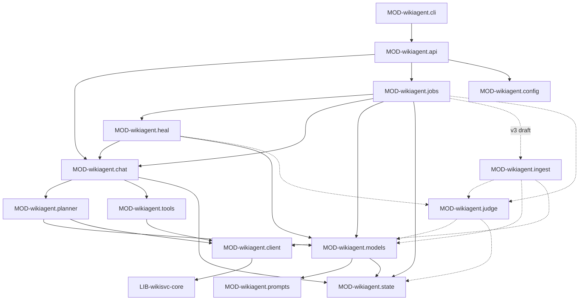

# wikiagent: устройство кода

> Модули верхнего уровня и ключевые классы. Не каждый класс — только те, что видны снаружи
> модуля, и те, где живёт важная логика.

## Модули

Из LIB-wikisvc-core агент импортирует только перечисленное в `component.md` (ошибки, домен
markdown/patch/secrets/validate, `tool_contracts`, `db_version`, `state_db.now`); данные вики — только
через `CLS-wikiagent.WikiClient`. Обратное направление запрещено и проверено тестом
`tests/test_security_invariants.py::test_wikisvc_has_no_network_or_agent_imports` (INV-core-deterministic).

| id | path | responsibility | public | depends on | must not | status | owner |
|---|---|---|---|---|---|---|---|
| MOD-wikiagent.api | `src/wikiagent/api.py` | FastAPI-приложение: аутентификация, эндпоинты API-wikiagent.*, запуск и остановка JobRunner и Scheduler в `lifespan` | `CLS-wikiagent.create_app`, `CLS-wikiagent.authorize` | MOD-wikiagent.chat, MOD-wikiagent.jobs, MOD-wikiagent.heal, MOD-wikiagent.client, MOD-wikiagent.models, MOD-wikiagent.state, MOD-wikiagent.config | вызывать модель напрямую; отвечать на запрос без `authorize` | implemented | SVC-wikiagent |
| MOD-wikiagent.cli | `src/wikiagent/cli.py`, `check.py`, `auth_check.py` | команды CLI-wikiagent.*; проверка готовности развёртывания | `CLS-wikiagent.check`, `CLS-wikiagent.check_authentication` | MOD-wikiagent.api, MOD-wikiagent.config, MOD-wikiagent.state, MOD-wikiagent.planner | печатать тела HTTP-ответов, заголовки авторизации и ответы модели; создавать сессии, джобы и предложения | implemented | SVC-wikiagent |
| MOD-wikiagent.client | `src/wikiagent/client.py` | единственный транспорт к API-wikisvc.* с allowlist путей (v3 planned: allowlist += чтение `API-wikisvc.knowledge.*` (`similar`, `topics`, `ask`) и запись производных данных `API-wikisvc.knowledge.verdicts`, `API-wikisvc.knowledge.novelty`; запрет accept не меняется) | `CLS-wikiagent.WikiClient` | LIB-wikisvc-core (`WikiError`), MOD-wikiagent.config | ходить вне `/api/v1`; вызывать accept, promote, deprecate, revert, reject, verify | implemented | SVC-wikiagent |
| MOD-wikiagent.models | `src/wikiagent/models.py` | клиент EXT-llm-server: бюджет контекста, учёт вызовов, структурированный вывод с повторами (v3 planned: роли `judge_llm`, `grounding.escalation`, `reference` (внешняя — за интерфейсом провайдера, rule-stack-llm-providers), сэмплы референсной модели с `temperature` из CFG-wikiagent.novelty.temperature) | `CLS-wikiagent.ModelClient`, `SYSTEM`, `PROMPT_VERSION` | MOD-wikiagent.config, MOD-wikiagent.state, MOD-wikiagent.prompts, `wikiagent.jobs.priority` | давать модели инструменты в `structured` | implemented | SVC-wikiagent |
| MOD-wikiagent.state | `src/wikiagent/state.py` | SQLite `agent.db`: схема, джобы, чекпойнты (v3 planned: TBL-wikiagent.agent.ingest_windows, TBL-wikiagent.agent.fact_verdicts, TBL-wikiagent.agent.novelty_results; `AGENT_SCHEMA` 1 → 2) | `CLS-wikiagent.AgentState` | LIB-wikisvc-core (`db_version`, `now`) | открывать БД SVC-wikisvc | implemented | SVC-wikiagent |
| MOD-wikiagent.tools | `src/wikiagent/tools.py` | исполнение вызова инструмента модели по контракту `wikisvc.tool_contracts` | `CLS-wikiagent.execute`, `definitions` | MOD-wikiagent.client, LIB-wikisvc-core (`tool_contracts`) | выбирать HTTP-маршрут из данных или ответа модели | implemented | SVC-wikiagent |
| MOD-wikiagent.chat | `src/wikiagent/chat/` | сессии чата, маршрутизация намерения, ответы на вопросы с инструментами | `CLS-wikiagent.Chat`, `CLS-wikiagent.Sessions`, DTO-wikiagent.Intent | MOD-wikiagent.planner, MOD-wikiagent.tools, MOD-wikiagent.models, MOD-wikiagent.state, MOD-wikiagent.client | показывать человеку текст модели без проверки `clarify` | implemented | SVC-wikiagent |
| MOD-wikiagent.planner | `src/wikiagent/planner/` | фраза → утверждения → классификация против существующих правил → план → черновик предложения; правка страниц; оценка на сценариях | `CLS-wikiagent.Planner`, `CLS-wikiagent.Builder`, `CLS-wikiagent.Reviser`, `CLS-wikiagent.plan_changes`, `CLS-wikiagent.verify`, `CLS-wikiagent.collect`, `CLS-wikiagent.evaluate_scenarios` | MOD-wikiagent.client, MOD-wikiagent.models, LIB-wikisvc-core (`markdown`, `patch`) | отправлять предложение на ревью или принимать его; писать страницу через PUT при правке существующей (только PATCH) | implemented | SVC-wikiagent |
| MOD-wikiagent.jobs | `src/wikiagent/jobs/` | очередь фоновых задач: `JobRunner`, `IngestBook`, `DocsAudit`, `PriorityGate` (v3 planned: `kind=novelty_scan` → CLS-wikiagent.NoveltyScan в `jobs/novelty.py`; `IngestBook` в режиме `facts` отдаёт работу CLS-wikiagent.FactIngest) | `JobRunner`, `RESUMABLE`, `parse_request` (детали — `runtime.md`) | MOD-wikiagent.state, MOD-wikiagent.client, MOD-wikiagent.models, MOD-wikiagent.chat, MOD-wikiagent.heal | создавать предложения из docs_audit (только находки) | implemented | SVC-wikiagent |
| MOD-wikiagent.heal | `src/wikiagent/heal/` | самолечение: пары страниц, вердикты модели, находки, планировщик окна простоя (v3 planned: пары фактов kNN → MOD-wikiagent.judge → PRM-wikiagent.heal_pair; планировщик запускает и JOB-wikiagent.novelty-scan) | `Healer`, `Scheduler` (детали — `runtime.md`) | MOD-wikiagent.jobs, MOD-wikiagent.models, MOD-wikiagent.client, MOD-wikiagent.chat, MOD-wikiagent.state | запускаться, пока идёт чат или другая джоба | implemented | SVC-wikiagent |
| MOD-wikiagent.config | `src/wikiagent/config.py` | загрузка и проверка FMT-wikiagent.config (`AgentConfig`; v3 draft: разделы `ingest`, `novelty`, `judge`, необязательные роли `models.judge`, `models.reference`) | `AgentConfig`, `load_config` (детали — `runtime.md`) | LIB-wikisvc-core (`load_yaml`) | хранить значения секретов (только имена переменных) | implemented | SVC-wikiagent |
| MOD-wikiagent.prompts | `src/wikiagent/prompts/*.md` | тексты промптов PRM-wikiagent.* (v3 planned: + `fact_extract`, `fact_judge`, `fact_links`, `hub_skeleton`, `novelty_cloze`, `novelty_answer`, `novelty_judge`; новая `PROMPT_VERSION`) | — (читаются по имени задачи) | — | менять текст без смены `PROMPT_VERSION` и карточки PRM | implemented | SVC-wikiagent |
| MOD-wikiagent.ingest | `src/wikiagent/ingest/` | v3: книга → факты: окна, привязка к хабам, дедупликация, связи, маршрутизация, предложения по хабам (FLOW-fact-ingest) | CLS-wikiagent.FactIngest | MOD-wikiagent.client, MOD-wikiagent.models, MOD-wikiagent.judge, MOD-wikiagent.state | принимать предложения (даже класса `auto`); удалять факты (INV-invalidate-not-delete); строить эмбеддинги и граф сам | planned | SVC-wikiagent |
| MOD-wikiagent.judge | `src/wikiagent/judge/` | v3: две роли судьи — claim ↔ claim (каскад NLI → LLM, FLOW-dedup-judge) и claim ↔ источник (grounding); локальный кэш вердиктов | CLS-wikiagent.Judge, CLS-wikiagent.GroundingJudge, DTO-wikiagent.JudgeVerdict | MOD-wikiagent.models, MOD-wikiagent.state, MOD-wikiagent.client, DEP-py-onnxruntime, DEP-py-tokenizers (решение Q-kb-judge-runtime) | решать по косинусу без судьи (ADR-0022); тянуть `torch` | planned | SVC-wikiagent |

## Ключевые классы и функции

| id | kind | symbol | что делает и гарантирует | errors | status | owner |
|---|---|---|---|---|---|---|
| CLS-wikiagent.create_app | function | `create_app(config, client, models)` в `src/wikiagent/api.py` | собирает AgentState, WikiClient, ModelClient, Chat, JobRunner, Scheduler; `lifespan`: `jobs.recover()` + `scheduler.start()`, на выходе — остановка | — | implemented | SVC-wikiagent |
| CLS-wikiagent.authorize | function | `authorize` внутри `create_app`, `src/wikiagent/api.py` | bearer → `/whoami` вызывающего; роль writer, reviewer или admin; рабочий токен агента — writer kind=agent; допуск вызывающего не ниже допуска токена агента (INV-agent-clearance-ceiling) | ERR-forbidden (403), ERR-agent_token (403) | implemented | SVC-wikiagent |
| CLS-wikiagent.WikiClient | class | `WikiClient` в `src/wikiagent/client.py` | allowlist метод+путь (GET — чтение; POST/PUT/PATCH/DELETE — только черновики, `/raw`, `/findings`); запрет `%`, `.`, `..` и сегментов accept, promote, deprecate, revert, reject, verify (INV-human-decides); токен — `os.environ[token_env]` (`CFG-wikiagent.WIKIAGENT_TOKEN`) или явный `token=` для `/whoami` вызывающего; `follow_redirects=False`, таймаут 60s (v3 planned: allowlist += чтение `API-wikisvc.knowledge.*`, POST `API-wikisvc.knowledge.verdicts` и `API-wikisvc.knowledge.novelty`) | ERR-agent_tool_forbidden, ERR-wiki_service, коды ядра как есть | implemented | SVC-wikiagent |
| CLS-wikiagent.ModelClient | class | `ModelClient` в `src/wikiagent/models.py` | `completion`: оценка контекста (символы/2.5), запись в TBL-wikiagent.agent.model_calls, приоритет переднего плана над `heal_*`/`docs_audit` (`PriorityGate`); `structured`: данные только внутри `<UNTRUSTED_DATA>` (INV-untrusted-external), схема Pydantic → `response_format`, повтор с текстом ошибки до `CFG-wikiagent.limits.retries` (v3 planned: роли `judge_llm`, `grounding.escalation`, `reference`; фон для `PriorityGate` — `heal_*`, `docs_audit`, `novelty_*` и вызовы судьи из heal: признак фона передаёт вызывающая задача, а не префикс имени) | ERR-model_context, ERR-model_unavailable, ERR-model_output | implemented | SVC-wikiagent |
| CLS-wikiagent.AgentState | class | `AgentState` в `src/wikiagent/state.py` | создаёт каталог 0700 и `agent.db` 0600, схему TBL-wikiagent.agent.*, WAL; `job`, `status` (отменённую джобу перевести можно только в `pending`), `checkpoint`/`restore` (v3 planned: + три таблицы `data.md`, `AGENT_SCHEMA` 2) | ERR-schema_newer | implemented | SVC-wikiagent |
| CLS-wikiagent.execute | function | `execute(client, mode, name, arguments)` в `src/wikiagent/tools.py` | инструмент из `ALLOWLISTS[mode]`, аргументы строго по `CONTRACTS`; идентификаторы без `/`, `..`, `?`, `%`; маршрут — из контракта, не из модели | ERR-agent_tool_forbidden, ERR-agent_tool_arguments | implemented | SVC-wikiagent |
| CLS-wikiagent.Chat | class | `Chat` в `src/wikiagent/chat/loop.py` | одна блокировка на сессию; вложения `/raw/<path>/text` помечаются как недоверенные данные; намерение (DTO-wikiagent.Intent) → Planner / Reviser / отмена черновика / `human_action` для отката / ответ с инструментами `question` (≤ `CFG-wikiagent.limits.max_tool_steps`); счётчик `active` для Scheduler | ERR-agent_step_limit, ошибки Planner и Reviser | implemented | SVC-wikiagent |
| CLS-wikiagent.Sessions | class | `Sessions` в `src/wikiagent/chat/sessions.py` | CRUD TBL-wikiagent.agent.chat_sessions и chat_messages; чужая сессия или сессия выше допуска — как отсутствующая (INV-404-not-403) | ERR-not_found, ERR-cursor_invalid, ERR-request_invalid | implemented | SVC-wikiagent |
| CLS-wikiagent.Planner | class | `Planner` в `src/wikiagent/planner/pipeline.py` | PRM-wikiagent.extract_claims → для правил `collect` + PRM-wikiagent.classify с `verify` → `plan_changes` → `Builder.build`; ≤ 10 пунктов на план, иначе несколько планов; ≤ 3 вопроса; `remove_ids` — только новые кандидаты текущего плана | ERR-agent_repair | implemented | SVC-wikiagent |
| CLS-wikiagent.collect | function | `collect(client, claim)` в `src/wikiagent/planner/related.py` | похожие страницы: `/rules/related` + `/graph/impact/<id>`, ≤ 20 страниц | — | implemented | SVC-wikiagent |
| CLS-wikiagent.verify | function | `verify(result, pages)` в `src/wikiagent/planner/classify.py` | цитата классификатора обязана дословно (без учёта регистра и пробелов) найтись в показанной странице; связь правил — только к `type: rule` | ERR-quote_not_found, ERR-model_output | implemented | SVC-wikiagent |
| CLS-wikiagent.plan_changes | function | `plan_changes(...)` в `src/wikiagent/planner/plan.py` | детерминированно, без модели и записей: утверждение + связи → пункты `create_rule`, `patch_rule`, `supersede_rule`, `noop_duplicate`, `flag_page`, вопросы об области и конфликте с действующим или must-правилом | — | implemented | SVC-wikiagent |
| CLS-wikiagent.Builder | class | `Builder` в `src/wikiagent/planner/builder.py` | создаёт или продолжает черновик (`draft`/`changes_requested`, владелец сохраняется), source-страницу чата с транскриптом в `/raw`, страницы правил, validate с ремонтом PRM-wikiagent.repair_validation (≤ retries, без новых страниц), записывает план в `notes` (DTO-wikiagent.Plan); в ревью не отправляет | ERR-agent_validation, ERR-agent_repair | implemented | SVC-wikiagent |
| CLS-wikiagent.Reviser | class | `Reviser` в `src/wikiagent/planner/revise.py` | правка существующих страниц в два шага (оглавление → выбранные разделы, PRM-wikiagent.locate_revision, PRM-wikiagent.revise_page); правки только в показанных разделах, только PATCH; чужой черновик или неверный статус — отказ; страница выше допуска — как отсутствующая; созданный и брошенный черновик отменяется | ERR-agent_revise_target (409), ERR-not_found | implemented | SVC-wikiagent |
| CLS-wikiagent.evaluate_scenarios | function | `evaluate_scenarios(...)` в `src/wikiagent/planner/eval.py` | прогон YAML-сценариев `tests/scenarios` через модель без SVC-wikisvc; отчёт с метриками и числом вызовов модели | — | implemented | SVC-wikiagent |
| CLS-wikiagent.check | function | `check(config, ...)` в `src/wikiagent/check.py` | `/api/v1/health` и `/whoami` ядра, `/models` каждой модели, `--model` — пробная генерация по схеме, затем API-wikiagent.jobs.list; ничего не создаёт | ValueError с текстом без секретов | implemented | SVC-wikiagent |
| CLS-wikiagent.check_authentication | function | `check_authentication()` в `src/wikiagent/auth_check.py` | только чтение: токен выдачи сессий в `state.db` (`mode=ro`) обязан быть kind=agent role=reader clearance=public; OIDC discovery по HTTPS; синхронизация NTP | ValueError | implemented | SVC-wikiagent |

Ключевые классы v3 (все `draft`; алгоритм — JOB-wikiagent.ingest-book, JOB-wikiagent.novelty-scan в `runtime.md`):

| id | kind | symbol | что делает и гарантирует | errors | status | owner |
|---|---|---|---|---|---|---|
| CLS-wikiagent.FactIngest | class | `FactIngest` в `src/wikiagent/ingest/pipeline.py` | оркестратор режима `facts`: скелет хабов → окна → извлечение → grounding → привязка → судья → связи → маршрутизация → предложения; каждое окно проходит стадии TBL-wikiagent.agent.ingest_windows#stage и не повторяет пройденные; множество занятых ID грузит один раз на запуск и пополняет локально | ERR-domain_unknown, ERR-model_unavailable, ERR-embeddings_unavailable | planned | SVC-wikiagent |
| CLS-wikiagent.Windows | class | `Windows` в `src/wikiagent/ingest/windows.py` | окна по разделам главы CFG-wikiagent.ingest.window_tokens с перекрытием CFG-wikiagent.ingest.overlap_paragraphs (нарезка — CLS-wikisvc-core.Extractions через API-wikisvc.raw.text); держит excerpt окна в памяти; цитата — подстрока excerpt, за его границы — только при промахе | ERR-quote_not_found (кандидат → `inferred`, не ошибка окна) | planned | SVC-wikiagent |
| CLS-wikiagent.GroundingJudge | class | `GroundingJudge` в `src/wikiagent/judge/grounding.py` | claim ↔ источник: следует ли `claim` из цитаты и её абзаца — MDL-grounding-judge (ONNX, CFG-wikiagent.models.grounding); оценка ≥ CFG-wikiagent.judge.grounding_threshold — grounded; от CFG-wikiagent.judge.grounding_escalate_below до порога — эскалация PRM-wikiagent.fact_ground (модель `models.reviewer`, MDL-gemma-12b; MDL-grounding-escalation — опция на будущее); ниже — сразу не подтверждено (решение Q-kb-grounding-escalation); провал или сбой → `confidence: inferred` и класс `queue` | — | planned | SVC-wikiagent |
| CLS-wikiagent.HubBinder | class | `HubBinder` в `src/wikiagent/ingest/hubs.py` | `suggested_topic` → хаб: id из `API-wikisvc.knowledge.topics` → `about`; иначе API-wikisvc.knowledge.ask (совпадение нормализованного title или alias, решение Q-kb-ingest-defaults) → `about` или новый хаб `draft` в первом предложении; решения кэшируются на задачу (одно понятие — один хаб) | — | planned | SVC-wikiagent |
| CLS-wikiagent.Dedup | class | `Dedup` в `src/wikiagent/ingest/dedup.py` | `API-wikisvc.knowledge.similar` (`include_pending=true`: черновики всех открытых предложений `kind=book`, решение Q-kb-knn-endpoint) ≥ CFG-wikiagent.ingest.dup_cosine, ≤ CFG-wikiagent.ingest.dup_k → CLS-wikiagent.Judge по каждой паре → duplicate / refines / contradicts / independent (FLOW-dedup-judge); судья недоступен → пара без вердикта, задача продолжается (rule-arch-outgoing-call-resilience) | ERR-embeddings_unavailable | planned | SVC-wikiagent |
| CLS-wikiagent.route_fact | function | `route_fact(candidate, verdicts)` в `src/wikiagent/ingest/routing.py` | детерминированно, без модели: подсказка класса STATE-fact-review-class по ТЗ §8.6; всегда `queue`: kNN-сосед без вердикта (`W_POSSIBLE_DUPLICATE`), провал grounding, `kind: snippet` (`example` с книгой не сверяется), URL или команды оболочки в `claim`, `summary`, `Example`, `note`, понижение `sensitivity` или `public`, правки существующих страниц (`add_source`, `replaces`; исключение — строка `[[f-…]]` в `## Facts` хаба без прочих правок), задачи не человека (INV-auto-class-scope). Действует класс ядра (FLOW-fact-review-routing); `auto`-блок принимает человек | — | planned | SVC-wikiagent |
| CLS-wikiagent.FactProposals | class | `FactProposals` в `src/wikiagent/ingest/proposals.py` | предложения по ключу (хаб, класс, часть) ≤ CFG-wikiagent.ingest.proposal_max_facts фактов; пара `contradicts` — отдельное предложение; первое предложение (`source` + новые хабы), остальные — `depends_on: [pid]` на него (решение Q-kb-proposal-dependencies); `sensitivity` = DTO-wikiagent.BookJob#sensitivity; владелец задачи — в описании; потерянное находит по метке `Job <id> <хаб> <класс> <часть>`; отправляет на ревью, но не принимает | ошибки ядра, ERR-proposal_dependency | planned | SVC-wikiagent |
| CLS-wikiagent.Judge | class | `Judge` в `src/wikiagent/judge/judge.py` | claim ↔ claim, каскад (решения Q-kb-nli-judge-model, Q-kb-judge-llm-confirm): NLI в обе стороны по всем kNN-кандидатам — MDL-nli-judge (heal — MDL-nli-judge-light, A/B — MDL-nli-modernbert), ONNX в процессе; PRM-wikiagent.fact_judge (CFG-wikiagent.models.judge_llm — по умолчанию модель `reviewer`, MDL-gemma-12b на RES-llama-server) — только на `contradicts` и парах ниже порогов CFG-wikiagent.judge.*; уверенный `duplicate` — без LLM. Вердикт → DTO-wikiagent.JudgeVerdict → `API-wikisvc.knowledge.verdicts` (источник правды — ядро), затем локальный кэш TBL-wikiagent.agent.fact_verdicts; сбой → «нет вердикта», в ядро и кэш не пишется; полнота противоречий — RISK-kb-contradiction-recall | `judge_unavailable` (в отчёт) | planned | SVC-wikiagent |
| CLS-wikiagent.NoveltyScan | class | `NoveltyScan` в `src/wikiagent/jobs/novelty.py` | усечённый SliCK (ТЗ §8.5) лениво по кандидатам brief: PRM-wikiagent.novelty_cloze → сэмплы PRM-wikiagent.novelty_answer → NLI CLS-wikiagent.Judge → бакет → `API-wikisvc.knowledge.novelty`; референсная модель — за интерфейсом провайдера (`ReferenceModel`; внешняя — официальный SDK, rule-stack-llm-providers); наружу — только `sensitivity: public`, фильтр в коде | ERR-model_unavailable, бюджет → `paused` | planned | SVC-wikiagent |
