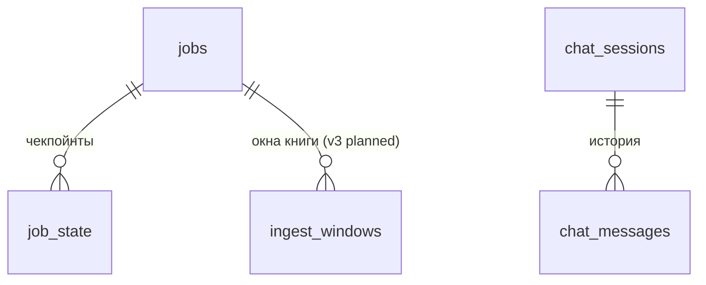

# wikiagent: данные

> Только данные, которыми владеет этот компонент. Чужие таблицы здесь не описываем — ссылаемся по ID.

Все таблицы — в SQLite-файле `agent.db` (RES-agent-db) в каталоге `CFG-wikiagent.WIKIAGENT_STATE_DIR`
(по умолчанию `.wikiagent`, в devShell `.dev/agent`). Схема создаётся `CREATE TABLE IF NOT EXISTS` при
каждом старте `CLS-wikiagent.AgentState`; версия — `PRAGMA user_version` = `AGENT_SCHEMA` (сейчас 1),
база новее кода → ERR-schema_newer. Каталог 0700, файл 0600, журнал WAL, `busy timeout` 30s.
Внешних ключей и индексов, кроме первичных ключей, нет. Время — строки ISO 8601 UTC из `state_db.now()`.
Других файлов агент в каталоге не создаёт (BKT нет); `wikiagent eval --out` пишет отчёт по пути, который задал оператор.
v3 (planned): три новые таблицы (ниже), `AGENT_SCHEMA` 1 → 2 по ADR-0016; создание — тем же `CREATE TABLE IF NOT EXISTS`
(RISK-core-ddl-at-startup). Эмбеддингов и векторов агент не хранит: kNN — у ядра (`API-wikisvc.knowledge.similar`). Вердикты пар и novelty — производные данные ядра (`API-wikisvc.knowledge.verdicts` → TBL-wikisvc-core.state.pair_verdicts, `API-wikisvc.knowledge.novelty` → TBL-wikisvc-core.state.novelty); таблицы агента ниже — только кэш и очередь.

## Связи

## Таблицы

### TBL-wikiagent.agent.jobs — Фоновые задачи
status: implemented | owner: SVC-wikiagent | store: RES-agent-db | entity: ENT-job

- purpose: очередь и состояние JOB-wikiagent.ingest-book, JOB-wikiagent.heal, JOB-wikiagent.docs-audit
- pk: `id`
- retention: бессрочно, удаления в коде нет
- pii: SEC-pii: `owner`; `payload` docs_audit содержит тексты документации проекта (после проверки на секреты)

| колонка | тип | null | default | ограничения | смысл |
|---|---|---|---|---|---|
| `id` | string | нет | uuid4 hex | pk | |
| `kind` | enum(ingest_book\|heal\|docs_audit) | нет | | | тип задачи (v3 planned: += `novelty_scan`, JOB-wikiagent.novelty-scan) |
| `status` | enum(STATE-job) | нет | `pending` | | `pending`, `running`, `paused`, `waiting_chat`, `needs_outline`, `awaiting_review`, `done`, `failed`, `cancelled` |
| `owner` | string | нет | | | `person` или `name` принципала |
| `clearance` | enum(public\|internal\|restricted) | нет | | | допуск создателя; видят только с допуском не ниже |
| `payload` | json | нет | | | тело запроса; `scheduled: true` у задач планировщика |
| `progress` | json | нет | `{}` | | прогресс для интерфейса |
| `error` | string? | да | | | код `WikiError` или имя класса исключения, без текста |
| `created_at` | timestamp | нет | | | |
| `updated_at` | timestamp | нет | | | |

- written by: API-wikiagent.jobs.*, MOD-wikiagent.jobs, MOD-wikiagent.heal
- read by: API-wikiagent.jobs.*, CLI-wikiagent.jobs, JOB-wikiagent.scheduler

### TBL-wikiagent.agent.job_state — Чекпойнты задач
status: implemented | owner: SVC-wikiagent | store: RES-agent-db

- purpose: промежуточные результаты задачи для продолжения после паузы или рестарта
- pk: `(job_id, key)`; запись — `INSERT OR REPLACE`
- retention: бессрочно

| колонка | тип | null | смысл |
|---|---|---|---|
| `job_id` | string | нет | TBL-wikiagent.agent.jobs#id (без FK) |
| `key` | string | нет | имя чекпойнта (задаёт джоба) |
| `value` | json | нет | значение |

### TBL-wikiagent.agent.pair_checks — Кэш проверенных пар
status: implemented | owner: SVC-wikiagent | store: RES-agent-db

- purpose: вердикт модели по паре (страница, версия) × (страница или файл, версия), чтобы не спрашивать модель повторно
- pk: `(a_id, a_hash, b_id, b_hash)`; запись — `INSERT OR REPLACE`
- retention: бессрочно; новая версия любой стороны — новый ключ

| колонка | тип | null | смысл |
|---|---|---|---|
| `a_id`, `b_id` | string | нет | ID сторон (для docs_audit — правило и `project/path`) |
| `a_hash`, `b_hash` | string | нет | версия или хэш содержимого стороны |
| `verdict` | json | нет | вердикт модели (схему задаёт джоба, `ai.md`) |
| `confidence` | float64 | нет | уверенность 0..1 |
| `checked_at` | timestamp | нет | |

- written by: JOB-wikiagent.heal, JOB-wikiagent.docs-audit
- changed: 2026-10-20 v3 (planned): heal кэширует здесь и вердикты LLM по парам фактов (по версиям страниц, как сейчас);
  вердикты NLI-судьи по содержимому `claim` — в TBL-wikiagent.agent.fact_verdicts

### TBL-wikiagent.agent.chat_sessions — Сессии чата
status: implemented | owner: SVC-wikiagent | store: RES-agent-db | entity: ENT-chat-session

- pk: `id` (uuid4 hex)
- retention: бессрочно, удаления в коде нет
- pii: SEC-pii: `owner`

| колонка | тип | null | смысл |
|---|---|---|---|
| `id` | string | нет | |
| `owner` | string | нет | `person` или `name` создателя; только он видит сессию |
| `clearance` | enum(public\|internal\|restricted) | нет | допуск создателя |
| `bind` | json | нет | `{type, id}` из DTO-wikiagent.NewSession |
| `profile` | string? | да | профиль правил |
| `plan` | json? | да | последний DTO-wikiagent.Plan |
| `created_at`, `updated_at` | timestamp | нет | |

- written by: API-wikiagent.chat.sessions.create, API-wikiagent.chat.messages.create
- read by: API-wikiagent.chat.*, JOB-wikiagent.scheduler (время последней активности)

### TBL-wikiagent.agent.chat_messages — Сообщения чата
status: implemented | owner: SVC-wikiagent | store: RES-agent-db

- pk: `id` (целое, автоинкремент SQLite)
- retention: бессрочно
- pii: SEC-pii: `text` — свободный текст человека и вложений

| колонка | тип | null | смысл |
|---|---|---|---|
| `id` | int64 | нет | порядок сообщений |
| `session_id` | string | нет | TBL-wikiagent.agent.chat_sessions#id (без FK) |
| `role` | enum(user\|assistant) | нет | автор |
| `text` | string | нет | текст; у `user` — с текстом вложений |
| `plan` | json? | да | DTO-wikiagent.Plan ответа |
| `created_at` | timestamp | нет | |

### TBL-wikiagent.agent.meta — Служебные ключи
status: implemented | owner: SVC-wikiagent | store: RES-agent-db

- pk: `key`; колонки `key string`, `value string`
- notes: таблица создаётся, но код `src/wikiagent` её не читает и не пишет; версия схемы хранится в `PRAGMA user_version`

### TBL-wikiagent.agent.model_calls — Журнал вызовов модели
status: implemented | owner: SVC-wikiagent | store: RES-agent-db

- purpose: дневные и поштучные бюджеты вызовов (`CFG-wikiagent.heal.max_model_calls_per_day`,
  `CFG-wikiagent.docs_audit.max_model_calls_per_day` и лимиты на прогон)
- pk: нет; строка на каждый запрос к EXT-llm-server, пишется до запроса
- retention: бессрочно, удаления в коде нет

| колонка | тип | null | смысл |
|---|---|---|---|
| `day` | date | нет | день UTC `YYYY-MM-DD` |
| `role` | enum(planner\|reviewer\|chat) | нет | роль модели (v3 planned: += `judge`, `reference`; NLI-судья в процессе не пишет строк) |
| `task` | string | нет | имя задачи (`route`, `extract_claims`, `heal_*`, `docs_audit`, `question`…) |
| `ts` | timestamp | нет | момент вызова |

- written by: `CLS-wikiagent.ModelClient`
- read by: JOB-wikiagent.heal, JOB-wikiagent.docs-audit
- changed: 2026-10-20 v3 (planned): читает и JOB-wikiagent.novelty-scan (CFG-wikiagent.novelty.max_calls_per_day по задачам `novelty_*`)

## Таблицы v3 (planned)

### TBL-wikiagent.agent.ingest_windows — Окна книги и их стадии
status: planned | owner: SVC-wikiagent | store: RES-agent-db

- purpose: чекпоинт окна вместе с результатом каждой стадии (ТЗ §11.8), чтобы resume не повторял вызовы модели,
  судьи и ядра для пройденных стадий
- pk: `(job_id, window_key)`; `window_key` = `<глава>:<страницы>:<offset>`; запись — `INSERT OR REPLACE` после каждой стадии
- retention: как TBL-wikiagent.agent.job_state (бессрочно, Q-wikiagent-chat-retention)
- pii: нет; книжный текст не хранится — только хеш excerpt и цитаты ≤ 30 слов в `result`

| колонка | тип | null | смысл |
|---|---|---|---|
| `job_id` | string | нет | TBL-wikiagent.agent.jobs#id (без FK) |
| `window_key` | string | нет | ключ окна |
| `chapter` | int32 | нет | номер главы оглавления |
| `excerpt_sha256` | string | нет | хеш текста окна; другой хеш при resume → окно проходится заново |
| `stage` | enum(extracted\|grounded\|bound\|judged\|linked\|written) | нет | последняя завершённая стадия |
| `result` | json | нет | DTO-wikiagent.ChapterResult.v2 + у каждого кандидата `quote_verified: bool` |
| `bindings` | json | да | кандидат → хаб (`about`) или новый хаб `draft` |
| `verdicts` | json | да | кандидат → `[{target, pair_hash, verdict}]` (ссылки на TBL-wikiagent.agent.fact_verdicts) |
| `links` | json | да | принятые связи `applies_with`/`precedes` (PRM-wikiagent.fact_links) |
| `placed` | json | да | кандидат → `{fact_id, review_class, proposal}`; `review_class` — STATE-fact-review-class |
| `updated_at` | timestamp | нет | |

- written by / read by: CLS-wikiagent.FactIngest (JOB-wikiagent.ingest-book, режим `facts`)

### TBL-wikiagent.agent.fact_verdicts — Кэш вердиктов судьи по парам фактов
status: planned | owner: SVC-wikiagent | store: RES-agent-db

- purpose: локальный кэш, чтобы не звать судью повторно (ТЗ §8.6 «кеш по хешам пары»); общий для ingest и heal. Источник
  правды — TBL-wikisvc-core.state.pair_verdicts (решение Q-kb-judge-verdict-visibility); строка пишется после успешного POST в ядро
- pk: `(pair_hash, judge_model)`; `pair_hash` = sha256 пары нормализованных `claim`, упорядоченных по их хешам
  (сторона `a` — меньший хеш); запись — `INSERT OR REPLACE`
- retention: бессрочно; изменился `claim` любой стороны — новый ключ, старая строка не читается

| колонка | тип | null | смысл |
|---|---|---|---|
| `pair_hash` | string | нет | ключ пары |
| `judge_model` | string | нет | модель и версия судьи (CFG-wikiagent.models.judge); LLM — с `PROMPT_VERSION` |
| `a_hash`, `b_hash` | string | нет | sha256 нормализованного `claim` сторон |
| `verdict` | enum(duplicate\|refines\|contradicts\|independent) | нет | DTO-wikiagent.JudgeVerdict#verdict |
| `direction` | enum(a_refines_b\|b_refines_a)? | да | только для `refines` |
| `scores` | json | нет | `{entail_ab, entail_ba, contradiction}` 0..1 |
| `source` | enum(nli\|llm) | нет | кто вынес итоговый вердикт |
| `checked_at` | timestamp | нет | |

- written by / read by: CLS-wikiagent.Judge (JOB-wikiagent.ingest-book, JOB-wikiagent.heal)

### TBL-wikiagent.agent.novelty_results — Результаты novelty по моделям
status: planned | owner: SVC-wikiagent | store: RES-agent-db

- purpose: кэш и очередь усечённого SliCK (ТЗ §8.5); источник правды — TBL-wikisvc-core.state.novelty (решение Q-kb-novelty-write-path)
- pk: `(fact_id, model, claim_hash)`, `model` — семейство модели; запись — `INSERT OR REPLACE`
- retention: бессрочно
- columns: поля DTO-wikiagent.NoveltyResult + `reported: bool` (записано в `API-wikisvc.knowledge.novelty`) и
  `checked_at: timestamp`; `samples`, `hits` — int32, `share` — float64
- written by / read by: CLS-wikiagent.NoveltyScan (JOB-wikiagent.novelty-scan); JOB-wikiagent.scheduler — есть ли непросчитанные факты
