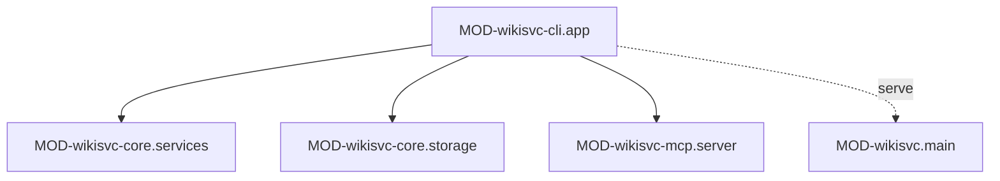

# wikisvc-cli: устройство кода

## Модули

### MOD-wikisvc-cli.app — Команды `wikisvc`
status: implemented | owner: SVC-wikisvc-cli

- path: `src/wikisvc/cli.py`
- responsibility: разбирает аргументы (Typer), собирает `Settings` из окружения и вызывает один сервис ядра на команду; печатает результат текстом или JSON.
- public: объект `app` — точка входа скрипта `wikisvc`; команды CLI-wikisvc-cli.*
- depends on: MOD-wikisvc-core.services, MOD-wikisvc-core.storage, MOD-wikisvc-core.domain, MOD-wikisvc-mcp.server
- must not: держать бизнес-логику — проверки и запись делают сервисы ядра
- implements: CLI-wikisvc-cli.*
- notes: импорты сервисов — внутри функций команд, чтобы `--help` и `version` не поднимали ядро.
  Общий помощник `cli_policies(profile)` синхронизирует индекс под блокировкой записи и компилирует свод
  от принципала `cli` (ROLE-admin, SEC-clearance#restricted, вид `human`) без учёта статистики использования;
  его используют CLI-wikisvc-cli.policies.export и CLI-wikisvc-cli.policies.check.
  Ошибки ядра (`WikiError`) не перехватываются: Python печатает трассировку, процесс завершается с кодом `1`.
- changed: 2026-10-20 v3 (planned): подгруппы `domains` и `embeddings`, команда `eval`. Новые команды не повторяют
  образец `scopes add` (там регулярное выражение и коммит прямо в CLI): проверка, коммит и расчёт метрик — в сервисах
  ядра (rule-arch-layers); CLI разбирает аргументы и печатает. depends on += CLS-wikisvc-core.Embeddings,
  CLS-wikisvc-core.Ask, CLS-wikisvc-core.Brief. `cli_policies` получает допуск брифа для `--knowledge`.
