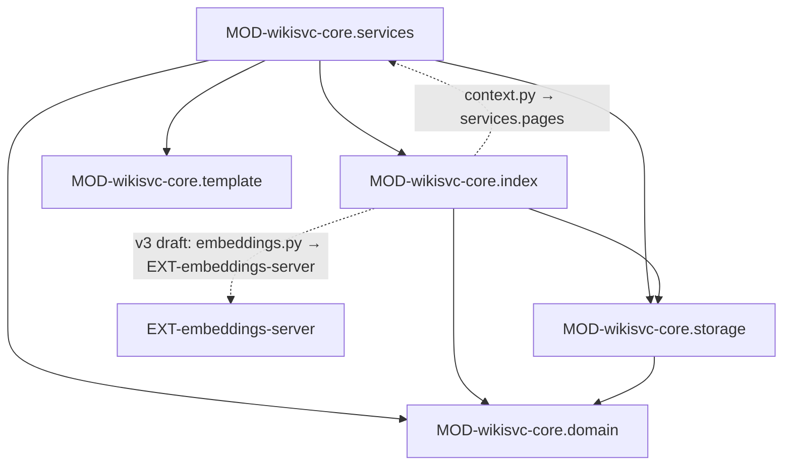

# wikisvc-core: устройство кода

> Модули верхнего уровня и ключевые классы. Не каждый класс — только те, что видны снаружи
> модуля, и те, где живёт важная логика.

## Модули

v3 (planned): CLS-wikisvc-core.Assemble грузит страницы из CLS-wikisvc-core.IndexDB сам, без `services/pages.py`, —
обратная зависимость RISK-core-dependency-cycle для нового кода не повторяется (rule-arch-dependency-direction).

### MOD-wikisvc-core.domain — Модели, формат страниц и проверки без ввода-вывода
status: implemented | owner: LIB-wikisvc-core

- path: `src/wikisvc/domain/`
- responsibility: доменные модели (pydantic), разбор и сборка Markdown с YAML-frontmatter, ID и пути страниц, валидация страниц и правил, точечные патчи, детектор секретов, модель шаблона проекта.
- public: CLS-wikisvc-core.WikiError, CLS-wikisvc-core.Principal, CLS-wikisvc-core.Page, CLS-wikisvc-core.Proposal, CLS-wikisvc-core.LintIssue, CLS-wikisvc-core.Registry, CLS-wikisvc-core.parse_page, CLS-wikisvc-core.validate_page, CLS-wikisvc-core.validate_set, CLS-wikisvc-core.apply_patch, CLS-wikisvc-core.secret_kinds, CLS-wikisvc-core.ProjectTemplate
- depends on: DEP-py-pydantic, DEP-py-ruamel.yaml; из своего пакета — только `domain/*`
- must not: читать диск, git и SQLite, делать сетевые вызовы, импортировать `storage`, `index`, `services`
- implements: FMT-wikisvc-core.page, FMT-wikisvc-core.rule, FMT-wikisvc-core.page-type, FMT-wikisvc-core.relations, FMT-wikisvc-core.profiles, FMT-wikisvc-core.project-template, INV-secrets-never-stored
- changed: 2026-10-20 v3 (planned): DTO слоя знаний (DTO-wikisvc-core.EdgeView, DTO-wikisvc-core.FactView, DTO-wikisvc-core.AskResult, DTO-wikisvc-core.BriefResult, DTO-wikisvc-core.TopicResult, DTO-wikisvc-core.ExpandResult, DTO-wikisvc-core.TechResult, DTO-wikisvc-core.WhyResult, DTO-wikisvc-core.ProposalReasons) — в `domain/views.py`, маркеры там (решение координатора 2026-10-20); модель DTO-wikisvc-core.RelationRef; проверки FMT-wikisvc-core.fact, FMT-wikisvc-core.topic, FMT-wikisvc-core.tech, FMT-wikisvc-core.question, FMT-wikisvc-core.domains; новый файл `domain/tokens.py` (CLS-wikisvc-core.estimate_tokens); по-прежнему без ввода-вывода и сети

### MOD-wikisvc-core.storage — Git-репозиторий, блокировка, state.db и безопасная ФС
status: implemented | owner: LIB-wikisvc-core

- path: `src/wikisvc/storage/`
- responsibility: всё, что меняет диск: git-коммиты и worktree через бинарник `git` (DEP-nix-git), журнал транзакций, файловая блокировка записи, схема и подключение `state.db`, версии схем SQLite, атомарная запись файлов, загрузка `schema/` в CLS-wikisvc-core.Registry.
- public: CLS-wikisvc-core.GitRepo, CLS-wikisvc-core.write_lock, CLS-wikisvc-core.StateDB, CLS-wikisvc-core.refuse_newer, CLS-wikisvc-core.SafeFS, CLS-wikisvc-core.raw_path, CLS-wikisvc-core.load_registry
- depends on: MOD-wikisvc-core.domain
- must not: принимать решения о правах и состояниях предложений; писать вне `WIKI_ROOT`/`STATE_DIR` мимо CLS-wikisvc-core.SafeFS
- implements: INV-single-node, TBL-wikisvc-core.state.*, BKT-wikisvc-core.wiki-repo, BKT-wikisvc-core.worktrees
- changed: 2026-10-20 v3 (planned): CLS-wikisvc-core.load_registry читает `schema/domains.yaml` и новый формат `scopes.yaml`

### MOD-wikisvc-core.index — Производный индекс wiki.db: FTS-поиск, граф, контекст
status: implemented | owner: LIB-wikisvc-core

- path: `src/wikisvc/index/`
- responsibility: перестройка индекса из файлов репозитория (полная и по изменённым путям), BM25-поиск по FTS5 со стеммингом и синонимами, обход графа связей, сборка контекста страницы в бюджете символов.
- public: CLS-wikisvc-core.IndexDB, CLS-wikisvc-core.Indexer, CLS-wikisvc-core.Search, CLS-wikisvc-core.GraphStore, CLS-wikisvc-core.Context, CLS-wikisvc-core.match_query
- depends on: MOD-wikisvc-core.domain, MOD-wikisvc-core.storage, DEP-py-pystemmer; `index/context.py` импортирует `services/pages.py` (обратная зависимость, RISK-core-dependency-cycle)
- must not: быть источником правды — индекс выбрасывается и собирается заново `wikisvc reindex --full`
- implements: TBL-wikisvc-core.index.*, INV-404-not-403 (фильтр по допуску в графе и поиске)
- changed: 2026-10-20 v3 (planned): новые файлы `index/embeddings.py` (CLS-wikisvc-core.Embeddings), `index/assemble.py` (CLS-wikisvc-core.Assemble), `index/pool.py` (CLS-wikisvc-core.ConnectionPool), снимок графа и PPR в `index/graph.py` (CLS-wikisvc-core.GraphSnapshot, CLS-wikisvc-core.ppr), `ask` в `index/search.py` (CLS-wikisvc-core.Ask); зависимости += DEP-py-numpy, DEP-py-scipy (согласие получено — решение Q-kb-numpy-scipy-consent), DEP-py-httpx; единственный модуль ядра с исходящим вызовом — `index/embeddings.py` (исключение к ADR-0003 — решение Q-kb-core-outbound-embeddings; второй — вызов reranker из CLS-wikisvc-core.Ask)

### MOD-wikisvc-core.services — Сценарии: предложения, правила, политики, сырьё, доступ
status: implemented | owner: LIB-wikisvc-core

- path: `src/wikisvc/services/`
- responsibility: бизнес-сценарии поверх storage и index; каждый пишущий сценарий берёт CLS-wikisvc-core.write_lock, проверяет роль и допуск, пишет git и `state.db`, пишет аудит.
- public: CLS-wikisvc-core.Runtime (точка сборки всех сервисов) и сервисы, которые он держит в атрибутах
- depends on: MOD-wikisvc-core.domain, MOD-wikisvc-core.storage, MOD-wikisvc-core.index, MOD-wikisvc-core.template, `src/wikisvc/config.py` (`Settings` из SVC-wikisvc)
- must not: вызывать LLM и внешние сети (INV-core-deterministic), знать про HTTP-запросы и ответы, импортировать `wikisvc.api`
- implements: STATE-proposal, INV-human-decides, INV-no-self-review, INV-agent-rule-inert, INV-policy-block-only, INV-untrusted-external, INV-anonymous-ceiling, FLOW-proposal-review, FLOW-policy-compile, JOB-wikisvc-core.extract-worker
- changed: 2026-10-20 v3 (planned): новые `services/brief.py` (CLS-wikisvc-core.Brief), `services/knowledge.py` (CLS-wikisvc-core.Knowledge), `services/review_routing.py` (CLS-wikisvc-core.review_class), `services/delivery.py` (CLS-wikisvc-core.DeliveryQueue), `services/evaluate.py` (CLS-wikisvc-core.evaluate); implements += FLOW-knowledge-brief, FLOW-ask, FLOW-fact-review-routing, JOB-wikisvc-core.embed-index, JOB-wikisvc-core.delivery-flush; сеть сервисы по-прежнему не вызывают — векторы запроса берут через MOD-wikisvc-core.index; имена файлов — по принятой в проекте схеме, а не `<сущность>_<слой>` (rule-arch-follow-existing-structure, rule-arch-file-naming)

### MOD-wikisvc-core.template — Стартовое содержимое новой вики
status: implemented | owner: LIB-wikisvc-core

- path: `src/wikisvc/template/`
- responsibility: файлы, которые CLS-wikisvc-core.initialize копирует в пустой `WIKI_ROOT`: `AGENTS.md` (и симлинк `CLAUDE.md`), `schema/` (типы страниц, связи, теги, области, профиль `python-fastapi`, синонимы, шаблон блока политик, сценарии `schema/workflows/*.md`), пустые `raw/<категория>/`, `wiki/<раздел>/`, `wiki/index.md`, `wiki/log.md`, `inbox/`.
- public: каталог на диске; читают CLS-wikisvc-core.initialize, CLS-wikisvc-core.upgrade_schema (дописывает недостающие файлы `schema/`), CLS-wikisvc-core.Policies (запасной `schema/policy-template.md`)
- must not: содержать исполняемых хуков; правки шаблона не меняют уже созданные вики (только через `upgrade_schema`)
- changed: 2026-10-20 v3 (planned): `schema/page-types/` += `fact`, `topic`, `tech`, `question` (FMT-wikisvc-core.fact … FMT-wikisvc-core.question), `source` += kinds и `covers`, `rule`/`adr`/`pattern`/`playbook` += `grounded_in`; `schema/relations.yaml` — связи и веса FMT-wikisvc-core.relations; `schema/scopes.yaml` — оси; `schema/domains.yaml` — стартовое дерево FMT-wikisvc-core.domains; профиль-пример с `reference_model` и `brief`; `schema/workflows/` += `knowledge-query.md`, `fact-authoring.md`, переписан `book-ingest.md` (FMT-wikisvc-core.workflow); `AGENTS.md` вики — обязанности ТЗ §7.4

## Ключевые классы и функции

Модуль `domain` — `src/wikisvc/domain/`:

| id | owner | kind | symbol | что делает, гарантии | implements | status |
|---|---|---|---|---|---|---|
| CLS-wikisvc-core.WikiError | LIB-wikisvc-core | class | `WikiError` в `domain/errors.py` | единственное доменное исключение: `code` (`E_…`, каталог — `docs/system/errors.md`), `message`, `hint`, `details`, HTTP-`status` (по умолчанию 422); `response()` → `{"error": {code, message, hint, details}}`; `not_found()` — ERR-not_found с 404 | | implemented |
| CLS-wikisvc-core.Principal | LIB-wikisvc-core | class | `Principal` в `domain/models.py` | кто действует: `name`, `role` (ROLE-reader…ROLE-admin), `clearance` (SEC-clearance), `person`, `kind` (SEC-principal-kind, по умолчанию `agent`); `identity` = `person` или `name` — по нему считаются авторство и самопроверка | | implemented |
| CLS-wikisvc-core.Page | LIB-wikisvc-core | class | `Page`, `Frontmatter` в `domain/models.py` | страница: frontmatter по FMT-wikisvc-core.page, `body_md`, `path`, `version` = CLS-wikisvc-core.content_hash текста | | implemented |
| CLS-wikisvc-core.Edge | LIB-wikisvc-core | class | `Edge` в `domain/models.py` | ребро графа `src→dst` с `rel` и `kind` (`frontmatter`, `wikilink`, `citation`, `inverse`) (v3 planned: + `weight`, `note?`, `origin` из DTO-wikisvc-core.RelationRef) | | implemented |
| CLS-wikisvc-core.LintIssue | LIB-wikisvc-core | class | `LintIssue` в `domain/models.py` | замечание проверки: `code`, `severity` (`E_*` → error, `W_MUST_WITHOUT_ENFORCER` → info, прочее → warning), `page`, `message`, `hint` | | implemented |
| CLS-wikisvc-core.Proposal | LIB-wikisvc-core | class | `Proposal` в `domain/models.py` | запись предложения: `status` (STATE-proposal: draft, submitted, changes_requested, accepted, rejected, conflict, abandoned, reverted), `kind` (manual, chat, book, heal), `author_identity`, `author_kind`, `base_commit`, `branch`, `accepted_commit`, `reverted_commit` | | implemented |
| CLS-wikisvc-core.Registry | LIB-wikisvc-core | class | `Registry`, `PageType`, `ExtraField`, `Profile`, `Relation` в `domain/registry.py` | схема вики в памяти: типы страниц, связи, теги, области, профили, синонимы, шаблоны проектов и карантин невалидных шаблонов; `page_type()` → ERR-type_unknown (v3 planned: `domains` (FMT-wikisvc-core.domains), оси областей и `scope_matches()` с иерархией, `Relation.weight`, `Profile.reference_model`/`brief`, `ExtraField.type` += `dict`, `date`; карта синонимов `нормализованное слово → группы` строится один раз при загрузке в MOD-wikisvc-core.index) | FMT-wikisvc-core.page-type, FMT-wikisvc-core.relations, FMT-wikisvc-core.profiles | implemented |
| CLS-wikisvc-core.page_path | LIB-wikisvc-core | function | `check_id`, `check_page_id`, `page_path` в `domain/ids.py` | ID — `[a-z0-9]+(-[a-z0-9]+)*` до 80 символов с префиксом типа; путь из `path_template` типа; `app-doc` требует `parent`, `adr` — `adr-NNNN-…`; путь с `..` или `\` → ERR-path_mismatch (v3 planned: подстановка `{domain}`; домен проверяется по FMT-wikisvc-core.domains до вычисления пути → ERR-domain_unknown) | | implemented |
| CLS-wikisvc-core.parse | LIB-wikisvc-core | function | `parse`, `load_yaml` в `domain/markdown.py` | отделяет YAML-frontmatter между `---`; YAML только safe, алиасы запрещены (ERR-frontmatter_invalid) | INV-untrusted-external | implemented |
| CLS-wikisvc-core.render | LIB-wikisvc-core | function | `render` в `domain/markdown.py` | обратная сборка `---\nYAML---\n\nbody\n` | | implemented |
| CLS-wikisvc-core.content_hash | LIB-wikisvc-core | function | `content_hash` в `domain/markdown.py` | `sha256:<hex>` нормализованного текста; это `version` страницы для оптимистичной блокировки | | implemented |
| CLS-wikisvc-core.edges | LIB-wikisvc-core | function | `edges`, `without_code`, `sections` в `domain/markdown.py` | рёбра из `relations`, `sources`, `[[id\|текст]]` и цитат; код в блоках и спанах маскируется и ссылок не даёт | | implemented |
| CLS-wikisvc-core.citations | LIB-wikisvc-core | function | `citations`, `unparsed_citations`, `normalize_quote`, `quote_too_short` в `domain/markdown.py` | цитата `[@src-id стр. N-M "текст"]` или `гл.`; нераспознанная ссылка с локатором → `W_CITATION_UNPARSED` | | implemented |
| CLS-wikisvc-core.parse_page | LIB-wikisvc-core | function | `parse_page` в `domain/validate.py` | текст → CLS-wikisvc-core.Page; тезис правила > 160 символов → ERR-summary_too_long; ошибки схемы → ERR-required_field / ERR-frontmatter_invalid | | implemented |
| CLS-wikisvc-core.validate_page | LIB-wikisvc-core | function | `validate_page`, `valid_extra` в `domain/validate.py` | локальные проверки страницы по типу: путь, разделы H2, доп. поля, теги, связи, цитаты ≤ 30 слов, секреты (`E_SECRET_DETECTED`), источники (v3 planned: `ExtraField.default` применяется; типы `dict`/`date`; элементы `relations` — DTO-wikisvc-core.RelationRef; `edges(page)` и `without_code` считаются один раз и передаются дальше; локальные коды слоя знаний — таблица «Коды lint v3») | INV-secrets-never-stored | implemented |
| CLS-wikisvc-core.validate_rule | LIB-wikisvc-core | function | `validate_rule` в `domain/validate.py` | проверки FMT-wikisvc-core.rule: известные области, `active` только с `verified_by`, кандидат = `draft` + `idea`/`should`, `must` требует `owner` и `sources`, `deprecated` — причину | INV-human-decides | implemented |
| CLS-wikisvc-core.validate_set | LIB-wikisvc-core | function | `validate_set`, `ValidationCache` в `domain/validate.py` | проверки множества: дубли ID, неразрешённые ссылки, пары типов связей, конфликт активных правил с пересекающимися областями; кэш локальных проверок по содержимому (v3 planned: вход для неизменённых страниц — строки TBL-wikisvc-core.index.page_meta, а не разобранные `Page`; ключ `ValidationCache` — `content_hash`; проверки хабов, `covers`, `tech:`-областей и коды множества из таблицы «Коды lint v3», включая ERR-sensitivity_ref) | | implemented |
| CLS-wikisvc-core.require_valid | LIB-wikisvc-core | function | `require_valid`, `check_version` в `domain/validate.py` | первая ошибка → CLS-wikisvc-core.WikiError с полным списком в `details`; несовпадение `base_version` → ERR-version_conflict (409) | | implemented |
| CLS-wikisvc-core.apply_patch | LIB-wikisvc-core | function | `apply_patch`, `section_span` в `domain/patch.py` | точечная правка frontmatter и раздела по заголовку; раздел должен быть единственным, текст не может содержать заголовок его уровня (ERR-patch_section); v3 planned (этап 2, до `propose_link`): `add_relation`/`remove_relation` понимают цель как строку и как DTO-wikisvc-core.RelationRef, сравнение по `id`, без дублей | | implemented |
| CLS-wikisvc-core.secret_kinds | LIB-wikisvc-core | function | `secret_kinds` в `domain/secrets.py` | SEC-secret-detector: приватные ключи, AWS, GitHub, Slack, JWT, присваивания `password=…`, пароль в URL, Bearer, строки ≥ 32 символов с энтропией ≥ порога (4.5 по умолчанию); плейсхолдеры `${VAR}`, `<secret>` пропускаются | INV-secrets-never-stored | implemented |
| CLS-wikisvc-core.ProjectTemplate | LIB-wikisvc-core | class | `ProjectTemplate` и вложенные модели в `domain/project_templates.py` | шаблон проекта для `wk` — только данные, без хуков; строгая схема, пути внутри проекта, ≤ 200 файлов, файл ≤ 256 KiB, всё ≤ 2 MiB | FMT-wikisvc-core.project-template | implemented |

Модули `storage` и `index`:

| id | owner | kind | symbol | что делает, гарантии | implements | status |
|---|---|---|---|---|---|---|
| CLS-wikisvc-core.GitRepo | LIB-wikisvc-core | class | `GitRepo` в `storage/gitrepo.py` | обёртка над `git` (subprocess, без подписи коммитов, автор = имя токена); `ensure_main()` — ветка `main` без грязных `wiki/ raw/ schema/` (ERR-git_dirty, ERR-git_merging); `transaction(paths)` пишет журнал `wikisvc-transaction.json` в `.git` и при сбое откатывает только свои пути; `recover()`; `add_worktree`/`remove_worktree`; `show(commit, path)` только для `wiki/` | BKT-wikisvc-core.wiki-repo, BKT-wikisvc-core.worktrees | implemented |
| CLS-wikisvc-core.write_lock | LIB-wikisvc-core | function | `write_lock` в `storage/lock.py` | `fcntl.flock` на `STATE_DIR/write.lock`, опрос каждые 20 ms до `lock_timeout` (по умолчанию 30 s) → ERR-lock_timeout (409); защищает только процессы одного хоста | INV-single-node | implemented |
| CLS-wikisvc-core.StateDB | LIB-wikisvc-core | class | `StateDB` в `storage/state_db.py` | создаёт `STATE_DIR` (0700) и `state.db` (0600), WAL, таймаут 30 s; DDL и добавление колонок при старте; `audit()`, `rows()`, `usage()` | TBL-wikisvc-core.state.* | implemented |
| CLS-wikisvc-core.refuse_newer | LIB-wikisvc-core | function | `refuse_newer`, `stamp`, `STATE_SCHEMA`, `INDEX_SCHEMA`, `AGENT_SCHEMA` в `storage/db_version.py` | версия схемы в `PRAGMA user_version` (сейчас 1 у всех трёх баз); база новее кода → ERR-schema_newer (500); `stamp` версию не понижает | | implemented |
| CLS-wikisvc-core.SafeFS | LIB-wikisvc-core | class | `SafeFS` в `storage/safefs.py` | путь только относительный, без `..`, `\`, NUL и выхода за корень после resolve (ERR-path_unsafe, 400); запись атомарная: временный файл, `fsync`, `os.replace` | | implemented |
| CLS-wikisvc-core.raw_path | LIB-wikisvc-core | function | `raw_path` в `storage/raw_paths.py` | `raw/…` → под `WIKI_ROOT`, `library/…` → под `STATE_DIR`, прочее → ERR-path_unsafe | BKT-wikisvc-core.library | implemented |
| CLS-wikisvc-core.load_registry | LIB-wikisvc-core | function | `load_registry` в `storage/schema.py` | читает `schema/page-types/*.yaml`, `relations.yaml`, `tags.yaml`, `scopes.yaml`, `profiles/*.yaml`, `synonyms.yaml`, `project-templates/*.yaml`; невалидный шаблон проекта уходит в карантин с предупреждением в лог, а не роняет сервис (v3 planned: + `domains.yaml` — неверный ключ или значение отказывают в загрузке схемы целиком (fail-closed), карантина нет; `scopes.yaml` в обоих форматах FMT-wikisvc-core.scopes) | FMT-wikisvc-core.scopes | implemented |
| CLS-wikisvc-core.IndexDB | LIB-wikisvc-core | class | `IndexDB` в `index/db.py` | `wiki.db`: требует SQLite с FTS5 (ERR-fts5_missing), WAL, `foreign_keys=ON`; при `discard_newer` удаляет индекс новее кода (v3 planned: `INDEX_SCHEMA` 2 и таблицы слоя знаний; убрать `DROP TABLE IF EXISTS embeddings` — сейчас он стёр бы TBL-wikisvc-core.index.embeddings при каждом открытии; соединения — через CLS-wikisvc-core.ConnectionPool, `journal_mode=WAL` — один раз при открытии) | TBL-wikisvc-core.index.* | implemented |
| CLS-wikisvc-core.Indexer | LIB-wikisvc-core | class | `Indexer`, `read_pages`, `chunks` в `index/indexer.py` | полная или частичная перестройка: страницы, рёбра, чанки ≤ 1500 символов, FTS, `raw_files`, `issues`; ставит `meta.index_commit` и увеличивает `meta.generation`; при дубле ID — всегда полная (v3 draft, ТЗ §11.2: `executemany`; старые ID — `SELECT id … WHERE path IN (…)` до удаления, без второго полного чтения; рёбра — из кэша `validate_set`, без `SELECT` на страницу; `issues` — `DELETE … WHERE path IN (…)`; пишет TBL-wikisvc-core.index.page_meta, TBL-wikisvc-core.index.facts_fts, `same_hub`/`co_cited` в TBL-wikisvc-core.index.soft_edges, TBL-wikisvc-core.index.node_stats, эффективный STATE-fact и STATE-question; тексты батчем через CLS-wikisvc-core.normalize_many; после коммита ставит JOB-wikisvc-core.embed-index; сети не касается) | | implemented |
| CLS-wikisvc-core.Search | LIB-wikisvc-core | class | `Search` в `index/search.py` | только `mode=bm25` (веса title 6, heading 3, text 1), `k` 1–50, запрос ≤ 1000 символов; сначала AND, при нехватке — OR; фильтр по допуску и `lifecycle` правил (по умолчанию candidate, active) (v3 draft, ТЗ §11.3: дедуп страниц оконной функцией в SQL, только нужные колонки, одно соединение на вызов; `expand=True` вместо соседей с весом 0.25 — расширение CLS-wikisvc-core.ppr; будет заменён CLS-wikisvc-core.Ask, сроки — у API-wikisvc.search) | INV-404-not-403 | implemented |
| CLS-wikisvc-core.match_query | LIB-wikisvc-core | function | `normalize`, `match_query`, `expand_synonyms` в `index/normalize.py` | нормализация, стоп-слова (`index/stopwords.txt`), стемминг DEP-py-pystemmer, расширение синонимами `schema/synonyms.yaml` (v3 draft, ТЗ §11.1: стеммеры — по экземпляру на поток (`threading.local`), а не два на вызов; `expand_synonyms` — по карте `слово → группы`, O(слов); поведение не меняется — golden-тест `test_normalizer_and_query`) | | implemented |
| CLS-wikisvc-core.GraphStore | LIB-wikisvc-core | interface | `GraphStore` (Protocol), `SqliteGraphStore` (= `Graph`) в `index/graph.py` | `neighbors`, `path`, `impact`, `subgraph`, `export`; глубина 1–5; невидимый по допуску узел → ERR-not_found (v3 draft, ТЗ §11.4: все методы — BFS по CLS-wikisvc-core.GraphSnapshot без SQL, допуск — маска до обхода, golden `graph-golden.json` не меняется; `path` — двунаправленный BFS с ранним выходом; рёбра в ответе `neighbors`/`export` — DTO-wikisvc-core.EdgeView (`w`, `note`, `origin`), мягкие рёбра — по флагу `soft`; `export` — только `id, type, title, summary, status` и предел числа узлов, RISK-kb-ui-graph-export-size) | INV-404-not-403 | implemented |
| CLS-wikisvc-core.Context | LIB-wikisvc-core | class | `Context` в `index/context.py` | страница + соседи по приоритету связей в бюджете `budget_chars` 1–60000, `depth` 1–3; пишет `delivery_stats` (v3 planned: будет заменён CLS-wikisvc-core.Assemble; до замены — без N+1 (`SELECT … WHERE id IN (…)`), ключ сортировки за один проход по рёбрам; `delivery_stats` пишет вызывающий сервис через CLS-wikisvc-core.DeliveryQueue, а не путь чтения) | | implemented |

Модуль `services` — `src/wikisvc/services/`:

| id | owner | kind | symbol | что делает, гарантии | implements | status |
|---|---|---|---|---|---|---|
| CLS-wikisvc-core.Runtime | LIB-wikisvc-core | class | `Runtime` в `services/runtime.py` | собирает все сервисы из `Settings`; на старте под блокировкой восстанавливает git-транзакцию и предложения; `reindex(full)` (частичная — по `git diff` от `index_commit`, при изменении `schema/` — полная), `sync_index()` | | implemented |
| CLS-wikisvc-core.Auth | LIB-wikisvc-core | class | `Auth`, `require_role`, `can_read` в `services/auth.py` | токен = `secrets.token_urlsafe(32)`, хранится только SHA-256; сравнение `hmac.compare_digest`; истечение `expires_at`; лимит запросов в минуту на токен (ERR-rate_limit, 429); анонимный принципал не выше `writer`/`internal` по типу полей | INV-anonymous-ceiling | implemented |
| CLS-wikisvc-core.require_human | LIB-wikisvc-core | function | `require_human` в `services/auth.py` | роль ≥ reviewer и `kind == human`, иначе ERR-human_required (403) | INV-human-decides | implemented |
| CLS-wikisvc-core.Sessions | LIB-wikisvc-core | class | `Sessions`, `RoleMap`, `load_roles` в `services/sessions.py` | выпуск SSO-сессии для UI: группы → роль/допуск по FMT-wikisvc-core.roles-file (максимум по совпавшим), токен `sso-<subject8>-<ns>` с `kind=human` и TTL; выключен без `SESSION_ISSUER_TOKEN_NAME` (404); без сети и OIDC | FLOW-oidc-login | implemented |
| CLS-wikisvc-core.Proposals | LIB-wikisvc-core | class | `Proposals` в `services/proposals.py` | предложение = ветка `proposal/<pid>` в worktree `STATE_DIR/worktrees/<pid>`; `create`, `put`/`patch`/`delete` страниц, `validate`, `submit`, `diff`, `decide`, `revert`, `recover`, `expire` (TTL → `abandoned`) (v3 planned: при `submit` и `validate` предложения с фактами считает CLS-wikisvc-core.review_class (класс, DTO-wikisvc-core.ProposalReasons, `needs_double_confirm`) и хранит с предложением (решение Q-kb-ui-review-class-field); класс `auto` — только сортировка и группировка: auto-блок принимает человек одним действием `decide` без построчного ревью, системного пути в `main` нет, INV-human-decides не меняется (решение Q-kb-auto-accept-human-decides); поле `depends_on: [pid]` — `validate` видит страницы базовых предложений, принятие зависимого раньше базового → ERR-proposal_dependency; дописывание `## Facts` одного хаба разными предложениями сливается по строкам, а не конфликтом (решение Q-kb-proposal-dependencies); правка `services/proposals.py` требует явного пункта в задаче — правило проекта; `propose_fact(fact, pid?)` и `propose_link(src, rel, ref, pid?)` для API-wikisvc-mcp.propose_fact и API-wikisvc-mcp.propose_link — создают предложение или дописывают своё открытое: факт пишется через `_put` по FMT-wikisvc-core.fact, агент ставит `confidence` только `inferred`/`open` (иное → ERR-request_invalid), ребро — точечной правкой `relations` с `origin: inferred`; проверки — как у любой записи в предложение) | STATE-proposal, FLOW-proposal-review | implemented |
| CLS-wikisvc-core.Proposals.decide | LIB-wikisvc-core | function | `Proposals.decide` в `services/proposals.py` | `accepted`/`rejected`/`changes_requested` — только CLS-wikisvc-core.require_human; автор и редакторы не принимают (ERR-self_review, 403, с записью в аудит); merge `--no-ff` в `main` в транзакции, конфликт → ERR-merge_conflict; активные правила при принятии получают `verified_by` ревьюера; `promote`/`deprecate` правил только из этого предложения (v3 planned: принятие с решениями ревьюера — `exclude[]` и `resolutions[]` {`pair`, `action`: keep_both \| replaces \| drop, для `replaces` — `old`, `new`}; `exclude` — только ID новых или изменённых в этом предложении страниц `fact`; `pair` — только пара `contradicts` из этого предложения, `old`/`new` ∈ `pair`; `drop` снимает только новый факт, существующий в `main` получает лишь `outdated`; иначе ERR-request_invalid; сервис применяет решения служебным коммитом в ветку предложения, затем повторно валидирует его (ошибка — отказ без merge), каждое решение пишет в аудит; ревьюер не попадает в редакторы (INV-no-self-review); формат — Q-kb-ui-review-decisions) | INV-human-decides, INV-no-self-review | implemented |
| CLS-wikisvc-core.Proposals._put | LIB-wikisvc-core | function | `Proposals._put` в `services/proposals.py` | запись страницы в предложение: статус страницы → `draft`, `verified_*` сбрасываются; у правил поля `lifecycle`, `level`, `priority`, `owner`, `deprecated_reason` берутся из старой версии, новое правило — `candidate`/`should`/3 (v3 planned: у факта `confidence: sourced` сохраняется только на пути ingest (предложение `kind=book` служебного токена SVC-wikiagent); при записи через `put_page`, `patch_page`, `propose_fact` — сбрасывается в `inferred`) | INV-agent-rule-inert | implemented |
| CLS-wikisvc-core.Proposals.revert | LIB-wikisvc-core | function | `Proposals.revert` в `services/proposals.py` | откат принятого предложения коммитом `Revert proposal <pid>` человеком; конфликт → ERR-revert_conflict; находки снова `open` (v3 planned: откат обычный, авто-пути приёма нет (решение Q-kb-auto-accept-human-decides); если позже другие предложения дописали строки в те же `## Facts` и откат даёт ERR-revert_conflict, человек ставит `outdated` фактам предложения через CLS-wikisvc-core.review — RISK-kb-revert-conflict) | INV-human-decides | implemented |
| CLS-wikisvc-core.review | LIB-wikisvc-core | function | `review`, `rule_decision`, `review_rule` в `services/review.py` | человек помечает страницу `verified`/`outdated` прямым коммитом в `main`; повышение правила (`level` must/should, `lifecycle` active) и снятие с причиной | INV-human-decides | implemented |
| CLS-wikisvc-core.Policies | LIB-wikisvc-core | class | `Policies` в `services/policies.py` | компилятор блока: правила `active` с `verified_by`, пересечение `applies_to` с областями профиля, `must` всегда, `should` — пока влезает в бюджет токенов (`chars_per_token`); `enforced`: keep_must, all, none; кэш на поколение индекса; счётчик `delivered` (v3 draft, ТЗ §11.6: стоимость строки считается один раз и копится суммой, рендер — один раз в конце, `{used_tokens}` — одна подстановка с запасом на ширину числа; при промахе кэша — `SELECT … WHERE type='rule'` с нужными колонками; шаблон — кэш по `mtime`, ключ кэша — хеш шаблона; токены — CLS-wikisvc-core.estimate_tokens; `delivered` — через CLS-wikisvc-core.DeliveryQueue; области — `Registry.scope_matches`) | FLOW-policy-compile, INV-agent-rule-inert | implemented |
| CLS-wikisvc-core.export_block | LIB-wikisvc-core | function | `export_block`, `BLOCK` в `services/policies.py` | заменяет в файле только блок FMT-wikisvc-core.policy-block или дописывает его в конец; два блока или битый маркер → ERR-policy_block (v3 planned: так же пишет FMT-wikisvc-core.knowledge-block своими маркерами, независимо от блока политик) | INV-policy-block-only | implemented |
| CLS-wikisvc-core.Rules | LIB-wikisvc-core | class | `Rules` в `services/rules.py` | карточка правила, связанные правила, влияние предложения на правила, список с сортировкой и статистикой `rule_usage`, приём нарушений (`violations`) (v3 draft, ТЗ §11.3: `related` — через CLS-wikisvc-core.Ask с фильтром `type=rule` и белым списком refines, conflicts_with, supersedes, depends_on, governed_by, implements; одна выборка страниц, ≤ 10 SQL-запросов на фикстурах (NFR-rules-related-queries) при том же результате; `list_rules` с `q` — по индексу `pages(type)` и нужным колонкам) | | implemented |
| CLS-wikisvc-core.Pages | LIB-wikisvc-core | class | `Pages`, `paginate` в `services/pages.py` | чтение страниц из индекса с фильтром допуска (невидимое → ERR-not_found), версия на коммите, история, `index.md`; открытие правила агентом → счётчик `opened` | INV-404-not-403 | implemented |
| CLS-wikisvc-core.Raw | LIB-wikisvc-core | class | `Raw`, `safe_name`, `validate_signature` в `services/raw.py` | загрузка сырья только с допуском `restricted` (иначе 404) и ролью writer: категория из списка, расширение из `ALLOWED_RAW_EXT`, сигнатура файла, лимит размера; дубликат по SHA-256 не пишется; ответ помечен `trust: untrusted_external`; сырьё неизменяемо (ERR-raw_exists) | INV-untrusted-external, INV-404-not-403 | implemented |
| CLS-wikisvc-core.Extractions | LIB-wikisvc-core | class | `Extractions` в `services/extractions.py` | постраничное извлечение текста PDF/EPUB/DOCX/MD/TXT в фоне (2 потока), кэш в BKT-wikisvc-core.extract, оглавление и его ручная правка, проверка цитат `[@src-…]` против извлечённого текста (v3 draft, ТЗ §11.8: текст — кэш в памяти процесса по `sha` вместо чтения `pages.jsonl` на вызов (размер кэша — константа кода, RISK-kb-untuned-constants); нарезка `text(offset, max_chars)` — по границам абзацев и предложений с перекрытием в один абзац) | STATE-extraction, JOB-wikisvc-core.extract-worker | implemented |
| CLS-wikisvc-core.Findings | LIB-wikisvc-core | class | `Findings` в `services/findings.py` | находки (от FLOW-heal и людей): доказательство должно найтись в странице, без секретов, дедупликация по отпечатку (вид + ID и версии страниц); закрыть/переоткрыть — только человек | STATE-finding, INV-human-decides | implemented |
| CLS-wikisvc-core.Lint | LIB-wikisvc-core | class | `Lint`, `timestamp` в `services/lint.py` | сводная проверка вики: ошибки индекса, сироты, устаревшие зависимости, источники без страниц, профили сверх бюджета; статистика доставки контекста (v3 planned: коды ТЗ §9 — таблица «Коды lint v3»; `stats` — агрегаты SQL по `delivery_stats`, а не вся таблица в Python) | | implemented |
| CLS-wikisvc-core.upgrade_schema | LIB-wikisvc-core | function | `upgrade_schema`, `migrate_rules` в `services/migrations.py` | admin: дописать недостающие файлы `schema/` из шаблона, слить связи, убрать старые типы `convention`, `stack`, `security`, `testing`; перевод старых страниц этих типов в правила-кандидаты через предложение (v3 planned: дописывает типы `fact`, `topic`, `tech`, `question`, `grounded_in` у `rule`/`adr`/`pattern`/`playbook`, `kind` и `covers` у `source`, связи ТЗ §4 с весами (FMT-wikisvc-core.relations), `domains.yaml`, сценарии FMT-wikisvc-core.workflow, дерево `wiki/kb/<домен>/…/.gitkeep`; `scopes.yaml` переводит в формат `axes` + `values` с сохранением всех значений; существующие значения и веса администратора не перезаписывает) | | implemented |
| CLS-wikisvc-core.Schema | LIB-wikisvc-core | class | `Schema` в `services/schema.py` | инструкции агентам (`AGENTS.md` + `schema/workflows/*.md`), шаблон типа страницы, следующий номер ADR с учётом открытых worktree (v3 planned: отдаёт новые сценарии FMT-wikisvc-core.workflow; `add_domain(path, description, actor)` для CLI-wikisvc-cli.domains.add — только admin, формат пути FMT-wikisvc-core.domains, родитель должен быть отдельной строкой файла, иначе ERR-domain_unknown; нет домена — коммит `schema/domains.yaml` в `main` под CLS-wikisvc-core.write_lock, полная перестройка индекса, аудит `domain.add`; повтор — без изменений) | | implemented |
| CLS-wikisvc-core.initialize | LIB-wikisvc-core | function | `initialize` в `services/initialize.py` | только пустой каталог (ERR-init_nonempty): копия MOD-wikisvc-core.template, симлинк `CLAUDE.md` → `AGENTS.md`, `git init -b main`, первый коммит (v3 planned: создаёт `wiki/kb/<домен>/{topics,facts,tech,questions}/.gitkeep` по `schema/domains.yaml` шаблона) | | implemented |
| CLS-wikisvc-core.generate | LIB-wikisvc-core | function | `generate`, `render_index` в `services/generators.py` | пересобирает `wiki/index.md` и дописывает строку в `wiki/log.md` при принятии | | implemented |
| CLS-wikisvc-core.repair_worktrees | LIB-wikisvc-core | function | `repair_worktrees` в `services/relocate.py` | после переноса данных чинит абсолютные ссылки worktree; worktree не перенесён или от чужого репозитория → ERR-restore_incomplete | FLOW-backup-restore | implemented |
| CLS-wikisvc-core.document_pages | LIB-wikisvc-core | function | `batch`, `epub`, `HTMLText` в `services/document_pages.py` | разбор документа пачкой страниц (PDF через DEP-py-pypdf с закладками, EPUB по главам, DOCX через DEP-py-python-docx, текст по `\f` или 4000 символов); импортируется только внутри рабочего процесса извлечения | INV-untrusted-external | implemented |

## Слой знаний v3 (planned)

Поток `ask`: CLS-wikisvc-core.Knowledge → CLS-wikisvc-core.Ask (семена: FTS + CLS-wikisvc-core.Embeddings) →
CLS-wikisvc-core.ppr на CLS-wikisvc-core.GraphSnapshot → CLS-wikisvc-core.Assemble → DTO-wikisvc-core.AskResult;
статистику пишет сервис через CLS-wikisvc-core.DeliveryQueue (MOD-wikisvc-core.index в services не ходит). FLOW-ask, ТЗ §7.2.

### CLS-wikisvc-core.Embeddings — Провайдер эмбеддингов и self-test
status: planned | owner: LIB-wikisvc-core

- symbol: `Embeddings` (Protocol) и `OpenAICompatibleEmbeddings` в `index/embeddings.py`; интерфейс — граница с внешней системой для подмены в тестах (rule-arch-no-overengineering, rule-stack-llm-providers)
- call: `POST <CFG-wikisvc.EMBEDDINGS_URL>/v1/embeddings` `{model, input: [текст…]}` → `data[].embedding` к EXT-embeddings-server (MDL-bge-m3 по умолчанию, ADR-0018); клиент DEP-py-httpx с таймаутом CFG-wikisvc.EMBEDDINGS_TIMEOUT_SECONDS и не более CFG-wikisvc.EMBEDDINGS_RETRIES повторов (rule-arch-outgoing-call-resilience); без ключа доступа — сервер на loopback (решение Q-kb-embeddings-api-key)
- checks: размер вектора ≠ CFG-wikisvc.EMBEDDINGS_DIM → ошибка; pooling (CFG-wikisvc.EMBEDDINGS_POOLING) задаётся на сервере, клиент его только проверяет self-test; включены по умолчанию, без URL сервис не стартует (решение Q-kb-core-outbound-embeddings)
- storage: в TBL-wikisvc-core.index.embeddings — float16; в памяти — матрица float32, L2-нормировка один раз при загрузке снимка, косинус = скалярное произведение; уровень `chunk` при разрастании корпуса допустимо не векторизовать (только FTS) (решение Q-kb-vector-store)
- pending: пул `claim`-векторов черновых фактов из worktree открытых предложений `kind=book`, отдельно от индекса; используется только при `include_pending=true` в CLS-wikisvc-core.Knowledge `similar` (решение Q-kb-knn-endpoint)
- url: валидатор при старте для CFG-wikisvc.EMBEDDINGS_URL и CFG-wikisvc.RERANKER_URL — хост только литерал из `127.0.0.0/8` или `::1`, без DNS-имён и userinfo; иначе процесс не стартует (SEC-embeddings-boundary)
- client: `httpx` с `trust_env=False` (прокси из окружения не используются) и `follow_redirects=False`; семафор числа одновременных вызовов на процесс (размер — константа кода, подбирается замером; RISK-kb-untuned-constants)
- gate: тексты страниц и запросов не отправляются, пока self-test не прошёл в этом процессе; после ошибки соединения self-test повторяется перед следующей отправкой
- self-test при старте CLS-wikisvc-core.Runtime: две фиксированные пары текстов в коде — парафраз (en/ru одного утверждения) и несвязанная пара; абсолютные пороги: cos(парафраз) ≥ 0.80, cos(несвязанная) ≤ 0.50, иначе провал (ловит неверный pooling на первом запуске) (решение координатора 2026-10-20); эталонные значения пишутся в TBL-wikisvc-core.index.meta (`embeddings_selftest`) при первом успехе модели, далее расхождение > 0.02 — провал (неверный pooling в llama.cpp даёт ~0.8 вместо ~1.0 молча, ТЗ §5) (решение Q-kb-embeddings-selftest); результат — OBS-wikisvc.embeddings-selftest
- errors: таймаут, 5xx, неверный ответ, проваленный self-test → ERR-embeddings_unavailable; процесс продолжает в урезанном режиме: BM25 и явные рёбра без dense-prior и `similar`, `degraded: true` в DTO-wikisvc-core.AskResult, `health.embeddings = failed` при `status: ok` (решение Q-kb-embeddings-degraded)
- security: SEC-embeddings-boundary — только локальный сервер; в лог — модель, код, число текстов, без текста
- deps: DEP-py-httpx; блокирующий вызов в синхронном ядре — RISK-kb-sync-outgoing-http

### CLS-wikisvc-core.Reranker — Клиент reranker
status: planned | owner: LIB-wikisvc-core

- symbol: `Reranker` в `index/rerank.py`; граница с внешней системой (RES-reranker-server), подменяется в тестах; (решение координатора 2026-10-20)
- call: `POST <CFG-wikisvc.RERANKER_URL>/v1/rerank` `{model: CFG-wikisvc.RERANKER_MODEL, query, documents[], top_n}` → `results[{index, relevance_score}]` (формат llama-server `--reranking`; точный путь и поля исполнитель сверяет с документацией llama.cpp установленной версии, rule-ai-facts-not-guesses)
- client: DEP-py-httpx, `trust_env=False`, таймаут 5 s, без повторов; хост URL — только loopback-литерал, как у CLS-wikisvc-core.Embeddings (SEC-embeddings-boundary)
- input/output: вход — кандидаты `expanded` (≤ 20); выход — топ CFG-wikisvc.ASK_RERANK_TOP (по умолчанию 5), раскрываемые до L1
- errors: сервер недоступен или ответ неверный — шаг пропускается без ошибки, в DTO-wikisvc-core.AskResult `rerank_used: false`
- used by: CLS-wikisvc-core.Ask (шаг 4)

### CLS-wikisvc-core.GraphSnapshot — Снимок графа в памяти (CSR)
status: planned | owner: LIB-wikisvc-core

- symbol: `GraphSnapshot` в `index/graph.py`; DEP-py-scipy (`scipy.sparse.csr_matrix`), DEP-py-numpy; ADR-0019
- build: один проход `SELECT src, dst, rel, weight FROM edges UNION ALL … soft_edges` + `id, type, status, sensitivity` страниц; массивы `id ↔ idx`; мягкие рёбра — в обе стороны
- lifecycle: привязан к `meta.generation` и версии векторов; после `accept`/`reindex` перестраивается лениво при первом запросе под блокировкой потока; в каждом процессе свой (RISK-kb-process-memory-state)
- clearance: маска по `sensitivity` применяется к узлам до построения матрицы перехода и reset-вектора — узлы выше допуска не участвуют (SEC-graph-clearance-mask, INV-404-not-403); матрица на уровень допуска кэшируется (≤ 3 на поколение — решение Q-kb-core-defaults)
- transition: `PT` — столбцово-нормированная транспонированная матрица `w = вес ребра · f_status(dst)` (`verified` 1.2, `draft` 1.0, `outdated` 0.3, ТЗ §4; `f_usage` = 1.0); `f_status` — константы ТЗ, отдельно от CFG-wikisvc.STATUS_BOOST поиска; узел без исходящих рёбер возвращает массу в `r`; вес ребра дополнительно умножается на множитель провенанса `origin`: manual 1.0, extracted 0.8, inferred 0.6; отдельного штрафа за `draft`-узел нет — статус уже в `f_status`; `w` от агента не выше базового веса связи (TBL-wikisvc-core.index.edges) (всё — решение Q-kb-core-defaults)
- serves: CLS-wikisvc-core.ppr, CLS-wikisvc-core.GraphStore (BFS по `indptr/indices`), CLS-wikisvc-core.Knowledge `expand`; память ≈ 6 MB на 500 000 рёбер (ТЗ §5)

| id | owner | kind | symbol | что делает, гарантии | implements | status |
|---|---|---|---|---|---|---|
| CLS-wikisvc-core.ppr | LIB-wikisvc-core | function | `ppr` в `index/graph.py` | power iteration `π = α·r + (1−α)·PT·π`, α = CFG-wikisvc.PPR_ALPHA (0.5), останов по `‖Δπ‖₁ <` CFG-wikisvc.PPR_TOL (1e-6), а не по числу итераций; защитный предел — 100 итераций (решение Q-kb-core-defaults); белый список связей — параметр; без `scipy.sparse.linalg` | NFR-ppr-latency, ADR-0020 | planned |
| CLS-wikisvc-core.ConnectionPool | LIB-wikisvc-core | class | `ConnectionPool` в `index/pool.py` | одно write-соединение под блокировкой потока и CFG-wikisvc.INDEX_READ_CONNECTIONS read-соединений, выдаются по одному потоку; PRAGMA один раз при открытии: `journal_mode=WAL`, `synchronous=NORMAL`; для read-соединений `cache_size=-65536` и `mmap_size` 256 MB; `executemany` пачками по 1000 строк (решение Q-kb-core-defaults); закрывается с CLS-wikisvc-core.Runtime | NFR-index-speedup | planned |
| CLS-wikisvc-core.normalize_many | LIB-wikisvc-core | function | `normalize_many` в `index/normalize.py` | батчевая нормализация списка строк для CLS-wikisvc-core.Indexer тем же алгоритмом, что CLS-wikisvc-core.match_query | NFR-index-speedup | implemented |
| CLS-wikisvc-core.estimate_tokens | LIB-wikisvc-core | function | `estimate_tokens` в `domain/tokens.py` | `ceil(кириллица / CFG-wikisvc.CHARS_PER_TOKEN_CYRILLIC + латиница, цифры, пробелы и ASCII-пунктуация / CFG-wikisvc.CHARS_PER_TOKEN_LATIN + прочие символы × 1)` — прочие символы (CJK, эмодзи, редкие знаки) считаются не меньше токена на символ, чтобы оценка не занижалась; взвешенная смесь вместо выбора одной константы (решение Q-kb-token-estimate-mix); заменяет `len/2.5` в ядре | NFR-token-estimate | planned |
| CLS-wikisvc-core.evaluate | LIB-wikisvc-core | function | `evaluate` в `services/evaluate.py` | прогон FMT-wikisvc-core.kb-eval через CLS-wikisvc-core.Ask: Recall@8 по `seeds`, Recall@20 по `seeds ∪ expanded`, срезы single/multi и ru/en, доля `expansion_used` и прирост recall от него; сравнение с базовой линией строгим ≥ (OBS-eval-metrics): в репозитории кода — `tests/fixtures/kb-eval-baseline.json` на векторах `tests/fixtures/kb-eval-vectors.<model>.npz` по `content_hash` (расхождение хеша — падение с подсказкой перезаписать), для живой вики — `schema/eval/` её репозитория; базовую линию поднимает человек в PR (решения Q-kb-eval-baseline, Q-kb-eval-ci-embeddings, Q-kb-cli-eval); общая для CLI-wikisvc-cli.eval и `pytest -m eval`; без LLM, на фиксированных векторах детерминирована | NFR-eval-recall-baseline | planned |
| CLS-wikisvc-core.DeliveryQueue | LIB-wikisvc-core | class | `DeliveryQueue` в `services/delivery.py` | очередь в памяти записей выдачи (`endpoint`, `ids`, идентичность вызывающего — имя токена или `person`, бюджеты, допуск; ни текста запроса, ни его хеша — решение Q-kb-delivery-stats-actor) и счётчиков правил; запись — только JOB-wikisvc-core.delivery-flush; чтение API её не ждёт | SEC-delivery-stats | planned |
| CLS-wikisvc-core.review_class | LIB-wikisvc-core | function | `review_class` в `services/review_routing.py` | детерминированный класс ревью STATE-fact-review-class по diff предложения (ТЗ §8.6, INV-auto-class-scope); класс — на уровне предложения (сильнейший: pair > queue > auto), у каждого факта — причины DTO-wikisvc-core.ProposalReasons; `needs_double_confirm` = класс `pair`, или правка `must`-правила, или понижение `sensitivity`, или > 5 страниц не-фактов (решение Q-kb-ui-double-confirm-facts); класс только сортирует — принимает человек; кандидаты в дубли — kNN ≥ CFG-wikisvc.SIMILAR_THRESHOLD без актуального вердикта CLS-wikisvc-core.Verdicts; `pair` — в предложении есть `contradicts`; `auto` — только если одновременно: все изменения — новые страницы `fact` и дописывание строк в `## Facts` хабов; нет правок существующих страниц и рёбер, кроме `about`; нет `replaces`, `valid_to`, смены `sensitivity` или `status`; у каждого факта `confidence: sourced`, цитаты проверены CLS-wikisvc-core.Extractions, кандидатов в дубликаты нет, `kind` ∉ {convention, snippet}, `novelty` нигде не `unique`, в `claim`, `summary` и `Example` нет URL и команд оболочки; автор — служебный токен SVC-wikiagent, предложение `kind=book`, задача запущена человеком; всё остальное — `queue`; векторы недоступны (дубли не исключить) — `queue`; кандидаты в дубли ищутся только среди страниц в пределах `proposal_clearance` автора; хранение — решение Q-kb-ui-review-class-field | FLOW-fact-review-routing, INV-human-decides | planned |
| CLS-wikisvc-core.Verdicts | LIB-wikisvc-core | class | `Verdicts` в `services/verdicts.py` | запись (роль ≥ writer И принципал — служебный токен с `kind=agent`, поле `kind` токена TBL-wikisvc-core.state.tokens, SEC-principal-kind; (решение координатора 2026-10-20); токен SVC-wikiagent) и чтение вердиктов пар TBL-wikisvc-core.state.pair_verdicts и новизны TBL-wikisvc-core.state.novelty для API-wikisvc.knowledge.verdicts и API-wikisvc.knowledge.novelty; пара нормализуется (`a < b`), ID проверяются по допуску писателя; запись хранит `content_hash` обеих сторон — вердикт и новизна устаревают при смене хеша и при чтении не учитываются; предложений не создаёт, `verified` не трогает (решения Q-kb-judge-verdict-visibility, Q-kb-novelty-write-path); читают CLS-wikisvc-core.Lint, CLS-wikisvc-core.review_class, CLS-wikisvc-core.Brief | FLOW-dedup-judge, FLOW-novelty-scan | planned |

### CLS-wikisvc-core.Ask — Поиск `ask` с условным расширением
status: planned | owner: LIB-wikisvc-core

- symbol: `Ask` в `index/search.py`: `ask(query, budget_tokens, actor, scopes?, types?, tags?, statuses?, rels?)` → DTO-wikisvc-core.AskResult (фильтры type/tag/status — решение Q-kb-wikisvc-defaults); бюджет по умолчанию CFG-wikisvc.ASK_BUDGET_DEFAULT (NFR-ask-budget)
- 1 семена: BM25 по TBL-wikisvc-core.index.facts_fts и TBL-wikisvc-core.index.chunks_fts (по странице — лучший ряд) + косинус к векторам всех трёх уровней TBL-wikisvc-core.index.embeddings одним пулом (страница — максимум по своим векторам; поиск — полным перебором матрицы в памяти, решение Q-kb-vector-store); слияние RRF, k = 60 (ТЗ §7.2) — только для порядка семян; топ CFG-wikisvc.ASK_SEEDS; допуск, `scopes` (`Registry.scope_matches`) и фильтры применяются до ранжирования
- SQL: строка `MATCH` для `facts_fts` — только из нормализованных токенов CLS-wikisvc-core.match_query, каждый в двойных кавычках; списки ID — плейсхолдерами `IN (?,…)`; `rels`, `types` и имена колонок — по белому списку из FMT-wikisvc-core.relations и реестра типов; фильтр домена `LIKE ? ESCAPE '\'` — только после проверки домена по FMT-wikisvc-core.domains
- 2 условие (без LLM): семян < 3 → без PPR, чистый гибридный поиск; сравниваются нормированные сырые score `s = max(BM25 / BM25max, cos)`, а не RRF (решение Q-kb-expansion-score, снимает RISK-kb-rrf-ratio); PPR пропускается, если `s(top-1) / s(top-2)` ≥ CFG-wikisvc.ASK_EXPANSION_RATIO и семена из ≤ 2 хабов; расширение — если хабов ≥ CFG-wikisvc.ASK_EXPANSION_MIN_HUBS, или нет отрыва, или top-1 слаб: `s(top-1)` < 0.5 (решение Q-kb-ask-weak-top1)
- 3 расширение: CLS-wikisvc-core.ppr; reset `r` = семена с весом `score · specificity` (TBL-wikisvc-core.index.node_stats) + все узлы с весом CFG-wikisvc.PPR_DENSE_PRIOR · max(0, cos(q, v)), нормировка суммы в 1 (решение Q-kb-core-defaults); белый список по умолчанию: applies_with, about/has_fact, same_hub, refines, supports, contradicts, precedes, grounded_in, similar (обе стороны); `expanded` — топ по π без семян, всего с семенами ≤ 20, бюджет токенов приоритетнее (решение Q-kb-core-defaults)
- 4 reranker (CLS-wikisvc-core.Reranker, CFG-wikisvc.ASK_RERANK_ENABLED, по умолчанию включён; MDL-bge-reranker-v2-m3 в RES-reranker-server на loopback): выбирает, какие `expanded` раскрыть до L1; недоступен — шаг пропускается (решение Q-kb-reranker-placement)
- 5–6 сборка CLS-wikisvc-core.Assemble; `version` = поколение индекса + модель векторов; одинаковый вход даёт одинаковый ответ (INV-canonical-order)
- без векторов (ERR-embeddings_unavailable): BM25 и явные рёбра, без dense-prior и `similar`, ответ без ошибки с `degraded: true` (решение Q-kb-embeddings-degraded); вектор запроса — один вызов CLS-wikisvc-core.Embeddings на запрос

### CLS-wikisvc-core.Assemble — Сборка ответа в бюджет (замена Context)
status: planned | owner: LIB-wikisvc-core

- symbol: `Assemble` и `view(page, level)` в `index/assemble.py`; страницы — одним `SELECT … WHERE id IN (…)`, без `services/pages.py`
- уровни DTO-wikisvc-core.FactView: семена L1, расширение L0, хабы семян — строкой; пары `contradicts` — рядом с пометкой `⚠ contested`
- допуск: в L1, L2 и `Digest` ссылки `[[id]]`, цитаты `[@src-…]` и рёбра на страницы выше допуска вызывающего вырезаются при рендере; пара `contradicts` с невидимым фактом выдаётся без него (SEC-graph-clearance-mask)
- порядок: внутри хаба — позиция в `hub_facts` TBL-wikisvc-core.index.page_meta, затем ID (INV-canonical-order); хабы — по лучшему score, затем ID; факты без хаба — в конце по ID (последние два — решение Q-kb-core-defaults)
- бюджет в токенах (CLS-wikisvc-core.estimate_tokens, потолок CFG-wikisvc.TOOL_RESPONSE_CAP): не влезло — семена L1 → L0, затем хвост `expanded`, затем хвост семян; всё срезанное — в `omitted_ids`, а не молча; меньше одной строки L0 — ERR-budget_too_small
- контекст страницы (замена CLS-wikisvc-core.Context): корень режется до L1, если не влез (попадает в `omitted_ids`); для L2 после невлезшего раздела пробуются следующие (ТЗ §11.5)
- `view(page, level)` — чистая функция над `Page`: тот же FactView для страниц предложения из worktree, которых нет в индексе (решение Q-kb-ui-proposal-fact-view)

### CLS-wikisvc-core.Brief — Компилятор brief профиля
status: planned | owner: LIB-wikisvc-core

- symbol: `Brief` в `services/brief.py`: `compile(profile, actor, budget_tokens?, model?)` → DTO-wikisvc-core.BriefResult; FLOW-knowledge-brief, ТЗ §7.1; бюджет ≤ CFG-wikisvc.BRIEF_BUDGET_MAX (NFR-brief-budget), по умолчанию — `budget_tokens` профиля
- кандидаты: `fact` видимые по допуску, область пересекается с профилем (`domain:<domain>` + `scopes`, иерархия), статус не `outdated`; в `main` факты попадают только решением человека, поэтому отдельного фильтра «принят человеком» нет (решение Q-kb-auto-accept-human-decides)
- кэш: LRU с ограничением размера (константа кода, RISK-kb-untuned-constants); ключ — профиль, `model`, модель эмбеддингов, бюджет, допуск вызывающего, поколение индекса
- novelty: семейство модели — `model` от клиента, иначе `reference_model` профиля; новизна — переопределение во frontmatter, иначе актуальная строка TBL-wikisvc-core.state.novelty, иначе `differs`; в brief — значения из `brief.include_novelty`; `common` — только если бюджет остался (решения Q-kb-novelty-reference-model, Q-kb-novelty-write-path)
- ранжирование: `priority` хаба × центральность факта (PPR от всех хабов профиля, кэш на поколение и профиль) × `f_status`; отбор жадно по рангу до бюджета и `brief.max_facts` (стоимость строки считается один раз)
- выдача: L0 по хабам в каноническом порядке; факт с несколькими `about` — под первым (решение Q-kb-core-defaults); `version` — 8 hex от пар (ID, `version`) и параметров; текст для FMT-wikisvc-core.knowledge-block
- статистика — CLS-wikisvc-core.DeliveryQueue; INV-rules-pushed-knowledge-pulled: в блок политик знания не попадают

### CLS-wikisvc-core.Knowledge — Чтение слоя знаний
status: planned | owner: LIB-wikisvc-core

- symbol: `Knowledge` в `services/knowledge.py`; все методы принимают `budget_tokens` (потолок CFG-wikisvc.TOOL_RESPONSE_CAP), фильтруют по допуску (невидимое → ERR-not_found), записывают выдачу в CLS-wikisvc-core.DeliveryQueue

| метод | что отдаёт |
|---|---|
| `ask(query, budget, scopes?)` | CLS-wikisvc-core.Ask + статистика |
| `get_fact(id)` | FactView L2 с рёбрами DTO-wikisvc-core.EdgeView; строка статистики `knowledge.fact`; при малом бюджете L2 режется как контекст страницы: заголовок и `claim`/`summary` всегда, затем разделы по порядку, пока влезают; невлезшие разделы — в подвале `truncated_sections`; меньше L0 — ERR-budget_too_small (решение координатора 2026-10-20) |
| `similar(ids, include_pending?)` | соседи по `claim`-векторам (kNN) с актуальными вердиктами CLS-wikisvc-core.Verdicts; `include_pending=true` добавляет черновые факты открытых предложений `kind=book` (пул CLS-wikisvc-core.Embeddings, решение Q-kb-knn-endpoint); скрытый по допуску ID неотличим от неизвестного (ERR-not_found), проверка до вычислений; кандидаты — только видимые |
| `get_topic(id, level=0, budget, cursor?)` | DTO-wikisvc-core.TopicResult; курсор — позиция в `Facts` (ERR-cursor_invalid) |
| `expand(ids, rels?, depth=1, budget)` | DTO-wikisvc-core.ExpandResult: соседи по CLS-wikisvc-core.GraphSnapshot по убыванию веса; `ids` 1..20, `depth` 1..3, обход ≤ 500 узлов (решение Q-kb-wikisvc-defaults) |
| `get_tech(id)` | DTO-wikisvc-core.TechResult: факты `about` L0, `alternative_to` |
| `why(id)` | DTO-wikisvc-core.WhyResult: `grounded_in` → факты → `supported_by`/`cites` → источники; пути глубиной ≤ 3 (решение Q-kb-core-defaults; PathRAG — вариант ТЗ §7.3) |
| `list_questions(scopes)` | открытые FMT-wikisvc-core.question по `priority`, затем ID |

Коды lint v3 (ТЗ §9). `E_*` — ошибки (каталог `system/errors.md`), `W_*` — предупреждения CLS-wikisvc-core.LintIssue.
Где: `page` — CLS-wikisvc-core.validate_page, `set` — CLS-wikisvc-core.validate_set, `lint` — CLS-wikisvc-core.Lint (нужны индекс, время или векторы).
Уточнения формулировок ТЗ — решение Q-kb-lint-semantics. kNN для lint и класса ревью — только среди страниц в пределах
допуска проверяющего (для предложения — `proposal_clearance`); текст предупреждения не называет ID невидимых страниц.

| код | где | проверка |
|---|---|---|
| ERR-claim_missing | page | у `fact` нет `claim` или он вне 20..200 символов |
| ERR-domain_unknown | page | домена нет в FMT-wikisvc-core.domains |
| ERR-valid_for_missing | page | `kind` ∈ {number, api, pitfall} без `valid_for` |
| ERR-sensitivity_ref | set | страница ссылается (`relations`, `[[id]]`, `[@src]`, `covers`, `Facts`) на страницу с более высокой `sensitivity`, чем у себя; только если одна из сторон — kb-страница с `domain` |
| `W_FACT_LONG` | page | тело факта > 1500 символов |
| `W_FACT_NO_HUB` | page | у факта нет `about` |
| `W_DIGEST_LONG` | page | раздел `Digest` хаба > 800 символов |
| `W_HUB_EMPTY`, `W_HUB_TOO_LARGE` | set | в `Facts` хаба 0 или > 60 фактов |
| `W_HUB_FACTS_MISMATCH` | set | `Facts` хаба ≠ множество `has_fact` |
| `W_HUB_CITES_OUTDATED` | set | хаб перечисляет факт с эффективным статусом `outdated` |
| `W_REPLACED_LINKED` | set | на `tech`/`fact` с `replaced_by` ссылается страница не `outdated` (кроме самой `replaces`) |
| `W_STALE_VERSION` | set | `valid_for` факта с `about: [tech-…]` не включает `current_version` этой технологии |
| `W_HIGH_DEGREE_DRAFT` | lint | `draft`-факт со степенью ≥ 20 (TBL-wikisvc-core.index.node_stats) |
| `W_POSSIBLE_DUPLICATE` | lint | пара `claim`-векторов с косинусом ≥ CFG-wikisvc.SIMILAR_THRESHOLD без явного ребра между ними и без актуального вердикта в TBL-wikisvc-core.state.pair_verdicts (вердикт `independent` тоже снимает предупреждение) |
| `W_CONTRADICTION_UNRESOLVED` | lint | пара `contradicts`, у которой `updated` новее из двух старше 30 d; уровень `info` (advisory, ТЗ §8.4) |
| `W_QUESTION_STALE` | lint | `open`-вопрос с `updated` старше 90 d |
| `W_NOVELTY_UNSET` | lint | у `sourced`-факта нет ни переопределения во frontmatter, ни актуальной строки TBL-wikisvc-core.state.novelty для `reference_model` любого профиля, чьи области его покрывают |
