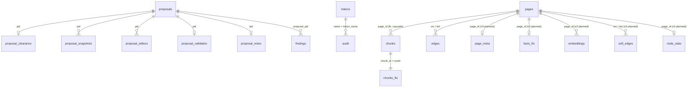

# wikisvc-core: данные

> Источник правды — git-репозиторий BKT-wikisvc-core.wiki-repo и `state.db`. `wiki.db` — производный
> индекс: его можно удалить, `wikisvc reindex --full` соберёт его заново. Все времена — строки ISO 8601
> в UTC. Схемы создаются кодом при открытии базы (`CREATE TABLE IF NOT EXISTS` + `ALTER TABLE ADD
> COLUMN`), версия схемы — `PRAGMA user_version` (CLS-wikisvc-core.refuse_newer: сейчас state 1,
> index 1). Внешних ключей между таблицами `state.db` нет — связь по значению.
> v3 (planned): `INDEX_SCHEMA` 1 → 2 (ADR-0016) — новые таблицы и колонки слоя знаний ниже; индекс версии < 2
> не мигрирует по месту, а пересобирается полностью (индекс производный; решение Q-kb-core-defaults).
> Способ доступа к новым таблицам продолжает отступление RISK-core-raw-sql и RISK-core-ddl-at-startup (RISK-kb-raw-sql-new-tables).

## Связи

## Таблицы state.db

### TBL-wikisvc-core.state.tokens — Токены доступа и SSO-сессии
status: implemented | owner: LIB-wikisvc-core | store: RES-state-db | entity: ENT-token

- purpose: принципалы API: имя, роль, допуск; сам токен не хранится, только SHA-256 (SEC-secrets)
- pk: `token_hash`; unique `name`
- retention: отзыв — `revoked_at`, строка остаётся; SSO-сессии (`name LIKE 'sso-%'`) с истёкшим `expires_at` удаляет `Auth.expire_sessions`
- pii: SEC-pii — `person` (subject SSO), `display_name`

| колонка | тип | null | default | ограничения | смысл |
|---|---|---|---|---|---|
| `token_hash` | string | нет | | pk, hex SHA-256 | хеш токена |
| `name` | string | нет | | unique, `[A-Za-z0-9][A-Za-z0-9_.-]{0,63}` | имя токена, автор коммитов и аудита |
| `role` | enum(reader\|writer\|reviewer\|admin) | нет | | | ROLE-reader…ROLE-admin |
| `clearance` | enum(public\|internal\|restricted) | нет | | | SEC-clearance |
| `created_at` | timestamp | нет | | | |
| `revoked_at` | timestamp? | да | | | отзыв |
| `person` | string? | да | | ≤ 128 | стабильный идентификатор человека |
| `kind` | enum(agent\|human) | нет | `'agent'` | | SEC-principal-kind |
| `expires_at` | timestamp? | да | | | срок; у SSO — `SESSION_TTL_HOURS` |
| `display_name` | string? | да | | | показываемое имя SSO-пользователя |

- written by: CLS-wikisvc-core.Auth (`create`, `revoke`), CLS-wikisvc-core.Sessions
- read by: CLS-wikisvc-core.Auth (`authenticate`); SVC-wikiagent `auth_check` — только чтение, `mode=ro`

### TBL-wikisvc-core.state.proposals — Предложения правок
status: implemented | owner: LIB-wikisvc-core | store: RES-state-db | entity: ENT-proposal

- purpose: состояние предложения; сами правки — в ветке `proposal/<pid>` и worktree BKT-wikisvc-core.worktrees
- pk: `pid` (32 hex, `uuid4().hex`)
- retention: бессрочно; незакрытые старше `PROPOSAL_TTL_DAYS` (14 d) переходят в `abandoned`, их worktree и ветка удаляются

| колонка | тип | null | default | ограничения | смысл |
|---|---|---|---|---|---|
| `pid` | string | нет | | pk | ID |
| `title` | string | нет | | 3..200, одна строка | |
| `description` | string | нет | | ≤ 12000 | |
| `author` | string | нет | | | имя токена автора |
| `status` | enum(STATE-proposal) | нет | | | |
| `base_commit` | string | нет | | | `main` на момент создания |
| `branch` | string | нет | | `proposal/<pid>` | |
| `review_comment` | string? | да | | ≤ 12000, без секретов | |
| `created_at`, `updated_at` | timestamp | нет | | | |
| `decided_by` | string? | да | | | `identity` ревьюера |
| `kind` | enum(manual\|chat\|book\|heal) | нет | `'manual'` | | источник предложения |
| `author_identity` | string? | да | | | `person` или имя автора (для INV-no-self-review) |
| `author_kind` | enum(agent\|human) | нет | `'agent'` | | |
| `accepted_commit`, `reverted_commit` | string? | да | | | коммиты в `main` |
| `last_editor` | string? | да | | | последний редактор |

- written by: CLS-wikisvc-core.Proposals; read by: CLS-wikisvc-core.Proposals, CLS-wikisvc-core.Rules

### TBL-wikisvc-core.state.findings — Находки проверок вики
status: implemented | owner: LIB-wikisvc-core | store: RES-state-db | entity: ENT-finding

- purpose: противоречия и проблемы в страницах (от FLOW-heal и людей) с доказательствами-цитатами
- pk: `id`; unique `fingerprint` — SHA-256 от вида и пар (ID, версия) страниц: повтор той же находки не создаёт строку
- retention: бессрочно; при принятии связанного предложения — `resolved`, при отклонении — `dismissed`, при откате — снова `open`

| колонка | тип | null | default | ограничения | смысл |
|---|---|---|---|---|---|
| `id` | string | нет | | pk | |
| `kind` | string | нет | | `[a-zA-Z0-9_-]{1,80}` (проверяет API) | вид находки |
| `severity` | enum(info\|warning\|error\|critical) | нет | | (проверяет API) | |
| `status` | enum(STATE-finding) | нет | `'open'` при создании | open, resolved, dismissed | |
| `pages` | json | нет | | string[] ID страниц | |
| `summary`, `explanation` | string | нет | | | |
| `evidence` | json | нет | | цитата обязана найтись в странице | доказательства |
| `proposal_pid` | string? | да | | только своё предложение | исправление |
| `run_id` | string? | да | | | прогон агента |
| `fingerprint` | string | нет | | unique | |
| `scope` | string | нет | `''` | | |
| `reason` | string? | да | | ≤ 2000 при отклонении | |
| `created_at`, `updated_at` | timestamp | нет | | | |

- written by: CLS-wikisvc-core.Findings, CLS-wikisvc-core.Proposals

### TBL-wikisvc-core.state.extractions — Задачи извлечения текста
status: implemented | owner: LIB-wikisvc-core | store: RES-state-db | entity: ENT-extraction

- purpose: состояние JOB-wikisvc-core.extract-worker по файлу сырья; результат — в BKT-wikisvc-core.extract
- pk: `path` (`raw/…` или `library/…`); новая версия файла (другой `sha256`) — новое извлечение

| колонка | тип | null | default | ограничения | смысл |
|---|---|---|---|---|---|
| `path` | string | нет | | pk | файл сырья |
| `sha256` | string | нет | | 64 hex | хеш файла |
| `status` | enum(STATE-extraction) | нет | | pending, running, done, failed | |
| `pages`, `chars` | int64 | нет | `0` | | прогресс и объём |
| `error` | string? | да | | код `E_…` | причина сбоя |
| `started_at`, `finished_at` | timestamp? | да | | | |

### Остальные таблицы state.db

| id | owner | status | ключ | колонки | назначение, кто пишет |
|---|---|---|---|---|---|
| TBL-wikisvc-core.state.audit | LIB-wikisvc-core | implemented | нет | `ts`, `token_name`, `action`, `target?`, `ok` (0/1), `detail?` | журнал действий; пишет `StateDB.audit`, читает админ-API SVC-wikisvc; бессрочно |
| TBL-wikisvc-core.state.proposal_validation | LIB-wikisvc-core | implemented | `pid` | `result` (json) | последний результат проверки предложения |
| TBL-wikisvc-core.state.proposal_snapshots | LIB-wikisvc-core | implemented | (`pid`, `path`) | `before_text?`, `after_text?` | тексты страниц до/после; только `wiki/**/*.md` кроме `index.md`, `log.md` |
| TBL-wikisvc-core.state.proposal_clearance | LIB-wikisvc-core | implemented | `pid` | `clearance` | допуск автора: кто ниже — не видит предложение (404) |
| TBL-wikisvc-core.state.proposal_editors | LIB-wikisvc-core | implemented | (`pid`, `name`) | `identity?` | все редакторы; они тоже не могут принять (INV-no-self-review) |
| TBL-wikisvc-core.state.proposal_notes | LIB-wikisvc-core | implemented | `pid` | `data` (json) | заметки к предложению (пишет агент) |
| TBL-wikisvc-core.state.raw_notes | LIB-wikisvc-core | implemented | `sha256` | `note`, `author`, `path`, `original_name?` | заметка и исходное имя загруженного сырья; пишет CLS-wikisvc-core.Raw |
| TBL-wikisvc-core.state.rate_limits | LIB-wikisvc-core | implemented | (`name`, `minute`) | `count` | счётчик запросов токена за минуту; прошлые минуты удаляются при каждой проверке |
| TBL-wikisvc-core.state.people | LIB-wikisvc-core | implemented | `person` | `display_name`, `updated_at` | справочник людей из SSO (SEC-pii); пишет CLS-wikisvc-core.Sessions |
| TBL-wikisvc-core.state.rule_usage | LIB-wikisvc-core | implemented | (`rule_id`, `day`) | `delivered`, `opened`, `violations` (int, 0) | статистика правил по дням UTC |
| TBL-wikisvc-core.state.violations | LIB-wikisvc-core | implemented | нет | `rule_id`, `note`, `ref`, `author`, `created_at` | зарегистрированные нарушения правил; пишет CLS-wikisvc-core.Rules |
| TBL-wikisvc-core.state.outline_overrides | LIB-wikisvc-core | implemented | `sha256` | `outline` (json), `author`, `updated_at` | ручное оглавление книги поверх автоматического |
| TBL-wikisvc-core.state.pair_verdicts | LIB-wikisvc-core | planned | (`a`, `b`), `a < b` | `verdict` enum(duplicate\|refines\|contradicts\|independent), `model`, `confidence` float64, `a_hash`, `b_hash` (`content_hash` сторон), `created_at` | вердикты судьи по парам фактов, включая `independent`; пишет и читает только CLS-wikisvc-core.Verdicts; строка устаревает при смене хеша любой стороны; источник правды для `W_POSSIBLE_DUPLICATE` и класса ревью, кэш агента — вторичен (решение Q-kb-judge-verdict-visibility); бессрочно, повтор пары заменяет строку |
| TBL-wikisvc-core.state.novelty | LIB-wikisvc-core | planned | (`page_id`, `model_family`) | `bucket` enum(common\|differs\|unique), `measured_at` timestamp, `content_hash` | измеренная новизна факта для семейства модели (`claude-sonnet`, `gemini-pro`, `gemma-31b`); пишет JOB-wikiagent.novelty-scan через CLS-wikisvc-core.Verdicts, предложений не создаёт; устаревает при смене `content_hash`; переопределение во frontmatter важнее (решение Q-kb-novelty-write-path) |

## Таблицы wiki.db (индекс)

### TBL-wikisvc-core.index.pages — Страницы в индексе
status: implemented | owner: LIB-wikisvc-core | store: RES-index-db | entity: ENT-page

- purpose: копия frontmatter и тела каждой валидно разобранной страницы для чтения, фильтров и графа
- pk: `id`; unique `path`
- retention: производная; полностью пересобирается из git

| колонка | тип | null | ограничения | смысл |
|---|---|---|---|---|
| `id` | string | нет | pk | ID страницы |
| `type`, `title`, `summary`, `status` | string | нет | | из frontmatter |
| `sensitivity` | enum(public\|internal\|restricted) | нет | | фильтр допуска во всех запросах |
| `path` | string | нет | unique | путь в репозитории |
| `tags`, `aliases`, `extra` | json | нет | | списки и поля типа (`extra.lifecycle` у правил) |
| `body` | string | нет | | тело Markdown |
| `content_hash` | string | нет | | `version` страницы |
| `created`, `updated`, `verified_at`, `verified_by` | string? | да | | |
| `metadata` | json | нет | | весь frontmatter |

- changed: 2026-10-20 v3 (planned): индексы `pages_type (type)` и `pages_status (status)`; `status` у `fact` — эффективный STATE-fact: `outdated`, если задан `valid_to` или есть входящее `replaces` (вычисляет CLS-wikisvc-core.Indexer, файл не меняется — решение Q-kb-derived-status); выборки читают только нужные колонки, `body` и `metadata` — по ID для L2

### TBL-wikisvc-core.index.chunks_fts — Полнотекстовый индекс
status: implemented | owner: LIB-wikisvc-core | store: RES-index-db

- purpose: FTS5-таблица `fts5(title, heading, text, tokenize='unicode61 remove_diacritics 2')`; `rowid` = `chunks.chunk_id`
- read by: CLS-wikisvc-core.Search — `bm25(chunks_fts, 6.0, 3.0, 1.0)`
- written by: CLS-wikisvc-core.Indexer (текст уже нормализован и застеммлен CLS-wikisvc-core.match_query)
- changed: 2026-10-20 v3 (planned): вставка `executemany`; поиск дедуплицирует страницы оконной функцией `row_number() OVER (PARTITION BY page_id)` в SQL (ТЗ §11.3); вынос дублируемой колонки `title` во внешний контент — по замеру, до него схема не меняется (решение Q-kb-core-defaults)

### TBL-wikisvc-core.index.facts_fts — Полнотекстовый ряд уровня страницы (L0)
status: planned | owner: LIB-wikisvc-core | store: RES-index-db

- purpose: один FTS5-ряд на страницу, чтобы 60 чанков хаба не съедали слоты `LIMIT` (ТЗ §11.2); BM25-ветка семян CLS-wikisvc-core.Ask
- schema: `fts5(page_id UNINDEXED, claim, title, aliases, tokenize='unicode61 remove_diacritics 2')`
- `claim`: у `fact` — `claim`, у остальных типов — `summary` (L0 = `id · summary` у topic/tech; решение Q-kb-core-defaults); текст нормализован как в chunks_fts
- веса `bm25()` колонок — в ТЗ не заданы, подбираются на FMT-wikisvc-core.kb-eval (решение Q-kb-core-defaults)
- written by: CLS-wikisvc-core.Indexer (удаление и вставка вместе с TBL-wikisvc-core.index.pages); read by: CLS-wikisvc-core.Ask

### TBL-wikisvc-core.index.page_meta — Лёгкие поля страниц для проверок множества
status: planned | owner: LIB-wikisvc-core | store: RES-index-db

- purpose: инкрементальный reindex собирает вход CLS-wikisvc-core.validate_set без разбора frontmatter всех страниц (ТЗ §11.2); хранит порядок фактов хаба
- pk: `page_id` (= `pages.id`, удаляется вместе со страницей)

| колонка | тип | null | смысл |
|---|---|---|---|
| `page_id` | string | нет | pk |
| `type`, `path`, `status` | string | нет | как в TBL-wikisvc-core.index.pages |
| `domain` | string? | да | FMT-wikisvc-core.domains |
| `relations` | json | нет | нормализованные рёбра frontmatter: `{rel: [{id, w, note, origin}]}` |
| `checks` | json | нет | поля проверок: `lifecycle`, `level`, `applies_to`/`scopes`, `kind`, `valid_for`, `valid_to`, `current_version`, `confidence` |
| `hub_facts` | json? | да | только `topic`: ID из раздела `Facts` в порядке списка (INV-canonical-order, `W_HUB_FACTS_MISMATCH`) |
| `content_hash` | string | нет | ключ кэша локальных проверок |
| `origin` | enum(book\|manual\|chat\|heal) | нет | `kind` предложения, внёсшего текущую версию страницы (DTO-wikisvc-core.FactView `origin`) |

- `origin` CLS-wikisvc-core.Indexer берёт из TBL-wikisvc-core.state.proposals по `accepted_commit` последнего коммита страницы; страница без предложения (ручной коммит, шаблон) — `manual` (решение Q-kb-core-defaults)
- written by: CLS-wikisvc-core.Indexer; read by: CLS-wikisvc-core.Indexer, CLS-wikisvc-core.Assemble, CLS-wikisvc-core.Brief, CLS-wikisvc-core.Lint

### TBL-wikisvc-core.index.embeddings — Векторы страниц
status: planned | owner: LIB-wikisvc-core | store: RES-index-db

- purpose: векторы трёх уровней для семян CLS-wikisvc-core.Ask, dense-prior PPR, `similar` и kNN дубликатов (ТЗ §5, ADR-0018)
- pk: (`page_id`, `level`, `chunk_id`); хранение в SQLite, а не pgvector — отступление от rule-stack-postgres-default принято: SQLite, без Qdrant и SurrealDB (решение Q-kb-vector-store, RISK-kb-vectors-in-sqlite)

| колонка | тип | null | ограничения | смысл |
|---|---|---|---|---|
| `page_id` | string | нет | | страница |
| `level` | enum(claim\|digest\|chunk) | нет | `claim` — title + claim факта; `digest` — topic и tech; `chunk` — разделы любой страницы | уровень |
| `chunk_id` | int32 | нет | `chunks.ord` для `chunk`, `0` для `claim`/`digest` | отступление от SQL ТЗ (`NULL`): в SQLite `NULL` в составном PK не уникален, а `chunks.chunk_id` меняется при перестройке (решение Q-kb-core-defaults) |
| `model` | string | нет | = CFG-wikisvc.EMBEDDINGS_MODEL с ревизией весов (решение Q-kb-mdl-bge-m3) | смена модели = полный `reindex --embeddings` (CLI-wikisvc-cli.reindex) |
| `dim` | int32 | нет | = CFG-wikisvc.EMBEDDINGS_DIM | |
| `vec` | bytes | нет | `dim` × float16 little-endian; в памяти — float32, нормировка при загрузке снимка (решение Q-kb-vector-store) | вектор |
| `content_hash` | string | нет | SHA-256 закодированного текста | инкрементальный пересчёт |

- written by: JOB-wikisvc-core.embed-index (вне транзакции индекса); read by: CLS-wikisvc-core.Ask, CLS-wikisvc-core.Lint (`W_POSSIBLE_DUPLICATE`)
- retention: полная перестройка индекса строки не стирает — переиспользуются по `content_hash`; строки удалённых страниц удаляет CLS-wikisvc-core.Indexer; удаление `wiki.db` = перекодирование всего корпуса; CLI-wikisvc-cli.reindex `--embeddings` кодирует вне блокировки записи, под ней пишет только строки, чей `content_hash` не изменился за время кодирования; `--full` сохраняет векторы с тем же хешем и моделью (решение Q-kb-cli-reindex-embeddings)
- security: текст всех страниц, включая `restricted`, уходит только в EXT-embeddings-server (SEC-embeddings-boundary); выдача фильтруется по допуску до ранжирования (INV-404-not-403)

### TBL-wikisvc-core.index.soft_edges — Производные мягкие рёбра
status: planned | owner: LIB-wikisvc-core | store: RES-index-db

- purpose: `similar`, `co_cited`, `same_hub` для снимка графа CLS-wikisvc-core.GraphSnapshot (ТЗ §4–5)
- pk: (`src`, `dst`, `rel`); пара хранится один раз с `src < dst`, снимок добавляет оба направления (решение Q-kb-core-defaults)

| колонка | тип | null | смысл |
|---|---|---|---|
| `src`, `dst` | string | нет | ID фактов |
| `rel` | enum(similar\|co_cited\|same_hub) | нет | |
| `weight` | float64 | нет | `same_hub` 0.4; `co_cited` 0.3; `similar` = косинус − 0.5 при косинусе `claim`-векторов ≥ CFG-wikisvc.SIMILAR_THRESHOLD |

- written by: CLS-wikisvc-core.Indexer (`same_hub`, `co_cited`), JOB-wikisvc-core.embed-index (`similar`)
- `co_cited` — «один источник в соседних главах»: соседние = номера глав в цитатах `[@src гл. N]` отличаются не больше чем на 1 (решение Q-kb-core-defaults); предела числа пар нет, квадратичный рост принят (решение Q-kb-soft-edges-cap, RISK-kb-soft-edges-blowup)

### TBL-wikisvc-core.index.node_stats — Специфичность узлов
status: planned | owner: LIB-wikisvc-core | store: RES-index-db

- purpose: вес семян в reset-векторе PPR; хабы на 60 фактов не перетягивают массу (ТЗ §5, TERM-specificity)
- pk: `page_id`

| колонка | тип | null | смысл |
|---|---|---|---|
| `page_id` | string | нет | pk |
| `degree` | int32 | нет | входящие + исходящие явные рёбра TBL-wikisvc-core.index.edges, включая обратные, без `soft_edges` (решение Q-kb-core-defaults) |
| `specificity` | float64 | нет | `log(N / (1 + degree)) / log(N)`, обрезано в [0, 1]; N — число страниц (нормировка — решение Q-kb-core-defaults) |

- written by: CLS-wikisvc-core.Indexer при каждой перестройке; read by: CLS-wikisvc-core.Ask, CLS-wikisvc-core.Lint (`W_HIGH_DEGREE_DRAFT`)
- известный побочный канал: `degree` и `specificity` считаются по всем страницам, включая невидимые вызывающему; через порядок выдачи косвенно видно число скрытых соседей узла. Принято осознанно (пересчёт на каждый допуск — 3 копии); наружу значения не отдаются (SEC-graph-clearance-mask)

### Остальные таблицы wiki.db

| id | owner | status | ключ | колонки | назначение |
|---|---|---|---|---|---|
| TBL-wikisvc-core.index.edges | LIB-wikisvc-core | implemented | (`src`, `dst`, `rel`, `kind`) | индексы `(dst)`, `(dst,rel)`, `(src,rel)` | рёбра графа (CLS-wikisvc-core.Edge) (v3 planned: колонки `weight` float64 NOT NULL default 1.0 — базовый вес связи или `w` ребра (у рёбер `origin` extracted/inferred `w` обрезается до базового веса связи), `note` string?, `origin` enum(manual\|extracted\|inferred) NOT NULL default `manual`; обратное ребро наследует вес, заметку и `origin` прямого; вставка `executemany`) |
| TBL-wikisvc-core.index.chunks | LIB-wikisvc-core | implemented | `chunk_id` | `page_id` (fk → pages, cascade), `ord`, `heading`, `text` | разделы страниц ≤ 1500 символов (v3 planned: индекс `chunks_page (page_id)`; вставка `executemany`) |
| TBL-wikisvc-core.index.raw_files | LIB-wikisvc-core | implemented | `path` | `sha256`, `size`, `mime`, `added_at` (mtime), `storage` (`git`\|`local`, default `git`) | каталог сырья `raw/` и `library/`; `.gitkeep` пропускается |
| TBL-wikisvc-core.index.delivery_stats | LIB-wikisvc-core | implemented | нет | `ts`, `endpoint`, `query_hash?`, `chars_available`, `chars_delivered`, `pages_truncated`, `clearance` (default `restricted`) | сколько контекста отдано агентам; пишет CLS-wikisvc-core.Context, читает CLS-wikisvc-core.Lint (v3 planned: колонка `ids` json string[] — выданные ID (основа будущего `f_usage`), открытие факта — строка с `endpoint` = `knowledge.fact`; ни текст запроса, ни `query_hash` не пишутся — в схеме 2 колонки `query_hash` нет (несолёный хеш короткого запроса восстанавливается перебором), только ID и колонка `actor` — имя токена или `person` вызывающего, основа будущего `f_usage` (решение Q-kb-delivery-stats-actor), SEC-delivery-stats; пишет CLS-wikisvc-core.DeliveryQueue пачками, а не каждое чтение; CLS-wikisvc-core.Lint читает агрегатами SQL; теряется при перестройке и восстановлении — RISK-kb-delivery-stats-derived) |
| TBL-wikisvc-core.index.issues | LIB-wikisvc-core | implemented | нет | `path`, `page?`, `data` (json LintIssue) | ошибки разбора и проверки по файлам (v3 planned: при инкременте `DELETE … WHERE path IN (…)` вместо полной перезаписи) |
| TBL-wikisvc-core.index.meta | LIB-wikisvc-core | implemented | `key` | `value` | `index_commit` — коммит, по которому собран индекс; `generation` — счётчик перестроек (сброс кэша блока политик) (v3 planned: `generation` сбрасывает и снимок графа, матрицу векторов, кэш brief; ключи `embeddings_model` и `embeddings_selftest` — модель и эталонный косинус self-test CLS-wikisvc-core.Embeddings) |

## Файлы и объекты

### BKT-wikisvc-core.wiki-repo — Git-репозиторий контента
status: implemented | owner: LIB-wikisvc-core | store: RES-wiki-repo

- changed: 2026-10-20 v3 (planned): слой знаний `wiki/kb/<domain>/{topics,facts,tech,questions}/` (FMT-wikisvc-core.fact и др.), `schema/domains.yaml` (FMT-wikisvc-core.domains)
- path: `WIKI_ROOT/`: `wiki/**/*.md` (FMT-wikisvc-core.page), `wiki/index.md` и `wiki/log.md` (генерируются), `schema/**` (FMT-wikisvc-core.page-type и др.), `raw/<категория>/<yyyy>/<sha256[:8]>-<имя>`, `AGENTS.md`, `CLAUDE.md` → `AGENTS.md`, `inbox/`
- категории сырья: docs, transcripts, tickets, api-specs, code-samples, assets
- access: пишет только ядро под CLS-wikisvc-core.write_lock; ветка `main` чистая (`wiki/`, `raw/`, `schema/` без незакоммиченных правок); журнал прерванной записи — `.git/wikisvc-transaction.json`
- lifecycle: сырьё неизменяемо, коммиты не переписываются; откат — новым коммитом
- pii: допускается в тексте страниц с `sensitivity: restricted`; секреты запрещены (INV-secrets-never-stored)

### BKT-wikisvc-core.worktrees — Рабочие копии предложений
status: implemented | owner: LIB-wikisvc-core | store: RES-host

- path: `STATE_DIR/worktrees/<pid>/` — git worktree ветки `proposal/<pid>` основного репозитория
- lifecycle: создаётся с предложением, удаляется при `abandoned`/TTL и после решения; при переносе данных чинится CLS-wikisvc-core.repair_worktrees (`STATE_DIR` копируется целиком)

### BKT-wikisvc-core.library — Загруженные книги
status: implemented | owner: LIB-wikisvc-core | store: RES-host

- path: `STATE_DIR/library/<yyyy>/<sha256[:8]>-<имя>` — не в git (лимит `MAX_LIBRARY_UPLOAD_MB`, 200 MB по умолчанию)
- content: PDF, EPUB, DOCX и другие разрешённые расширения; данные недоверенные (INV-untrusted-external)
- access: только принципал с допуском `restricted`; путь резолвит CLS-wikisvc-core.raw_path

### BKT-wikisvc-core.extract — Кэш извлечённого текста
status: implemented | owner: LIB-wikisvc-core | store: RES-host

- path: `STATE_DIR/extract/<sha256 файла>/`: `batch-<NNNNNN>.json` (пачки по 15 страниц от рабочего процесса), `pages.jsonl`, `outline.json`
- lifecycle: ключ — хеш содержимого, кэш переиспользуется при повторе; автоматической очистки нет
