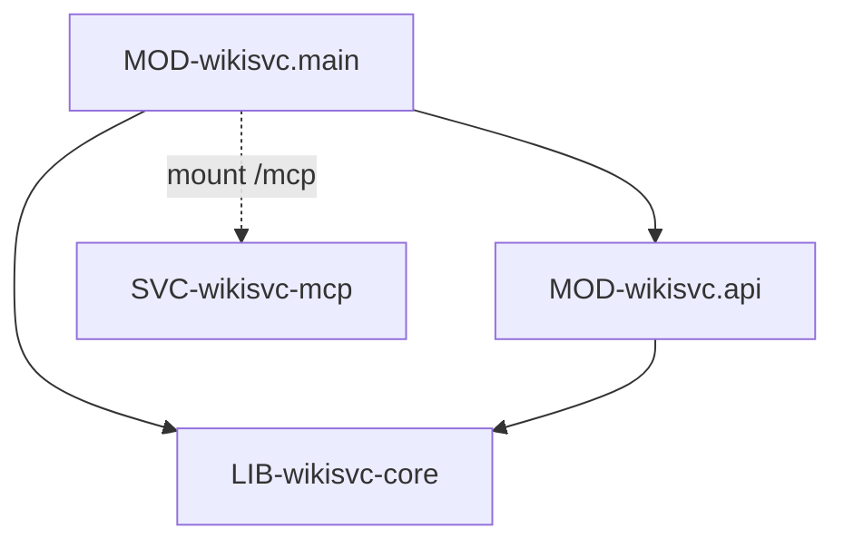

# wikisvc: устройство кода

> Модули верхнего уровня и ключевые классы HTTP-слоя. Бизнес-логика — в LIB-wikisvc-core
> (`components/wikisvc-core/code.md`).

## Модули

### MOD-wikisvc.main — сборка приложения FastAPI
status: implemented | owner: SVC-wikisvc

- path: `src/wikisvc/main.py`, `src/wikisvc/config.py`
- responsibility: собирает приложение `create_app`: lifespan, middleware, обработчики ошибок,
  health и роутеры под префиксом `/api/v1`.
- public: CLS-wikisvc.create_app, CLS-wikisvc.BodyLimit, CLS-wikisvc.Settings
- depends on: MOD-wikisvc.api, LIB-wikisvc-core, SVC-wikisvc-mcp (только при CFG-wikisvc.MCP_HTTP_ENABLED)
- implements: API-wikisvc.health, INV-auth-before-body
- notes: порядок middleware снаружи внутрь — CORS (если задан CFG-wikisvc.CORS_ORIGINS),
  `MCPHTTPAuth` (если включён MCP по HTTP), CLS-wikisvc.BodyLimit, затем роутер.
- must not: содержать бизнес-правила — только перевод HTTP ↔ ядро.

### MOD-wikisvc.api — роутеры и зависимости доступа
status: implemented | owner: SVC-wikisvc

- path: `src/wikisvc/api/` (`deps.py`, `routers/*.py`: admin, graph, lint, pages, people, policies,
  proposals, raw, review_queue, rules, schema, search, sessions)
- responsibility: объявляет эндпоинты API-wikisvc.* и тела запросов DTO-wikisvc.*, проверяет роль
  зависимостью и передаёт вызов службам `Runtime` ядра.
- public: CLS-wikisvc.Authorize, CLS-wikisvc.runtime
- depends on: LIB-wikisvc-core
- implements: API-wikisvc.*, INV-anonymous-ceiling (через CLS-wikisvc.Authorize), INV-404-not-403
  (`API-wikisvc.admin.audit`)
- must not: проверять доступ к конкретному объекту (это ядро); исключения: `admin.audit`,
  `people.list`, `inbox` и `sessions.*` проверяют допуск и вид принципала прямо в роутере.
- notes: обработчики синхронные (`def`); FastAPI выполняет их в пуле потоков.
- changed: 2026-10-20 v3 (planned): новый роутер `routers/knowledge.py` — API-wikisvc.knowledge.* (DTO-wikisvc.KnowledgeMeta и
  core-DTO ответов), только чтение через CLS-wikisvc-core.Ask, CLS-wikisvc-core.Brief, CLS-wikisvc-core.Knowledge;
  потолок ответа CFG-wikisvc.TOOL_RESPONSE_CAP применяет роутер до вызова ядра; обработчики — как у остальных, `def`
  (RISK-sync-io, RISK-kb-sync-outgoing-http); строгая типизация ответов моделями pydantic (rule-arch-strict-typing).

## Ключевые классы и функции

### CLS-wikisvc.create_app — фабрика приложения
status: implemented | owner: SVC-wikisvc | kind: function

- module: MOD-wikisvc.main
- symbol: `create_app` в `src/wikisvc/main.py`
- signature: `create_app(settings: Settings | None = None) -> FastAPI`
- guarantees: без аргумента читает CFG-wikisvc.* из окружения; `CORS_ORIGINS` с `*` — отказ старта.
- lifespan: под блокировкой записи — переиндексация, истечение предложений, удаление истёкших
  SSO-сессий; затем восстановление извлечений; при CFG-wikisvc.MCP_HTTP_ENABLED монтирует
  `/mcp` и снимает монтирование при остановке; при остановке закрывает извлечения.
- errors: перевод в единый конверт ошибки CLS-wikisvc-core.WikiError:
  `WikiError` → его код и статус (для изменяющих методов ещё запись `request.denied` в аудит);
  ошибка валидации FastAPI → ERR-request_invalid (`400`, поля в `details`);
  `RecursionError` → ERR-request_invalid (`400`); `HTTPException` Starlette (неизвестный путь,
  метод) → ERR-http со статусом исключения; прочее → ERR-internal (`500`), в лог только имя класса.
- changed: 2026-10-20 v3 (planned): lifespan ещё делает self-test CLS-wikisvc-core.Embeddings (результат — в
  API-wikisvc.health), запускает JOB-wikisvc-core.delivery-flush и открывает CLS-wikisvc-core.ConnectionPool; при
  остановке сбрасывает CLS-wikisvc-core.DeliveryQueue до закрытия пула.

### CLS-wikisvc.BodyLimit — аутентификация до тела и лимит размера
status: implemented | owner: SVC-wikisvc | kind: class

- module: MOD-wikisvc.main
- symbol: `BodyLimit` в `src/wikisvc/main.py` (ASGI middleware)
- implements: INV-auth-before-body, SEC-auth-before-body
- guarantees:
  - для путей `/api/v1/*`, кроме `/api/v1/health`, принципал определяется до чтения тела:
    нет заголовка `Authorization` и включён CFG-wikisvc.ANONYMOUS_ACCESS → анонимный принципал;
    иначе нужен `Bearer <token>`, токен проверяется ядром (в том числе лимит CFG-wikisvc.RATE_LIMIT_PER_MIN);
  - токен с именем CFG-wikisvc.SESSION_ISSUER_TOKEN_NAME допускается только к `POST /api/v1/sessions`;
    при заданном выпускающем токене `/api/v1/health` с заголовком `Authorization` тоже проверяется;
  - тело любого HTTP-запроса (в том числе `/mcp`) ≤ 1 MB; для `POST /api/v1/raw` —
    max(CFG-wikisvc.MAX_UPLOAD_MB, CFG-wikisvc.MAX_LIBRARY_UPLOAD_MB) + 64 KB;
  - `Content-Length` проверяется до чтения (несколько заголовков или не число → ERR-request_invalid),
    затем тело читается с подсчётом и передаётся дальше из памяти.
- errors: ERR-unauthorized (`401`), ERR-forbidden (`403`), ERR-rate_limit (`429`),
  ERR-request_invalid (`400`), ERR-body_too_large (`413`)
- notes: отказ пишет в лог `WARNING` с кодом ошибки не чаще раза в минуту — защита лога от
  перебора токенов. Принципал кладётся в `scope.state.actor`, имя токена — в `scope.state.token_name`.

### CLS-wikisvc.Authorize — зависимость проверки роли
status: implemented | owner: SVC-wikisvc | kind: class

- module: MOD-wikisvc.api
- symbol: `Authorize` в `src/wikisvc/api/deps.py`; псевдонимы `Reader`, `Writer`, `Reviewer`, `Admin`
- signature: `Authorize(role: Role = "reader")(services, request, credentials) -> Principal`
- guarantees: берёт принципала, найденного CLS-wikisvc.BodyLimit (в том числе анонимного); если
  его нет — проверяет Bearer-токен сам; затем требует роль не ниже заданной
  (ROLE-reader < ROLE-writer < ROLE-reviewer < ROLE-admin).
- implements: INV-anonymous-ceiling — анонимный принципал имеет `kind=agent`, роль из
  CFG-wikisvc.ANONYMOUS_ROLE (не выше writer) и допуск из CFG-wikisvc.ANONYMOUS_CLEARANCE
  (не выше internal), поэтому не проходит `Reviewer`, `Admin` и проверки SEC-principal-kind#human.
- errors: ERR-unauthorized (`401`), ERR-forbidden (`403`)

### CLS-wikisvc.runtime — доступ роутеров к службам ядра
status: implemented | owner: SVC-wikisvc | kind: function

- module: MOD-wikisvc.api
- symbol: `runtime` и тип `Services` в `src/wikisvc/api/deps.py`
- signature: `runtime(request: Request) -> Runtime`
- guarantees: возвращает единственный `Runtime` ядра, созданный в lifespan CLS-wikisvc.create_app.

### CLS-wikisvc.Settings — настройки из окружения
status: implemented | owner: SVC-wikisvc | kind: class

- module: MOD-wikisvc.main
- symbol: `Settings` в `src/wikisvc/config.py` (DEP-py-pydantic-settings)
- signature: `Settings()` — читает CFG-wikisvc.* из env; `.env` не загружает, лишние переменные игнорирует
- guarantees: проверяет значения при создании: пути приводятся к абсолютным, `STATE_DIR` и
  `INDEX_DIR` разные и вне `WIKI_ROOT`, `ROLES_FILE` вне `WIKI_ROOT`, формат `STATUS_BOOST`.
- changed: 2026-10-20 v3 (planned): поля слоя знаний (`runtime.md`, раздел v3) и их взаимные проверки
  (`EMBEDDINGS_*` при `EMBEDDINGS_ENABLED`, `RERANKER_*` при `ASK_RERANK_ENABLED`, бюджеты ≤ `TOOL_RESPONSE_CAP`).
- notes: общий для SVC-wikisvc, SVC-wikisvc-cli, SVC-wikisvc-mcp и LIB-wikisvc-core (`Runtime`).
