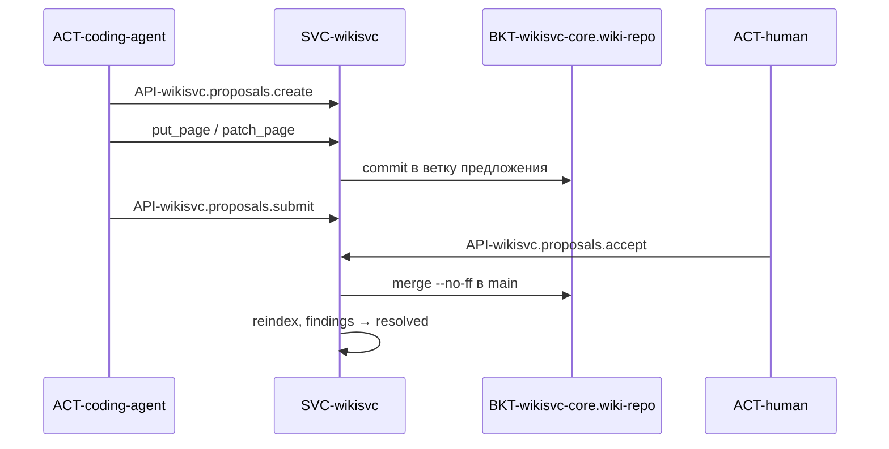
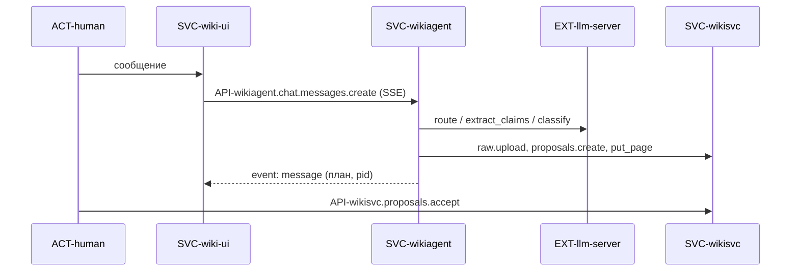
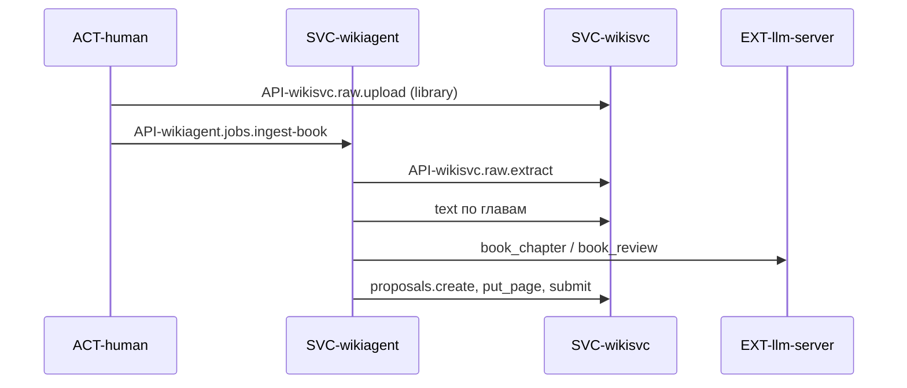
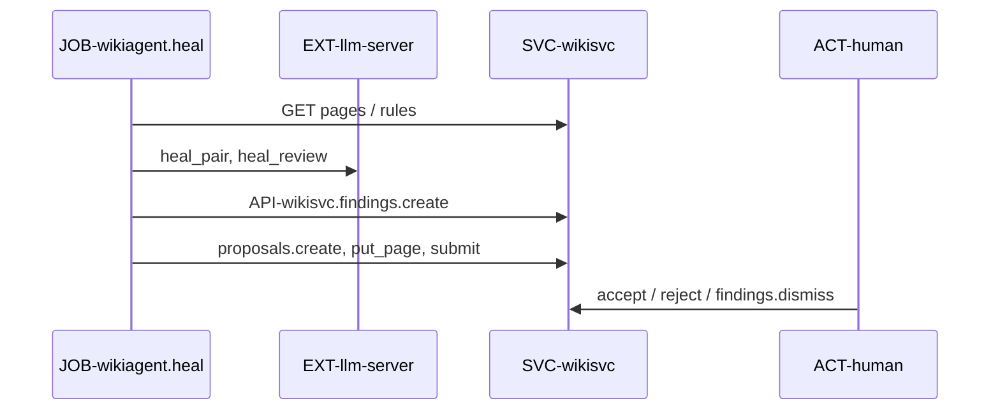
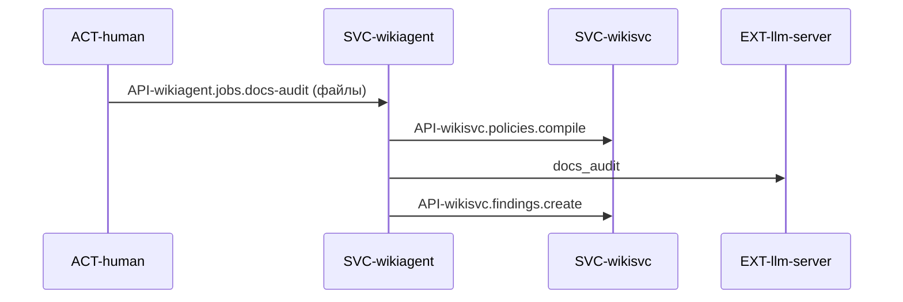
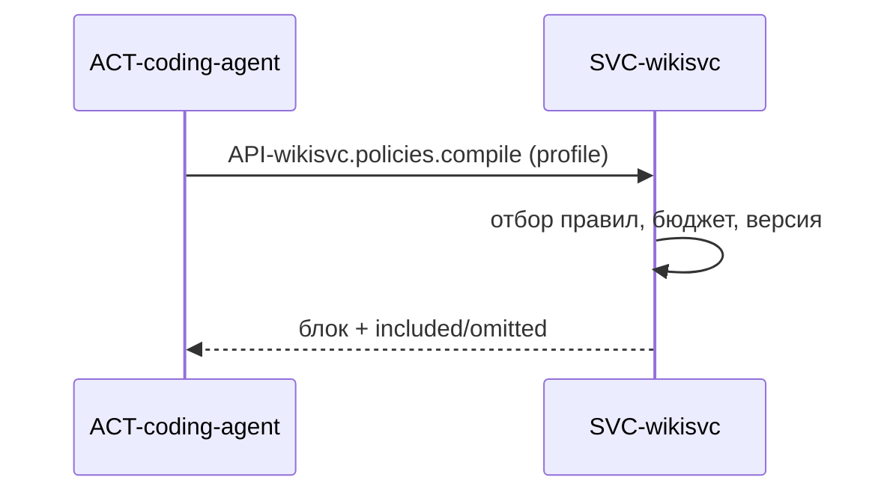
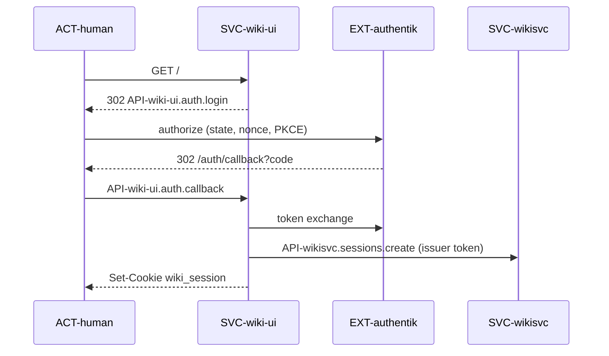
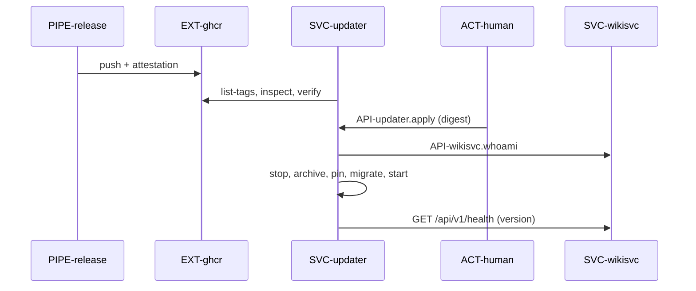
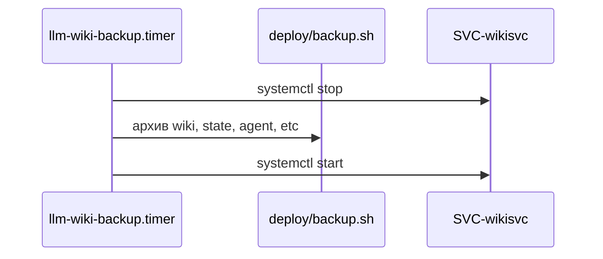

# Сквозные сценарии

> Только сценарии, которые проходят через несколько компонентов или внешних систем.
> Шаги ссылаются на ID — детали в карточках, здесь только порядок.

### FLOW-proposal-review — Предложение и ревью
status: implemented

- trigger: `ACT-coding-agent` (MCP `API-wikisvc-mcp.create_proposal`) или `ACT-human` в `SVC-wiki-ui` создаёт предложение.
- result: правки слиты в `main` `BKT-wikisvc-core.wiki-repo` одним merge-коммитом, индекс обновлён, связанные находки `resolved`.

1. Автор → `API-wikisvc.proposals.create`: строка в `TBL-wikisvc-core.state.proposals`, ветка и worktree (`BKT-wikisvc-core.worktrees`), `STATE-proposal#draft`.
2. Автор → правки страниц (`API-wikisvc-mcp.put_page`, `API-wikisvc-mcp.patch_page`, `API-wikisvc.proposals.*`): коммит в ветку, проверка страницы, `INV-agent-rule-inert`, `INV-secrets-never-stored`.
3. Автор → `API-wikisvc-mcp.validate_proposal`, затем `API-wikisvc.proposals.submit` → `STATE-proposal#submitted`.
4. `ACT-human` (reviewer, `kind=human`) читает diff и impact в `SVC-wiki-ui` и вызывает `API-wikisvc.proposals.accept` (с `promote`/`deprecate` правил), `.reject` или `.request-changes`.
5. Accept под `write_lock`: `INV-human-decides`, `INV-no-self-review`, повторная валидация, `git merge --no-ff`, активные правила → `verified`, `wiki/index.md` и `wiki/log.md`, коммит, `accepted_commit`, переиндексация, удаление worktree.
6. При необходимости reviewer → `API-wikisvc.proposals.revert` → `STATE-proposal#reverted`.

- failures:
  - конфликт слияния → `ERR-merge_conflict`, main не меняется, статус остаётся `submitted`;
  - новые ошибки валидации на объединённом наборе → `ERR-validation`;
  - запись занята → `ERR-lock_timeout`, повтор;
  - предложение без движения дольше `CFG-wikisvc.PROPOSAL_TTL_DAYS` → `abandoned` при старте.
- consistency: git — источник правды, `TBL-wikisvc-core.state.proposals` — его отражение. Сбой между merge-коммитом и записью статуса чинит `Proposals.recover()` при старте (по сообщению коммита `Accept proposal <pid>` / `Revert proposal <pid>`); индекс пересобирается при старте (`reindex`).
- changed: 2026-10-20 v3 (planned): предложения ingest — по (хаб, класс) с `depends_on`, ревью списком claims L0 (L1 для конфликтов), `accept {exclude, resolutions}` (`FLOW-fact-review-routing`); блок `auto` принимает человек одним действием (Q-kb-auto-accept-human-decides); зависимое раньше базового → `ERR-proposal_dependency`.

### FLOW-chat-plan — Чат и план правок
status: implemented

- trigger: `ACT-human` пишет сообщение в чат `SVC-wiki-ui`.
- result: ответ на вопрос или предложение `kind=chat` в `STATE-proposal#draft` от токена агента с транскриптом-источником.

1. `ACT-human` → `API-wiki-ui.proxy.wikiagent` → `API-wikiagent.chat.sessions.create`, затем `API-wikiagent.chat.messages.create` (SSE): проверка `INV-agent-clearance-ceiling`.
2. `SVC-wikiagent` классифицирует сообщение (`PRM-wikiagent.route`) и либо отвечает с инструментами чтения (`API-wikisvc.*` по allowlist, не больше `CFG-wikiagent.limits.max_tool_steps`), либо строит план.
3. План: извлечение утверждений (`PRM-wikiagent.extract_claims`), сверка с правилами (`PRM-wikiagent.classify`), транскрипт → `API-wikisvc.raw.upload` (`raw/transcripts`), страница `source` и кандидаты правил → `API-wikisvc.proposals.create` + правки; модель — `EXT-llm-server`.
4. План и ссылка на предложение сохраняются в `TBL-wikiagent.agent.chat_sessions`; `ACT-human` принимает предложение по `FLOW-proposal-review` (черновик агента принимается без submit).

- failures: модель недоступна → событие `error` с `ERR-model_unavailable`; лимит инструментов → `ERR-agent_step_limit`; ответ модели не прошёл проверку → `ERR-model_output`, предложение не создаётся.
- consistency: незавершённый план остаётся в сессии; пустое предложение пересмотра агент отменяет (`abandon`).

### FLOW-ingest-book — Разбор книги
status: implemented

- trigger: `ACT-human` загружает книгу и запускает `API-wikiagent.jobs.ingest-book`.
- result: предложение `kind=book` со страницей-источником и кандидатами правил с цитатами, `STATE-job#awaiting_review`.

1. `ACT-human` → `API-wikisvc.raw.upload` (категория `library`, `SEC-upload`) → файл в `BKT-wikisvc-core.library`.
2. `ACT-human` → `API-wikiagent.jobs.ingest-book` → строка в `TBL-wikiagent.agent.jobs`, `JOB-wikiagent.ingest-book`.
3. Задача → `API-wikisvc.raw.extract` (`retry=true`) и опрос до `STATE-extraction#done`; `JOB-wikisvc-core.extract-worker` пишет `BKT-wikisvc-core.extract`.
4. Только запасное оглавление → `STATE-job#needs_outline`; человек правит оглавление `PUT /raw/{path}/outline` и вызывает `API-wikiagent.jobs.resume`.
5. Главы по `CFG-wikiagent.limits.chapter_chunk_tokens` → `EXT-llm-server` (`PRM-wikiagent.book_chapter`, `PRM-wikiagent.book_review`); каждая цитата сверяется с текстом страницы источника.
6. Предложение `kind=book` → правки → `API-wikisvc.proposals.submit` → `STATE-job#awaiting_review`; дальше `FLOW-proposal-review`.

- failures: извлечение `failed` → задача `failed` с кодом (`ERR-text_limit`, `ERR-no_text_layer`…); ожидание дольше таймаута модели + 600s → `ERR-extract_timeout`; модель недоступна → `failed`, повтор через resume; цитата не найдена → `ERR-quote_not_found`, утверждение отбрасывается.
- consistency: прогресс и выданные ID кандидатов — в `TBL-wikiagent.agent.job_state`; повтор продолжает с контрольной точки и не создаёт дубликатов страниц.
- changed: 2026-10-20 v3 (planned): шаги 1–4 общие; извлечение фактов (окна 1–2k токенов, хабы, дедупликация судьёй, предложения по хабам) идёт по `FLOW-fact-ingest`; этот сценарий остаётся для кандидатов в правила.

### FLOW-heal — Самолечение
status: implemented

- trigger: `JOB-wikiagent.scheduler` в окне `CFG-wikiagent.heal.windows` после простоя `idle_minutes` или `ACT-human` → `API-wikiagent.jobs.heal`.
- result: находки (`ENT-finding`) и предложения `kind=heal` на проверку; `STATE-job#done` или `#paused`.

1. Задача выбирает пары связанных страниц (`changed` или `full` раз в `full_sweep_days`), пропуская пары из кэша `TBL-wikiagent.agent.pair_checks`.
2. Пара → `EXT-llm-server` (`PRM-wikiagent.heal_pair`, второе мнение `PRM-wikiagent.heal_review`); вердикт ниже `confidence_threshold` отбрасывается; плюс детерминированные проверки.
3. Находка → `API-wikisvc.findings.create` (цитаты проверяет `SVC-wikisvc`).
4. Исправимое → предложение `kind=heal` → правки только страниц находки → `validate` → `submit`; находка связывается с предложением.
5. Чат человека приоритетнее: задача ждёт в `STATE-job#waiting_chat`.

- failures: исчерпан лимит вызовов за прогон или день (`NFR-agent-model-budget`) → `paused`; второй `heal` → `ERR-job_busy`; правка вне находки → `ERR-agent_tool_forbidden`.
- consistency: повторная находка с тем же `fingerprint` не дублируется; решение по предложению меняет `STATE-finding`.
- changed: 2026-10-20 v3 (planned): для `fact` партнёры — kNN по claim-векторам, затем NLI-судья до LLM (`FLOW-dedup-judge`, ТЗ §8.6, §11.9): дубликаты и противоречия между книгами; вердикты пишутся в ядро (`API-wikisvc.knowledge.verdicts` → `TBL-wikisvc-core.state.pair_verdicts`), `TBL-wikiagent.agent.fact_verdicts` — кэш; соседи изменённых страниц — один запрос; выбор по `(category, scope)` — индекс в памяти на запуск; счётчик вызовов — один на запуск.

### FLOW-docs-audit — Сверка документации проекта с политиками
status: implemented

- trigger: `ACT-human` загружает `.md`-файлы проекта в `SVC-wiki-ui` и запускает `API-wikiagent.jobs.docs-audit`.
- result: находки `kind=docs-audit` с цитатами правила и строки проекта; `STATE-job#awaiting_review`.

1. `API-wikiagent.jobs.docs-audit`: только `kind=human`, включено `CFG-wikiagent.docs_audit.enabled`; лимиты файлов (`NFR-docs-audit-limits`), детектор секретов по файлам.
2. `JOB-wikiagent.docs-audit` → `API-wikisvc.policies.compile` для профиля и областей.
3. Пары «правило × файл» → `EXT-llm-server` (`PRM-wikiagent.docs_audit`, файлы помечены `untrusted_external`); точные цитаты обеих сторон проверяются.
4. Перед записью политики компилируются снова; изменились → `ERR-audit_stale`.
5. Находка → `API-wikisvc.findings.create` (`scope` = проект).

- failures: выключено → `ERR-docs_audit_disabled`; бюджет → `paused`; контекст мал → пара пропускается.
- consistency: «ожидающая» запись в `TBL-wikiagent.agent.job_state` пишется до POST, сбой после POST повторяет тот же запрос, а `fingerprint` отсекает дубль.

### FLOW-policy-compile — Сборка блока политик
status: implemented

- trigger: `ACT-coding-agent` → `API-wikisvc-mcp.get_policies` / `API-wikisvc.policies.compile`; `ACT-operator` → `CLI-wikisvc-cli.policies.export`.
- result: блок `FMT-wikisvc-core.policy-block` с версией; в файле проекта заменён только он (`INV-policy-block-only`).

1. Профиль (`ENT-profile`) даёт области и бюджет (по умолчанию 2000 токенов); области проверяются по `ENT-scope`.
2. Из индекса берутся правила в пределах допуска: `active`, `verified_by`, уровень `must`/`should`, пересечение `applies_to` с областями; `enforced` решает судьбу правил с автопроверкой.
3. Сортировка: `must` раньше, затем приоритет; бюджет считается как символы / `CFG-wikisvc.CHARS_PER_TOKEN`; `must` не выкидываются.
4. Результат кешируется до смены поколения индекса; выдача увеличивает `delivered` в `TBL-wikisvc-core.state.rule_usage`.
5. Экспорт пишет блок в файл между маркерами; `CLI-wikisvc-cli.policies.check` сверяет версию.

- failures: неизвестный профиль → `ERR-profile_unknown`; области → `ERR-scope_unknown`; блок в файле повреждён → `ERR-policy_block`.
- changed: 2026-10-20 v3 (planned): правила по-прежнему всегда в блоке (`INV-rules-pushed-knowledge-pulled`); экспорт умеет вписывать отдельный блок знаний `FMT-wikisvc-core.knowledge-block` из `FLOW-knowledge-brief`; токены — `NFR-token-estimate`; стоимость строки считается один раз, рендер один (ТЗ §11.6); `applies_to` — алиас `scopes`.

### FLOW-oidc-login — Вход человека
status: implemented

- trigger: `ACT-human` открывает `SVC-wiki-ui` без cookie `wiki_session`.
- result: cookie `SEC-session-cookie` с токеном `ENT-session`; запросы браузера идут с ним как Bearer.

1. `API-wiki-ui.auth.login`: случайные `state`, `nonce`, PKCE-verifier; `state` в cookie `wiki_oidc_flow` (путь `/auth`, 10 min); редирект на `EXT-authentik`.
2. `API-wiki-ui.auth.callback`: сверка `state` с cookie, обмен кода с verifier, проверка ID-token (издатель, `client_id`, `nonce`, `iat`, `exp`, `nbf`).
3. `SVC-wiki-ui` → `API-wikisvc.sessions.create` выпускающим токеном (`CFG-wiki-ui.WIKI_UI_SESSION_TOKEN_FILE`, имя = `CFG-wikisvc.SESSION_ISSUER_TOKEN_NAME`) с `sub`, `preferred_username`, `groups`.
4. `SVC-wikisvc` отображает группы на роль и допуск по `FMT-wikisvc-core.roles-file` (неизвестные — reader/public), пишет токен `kind=human` в `TBL-wikisvc-core.state.tokens` и `TBL-wikisvc-core.state.people`.
5. `SVC-wiki-ui` ставит cookie до `expires_at` и проксирует запросы с `Authorization: Bearer`.
6. Выход: `API-wiki-ui.auth.logout` (POST, проверка `Origin`) → `API-wikisvc.sessions.revoke` → редирект на выход `EXT-authentik`.

- failures: IdP недоступен → 503 «Вход временно недоступен»; `SVC-wikisvc` недоступен → 503 «Не удалось создать сеанс вики»; токен сессии истёк → 401 от `SVC-wikisvc` превращается в 302 на вход с очисткой cookie.
- consistency: отзыв при выходе не подтверждён → cookie всё равно удаляется, пользователь получает 503 с объяснением; просроченные сессии удаляются при старте `SVC-wikisvc`.

### FLOW-release-update — Релиз и обновление
status: implemented

- trigger: тег `vX.Y.Z[-beta.N]` на коммите `main` запускает `PIPE-release`; `ACT-human` (admin) применяет обновление в `SVC-wiki-ui`.
- result: на хосте запущен образ нового релиза по digest; данные мигрированы, архив до обновления сохранён.

1. `PIPE-release`: `scripts/check-release-tag.sh`, `nix build .#image`, `scripts/smoke-image.sh`, push в `EXT-ghcr` (`sha-…`, тег или `main`), аттестация `actions/attest` (`EXT-github-releases`).
2. `JOB-updater.check` раз в `CFG-updater.check-every`: теги канала (`release`/`beta`), `skopeo inspect`, `cosign verify-attestation`; понижение версии не предлагается.
3. `ACT-human` → `API-wiki-ui.proxy.updater` → `API-updater.status`, `API-updater.channel`, `API-updater.apply` с digest; `SVC-updater` проверяет `API-wikisvc.whoami`: `kind=human` и admin.
4. `JOB-updater.apply`: pull → verify → список возобновляемых задач (`STATE-job`) → stop (ждёт `llm-wiki-backup`) → архив в `BKT-updater.pre-update-archives` → смена digest в `CFG-updater.image-file` → `CLI-wikisvc-cli.schema.upgrade`, `CLI-wikisvc-cli.reindex --full`, `CLI-wikisvc-cli.lint` → start → health (`OBS-wikisvc.health` сообщает версию тега, `OBS-wiki-ui.health`) → сверка задач → prune.

- failures: до остановки сервисов — операция `failed`, ничего не меняется; после архива — откат: стоп, восстановление архива, прежний digest, `reindex --full`, запуск; второе обновление во время первого → `ERR-update_busy`; предложенный digest сменился → `ERR-update_stale`.
- consistency: состояние операции в `BKT-updater.state-dir` (`state.json`, атомарная запись); индекс не архивируется и пересобирается.

### FLOW-backup-restore — Бэкап и восстановление
status: implemented

- trigger: `llm-wiki-backup.timer` ежедневно в 23:00 по времени хоста (`deploy/systemd/llm-wiki-backup.timer`) или `ACT-operator` вручную; восстановление — `ACT-operator`.
- result: архив `data-<UTC>-<суффикс>.tar.gz` (права 0600) в `BACKUP_DIR`; старше `BACKUP_KEEP_DAYS` удаляются.

1. `llm-wiki-backup.service` останавливает `wiki-ui`, `wikiagent`, `wikisvc` (согласованный снимок).
2. `deploy/backup.sh` (root): проверяет, что `BACKUP_DIR` абсолютный и вне `/var/lib/llm-wiki` и `/etc/llm-wiki`; архивирует `wiki` (`BKT-wikisvc-core.wiki-repo`), `state` (`RES-state-db`, worktrees, библиотека, кэш извлечения), `agent` (`RES-agent-db`) и `/etc/llm-wiki` во временный файл, затем переименовывает; ротация по возрасту.
3. `ExecStopPost` запускает сервисы снова.
4. Проверка восстановления (оператор, по `ref/deploy-linux.md`): распаковать во временный каталог, в контейнере образа без сети выполнить `CLI-wikisvc-cli.repair-worktrees`, `CLI-wikisvc-cli.reindex --full`, `CLI-wikisvc-cli.lint`.

- failures: неверный `BACKUP_DIR` → выход 2 до записи; ошибка tar → временный файл удаляется, неполный архив не появляется; worktree не перенесён → `ERR-restore_incomplete`.
- consistency: `RES-index-db` не архивируется — восстанавливается `reindex --full`; `image.env` в архиве возвращает образ, с которым данные записаны.

## Слой знаний (v3, draft)

### FLOW-knowledge-brief — Brief знаний в начале задачи
status: planned

- trigger: `ACT-coding-agent` → `API-wikisvc-mcp.get_brief` / `API-wikisvc.knowledge.brief` (профиль, бюджет, `model` клиента); `ACT-operator` → `CLI-wikisvc-cli.policies.export --knowledge`.
- result: список L0 (`TERM-delivery-level`) по хабам в каноническом порядке с `version`, не больше `NFR-brief-budget` (`DTO-wikisvc-core.BriefResult`, ТЗ §7.1).

1. `CLS-wikisvc-core.Brief` читает профиль (`ENT-profile`): области с иерархией (`ENT-scope`), `brief.include_novelty`, `brief.max_facts`; модель — `model` от клиента, `reference_model` профиля — умолчание (Q-kb-novelty-reference-model).
2. Кандидаты — `fact` с пересекающимися областями, не `outdated`, видимые принципалу (`SEC-graph-clearance-mask`), только `verified` и принятые человеком; авто-`draft` выдаётся лишь через `ask` (`SEC-untrusted-external`).
3. Фильтр по `TBL-wikisvc-core.state.novelty` для семейства модели клиента: `differs`, `unique` и неизвестное (= `differs`); `common` — только если остался бюджет. Первый запрос клиента с новой моделью ставит кандидатов в очередь `FLOW-novelty-scan`.
4. Ранг: приоритет хаба × центральность (`CLS-wikisvc-core.ppr` от всех хабов профиля на `CLS-wikisvc-core.GraphSnapshot`, кэш по поколению) × `f_status`.
5. `CLS-wikisvc-core.Assemble`: L0 до бюджета (`CLS-wikisvc-core.estimate_tokens`), группы по хабам, `INV-canonical-order`; кэш по хешу содержимого, модели и допуску; выданные id → `CLS-wikisvc-core.DeliveryQueue` (`SEC-delivery-stats`).
6. Экспорт (по флагу, допуск internal): блок `FMT-wikisvc-core.knowledge-block` в файл проекта (`INV-policy-block-only`).

- failures: неизвестный профиль → `ERR-profile_unknown`; области → `ERR-scope_unknown`; бюджет меньше минимума → `ERR-budget_too_small`. Эмбеддинги brief не нужны: работает и без `EXT-embeddings-server`.
- consistency: вики только читает; в state.db пишет статистику выдачи и очередь novelty (TBL-wikisvc-core.state.novelty_queue; постановка в очередь — не правка контента) (решение координатора 2026-10-20); кэш сбрасывается сменой поколения индекса.

### FLOW-ask — Запрос знаний по ходу задачи
status: planned

- trigger: `ACT-coding-agent` → `API-wikisvc-mcp.ask` / `API-wikisvc.knowledge.ask` (запрос, бюджет, области, фильтры type/tag/status); внутри — `API-wikisvc.rules.related`, привязка к хабам в `FLOW-fact-ingest`.
- result: `DTO-wikisvc-core.AskResult` компактным markdown (`CLS-wikisvc-mcp.render_compact`) в пределах `NFR-ask-budget` и `NFR-tool-response-cap` (ТЗ §7.2).

1. Семена (`TERM-seed`): `CLS-wikisvc-core.Ask` — BM25 по `TBL-wikisvc-core.index.facts_fts` и `TBL-wikisvc-core.index.chunks_fts` + косинус по векторам трёх уровней (`TBL-wikisvc-core.index.embeddings`; вектор запроса — `CLS-wikisvc-core.Embeddings` → `EXT-embeddings-server`); слияние списков RRF (k = 60); топ `CFG-wikisvc.ASK_SEEDS`; только видимые страницы в заданных областях.
2. Нужно ли расширение (`TERM-expansion`, без LLM), по нормированным сырым score семени max(BM25/BM25max, cos), а не по RRF: нет, если top-1/top-2 ≥ `CFG-wikisvc.ASK_EXPANSION_RATIO` и семена из ≤ 2 хабов; да, если хабов ≥ `CFG-wikisvc.ASK_EXPANSION_MIN_HUBS` или top-1 < 0.5; семян < 3 — чистый гибридный поиск (Q-kb-expansion-score, Q-kb-ask-weak-top1).
3. Расширение (`TERM-ppr`): `CLS-wikisvc-core.ppr` на `CLS-wikisvc-core.GraphSnapshot` (рёбра и `TERM-soft-edge` из белого списка ТЗ §7.2, веса × `f_status`), α = `CFG-wikisvc.PPR_ALPHA`, останов по `CFG-wikisvc.PPR_TOL`, не больше 100 итераций; reset — score × `TERM-specificity` семян + `CFG-wikisvc.PPR_DENSE_PRIOR` × косинус для всех видимых узлов; `expanded` ≤ 20 минус семена, бюджет приоритетнее (Q-kb-core-defaults).
4. Reranker в ядре, включён с этапа 2 (`CFG-wikisvc.ASK_RERANK_ENABLED`, Q-kb-reranker-placement): какие id из `expanded` раскрыть до L1.
5. `CLS-wikisvc-core.Assemble`: семена — L1, расширение — L0, хабы — строкой, пары `contradicts` — вместе с пометкой `contested`; `INV-canonical-order`; не влезло — режется по уровню в `omitted_ids`, не молча.
6. Выданные id → `CLS-wikisvc-core.DeliveryQueue` (`SEC-delivery-stats`).

- failures: `EXT-embeddings-server` недоступен или self-test не прошёл — урезанный режим: BM25 и явные рёбра без dense-prior, поле `degraded: true` в ответе, строка-предупреждение в MCP-ответе, выделенное сообщение в `SVC-wiki-ui`, не 500 (`rule-arch-outgoing-call-resilience`, Q-kb-embeddings-degraded); бюджет меньше минимума → `ERR-budget_too_small`; запрос вне лимитов → `ERR-request_invalid`; область → `ERR-scope_unknown`.
- consistency: только чтение; `version` = хеш поколения индекса + модель эмбеддингов; одинаковые `version`, запрос и допуск дают одинаковый ответ (`INV-core-deterministic`).

### FLOW-fact-ingest — Книга → факты по хабам
status: planned

- trigger: `ACT-human` → `API-wikiagent.jobs.ingest-book`; режим по умолчанию `mode=facts` (`rules` — явно, Q-kb-ingest-rules-mode); запуск `mode=facts` — только `kind=human` (`SEC-principal-kind`), иначе `ERR-human_required`.
- result: предложения по (хаб, класс) с зависимостями `depends_on`; `STATE-job#awaiting_review` (ТЗ §8).

1. Загрузка, извлечение и оглавление — шаги 1–4 `FLOW-ingest-book`.
2. Скелет хабов: оглавление → `PRM-wikiagent.hub_skeleton` (один вызов) → хабы-понятия; оглавление — в `covers` страницы `source`.
3. Окна по разделам `CFG-wikiagent.ingest.window_tokens` с перекрытием `CFG-wikiagent.ingest.overlap_paragraphs` (нарезка `CLS-wikisvc-core.Extractions`, `API-wikisvc.raw.text`); в окно — текст, хабы и tech домена (≤ `CFG-wikiagent.ingest.hub_list_max`), выжимка главы ≤ 1 500 токенов, `CFG-wikiagent.ingest.fewshot_facts` эталонных фактов. Окно чекпоинтится в `TBL-wikiagent.agent.ingest_windows` по стадиям `extracted` → `bound` → `judged` → `linked` → `written`.
4. `PRM-wikiagent.fact_extract` → ≤ `CFG-wikiagent.ingest.max_candidates_per_window` `DTO-wikiagent.FactCandidate`; цитата сверяется подстрокой с текстом окна; без неё — `confidence: inferred`. Факт получает `sensitivity` источника, по умолчанию `restricted`; понижение или `public` — класс `queue` (Q-kb-ingest-sensitivity).
5. Grounding: следует ли claim из цитаты и абзаца — `CLS-wikiagent.GroundingJudge` (`PRM-wikiagent.fact_ground`, `MDL-grounding-judge`, эскалация `MDL-grounding-escalation`); не прошёл — `confidence: inferred`.
6. Хаб: `suggested_topic` → `API-wikisvc.knowledge.ask`; подходящий `topic` → `about`; нет — новый хаб `draft`.
7. Дедупликация — `FLOW-dedup-judge`; связи — `PRM-wikiagent.fact_links` (`applies_with`, `precedes` с `note`, `origin: extracted`).
8. Предложения — `FLOW-fact-review-routing`: страница `source` и новые хабы — базовым предложением, предложения фактов ссылаются на него через `depends_on` → `API-wikisvc.proposals.submit` → `STATE-job#awaiting_review`.

- failures: как `FLOW-ingest-book`; эмбеддинги → `ERR-embeddings_unavailable`, модель → `ERR-model_unavailable`: задача `failed`, продолжение — `API-wikiagent.jobs.resume`; лимиты `CFG-wikiagent.ingest.max_windows_per_job` (500) и `CFG-wikiagent.ingest.max_model_calls_per_job` (20 000) → `paused` (Q-kb-ingest-defaults).
- consistency: повтор продолжает с последней стадии окна и не зовёт модель заново; занятые id загружаются один раз за запуск; черновые факты других открытых книг видны через `include_pending` (`FLOW-dedup-judge`) — дубликатов между параллельными книгами нет.

### FLOW-dedup-judge — Дубликат, уточнение или противоречие
status: planned

- trigger: `FLOW-fact-ingest` (шаг 7) для каждого кандидата; `FLOW-heal` для фактов из разных книг.
- result: вердикт `DTO-wikiagent.JudgeVerdict` на пару (новый, существующий), записанный в ядро, и правка в предложении (ТЗ §8.4, ADR-0022).

1. kNN по claim-векторам: `API-wikisvc.knowledge.similar` с `include_pending=true` — видит и черновые факты открытых предложений `kind=book`; косинус ≥ `CFG-wikiagent.ingest.dup_cosine`, ≤ `CFG-wikiagent.ingest.dup_k` кандидатов; это только отбор (Q-kb-knn-endpoint).
2. Судья claim ↔ claim (`TERM-judge`), каскад: двунаправленный NLI `MDL-nli-judge` через onnxruntime (`MOD-wikiagent.judge`) по всем кандидатам; LLM — развёрнутая Gemma на `RES-llama-server` (сейчас 12B, `MDL-gemma-12b`; `PRM-wikiagent.fact_judge`, `CFG-wikiagent.models.judge_llm`) — только на contradiction и на парах с уверенностью < 0.7; пороги `CFG-wikiagent.judge.entail_threshold` и `CFG-wikiagent.judge.contradiction_threshold` (0.7), уверенный duplicate LLM не подтверждает (Q-kb-nli-judge-model, Q-kb-judge-thresholds, Q-kb-judge-llm-confirm).
3. Вердикт (включая `independent`) → `API-wikisvc.knowledge.verdicts` → `TBL-wikisvc-core.state.pair_verdicts`; устаревает при смене `content_hash` любой стороны; `TBL-wikiagent.agent.fact_verdicts` — только кэш (Q-kb-judge-verdict-visibility).
4. A ⊨ B и B ⊨ A → дубликат: страница не создаётся, существующему факту — `add_source` и цитата (`API-wikisvc.proposals.patch-page`).
5. Следование в одну сторону → `refines` (частный уточняет общий); противоречие → `contradicts`, пара — класс `pair`; иначе — независимый факт.

- failures: эмбеддинги → `ERR-embeddings_unavailable`, задача `failed`; судья недоступен → кандидат без вердикта остаётся с `W_POSSIBLE_DUPLICATE` и идёт в класс `queue`.
- consistency: порог косинуса калибруется на размеченных парах (`TERM-eval-set`); lint и класс ревью читают вердикты из ядра; вердикт — данные модели (`SEC-untrusted-external`), противоречие разрешает человек.

### FLOW-fact-review-routing — Маршрутизация ревью фактов
status: planned

- trigger: `FLOW-fact-ingest`, шаг 8.
- result: предложения по ключу (хаб, класс) — только `auto` или только `queue`; каждая пара `contradicts` — отдельным предложением (ТЗ §8.6, ADR-0024).

1. `SVC-wikiagent` группирует факты по (хаб, класс), ≤ `CFG-wikiagent.ingest.proposal_max_facts` в предложении; класс агента — подсказка.
2. `LIB-wikisvc-core` пересчитывает класс по diff (`INV-auto-class-scope`), вердиктам `TBL-wikisvc-core.state.pair_verdicts` и `TBL-wikisvc-core.state.novelty`; отдаёт `review_class` предложения, `reasons` по фактам (`DTO-wikisvc-core.ProposalReasons`) и `needs_double_confirm`.
3. `pair` → `ACT-human` в `SVC-wiki-ui` одним действием: оставить оба / `replaces` / снять (`API-wikisvc.proposals.accept` с `resolutions`; для уже принятых «снять» = `API-wikisvc.pages.mark-outdated` одного).
4. `queue` → обычное ревью списком L0 (`summary`), L1 для конфликтов; `exclude` убирает отдельные факты (`FLOW-proposal-review`).
5. `auto` → человек принимает блок одним действием без построчного ревью, обычным `API-wikisvc.proposals.accept`; системного пути в `main` нет (Q-kb-auto-accept-human-decides); откат — обычный `API-wikisvc.proposals.revert`.
6. Порядок принятия: базовое предложение (`source`, хабы) раньше зависимых, иначе `ERR-proposal_dependency`; выборочная проверка split/merge — ~50 фактов на главу (`NFR-ingest-quality`).

- failures: ошибки валидации → `ERR-validation`; зависимое раньше базового → `ERR-proposal_dependency`; конфликт слияния → `ERR-merge_conflict` (дописывание `## Facts` разными предложениями сливается по строкам).
- consistency: класс вычисляется детерминированно при `submit` и пересчитывается при принятии; снимок (`review_class`, `needs_double_confirm`, `depends_on`, `reasons` json) хранится в TBL-wikisvc-core.state.proposals для списков и фильтров (решение координатора 2026-10-20); повышение в `verified`, `replaces`, нормативные утверждения — только человек (`INV-human-decides`).

### FLOW-novelty-scan — Novelty фактов для модели клиента
status: planned

- trigger: первый `get_brief` клиента с новой моделью — для кандидатов brief профиля (лениво); `JOB-wikiagent.scheduler` в окнах и простое `heal` — остальное локальной моделью; `ACT-human` → `API-wikiagent.jobs.novelty-scan`. По умолчанию выключено (Q-kb-novelty-defaults).
- result: строки `TBL-wikisvc-core.state.novelty` (`page_id`, семейство модели, bucket, `measured_at`, `content_hash`) через `API-wikisvc.knowledge.novelty`; без предложений, `verified` не трогается (`DTO-wikiagent.NoveltyResult`, `TERM-novelty`, ТЗ §8.5, ADR-0026, Q-kb-novelty-write-path).

1. `CLS-wikiagent.NoveltyScan` выбирает факты не `outdated` без строки для семейства модели (`claude-sonnet`, `gemini-pro`, `gemma-12b` — развёрнутая Gemma, сейчас 12B); `W_NOVELTY_UNSET` читает ту же таблицу.
2. claim → cloze-вопрос (`PRM-wikiagent.novelty_cloze`); `CFG-wikiagent.novelty.paraphrases` (2) × `CFG-wikiagent.novelty.samples` (5) при `CFG-wikiagent.novelty.temperature` (0.5) у модели (`PRM-wikiagent.novelty_answer`).
3. NLI-судья `MOD-wikiagent.judge` сравнивает ответ с claim (11 вызовов на факт, `NFR-agent-model-budget`); доля попаданий ≥ `CFG-wikiagent.novelty.common_threshold` → `common`, < `CFG-wikiagent.novelty.unique_threshold` → `unique`, иначе `differs`.
4. Внешняя модель — через официальный SDK за интерфейсом провайдера (`rule-stack-llm-providers`), только `https` и ключ из окружения; наружу — только факты `sensitivity: public`, фильтр в коде; `internal`/`restricted` — только локальные модели (Q-kb-novelty-reference-model).
5. Лимит `CFG-wikiagent.novelty.max_calls_per_day` (2000, `TBL-wikiagent.agent.model_calls`); чат человека приоритетнее (`STATE-job#waiting_chat`).

- failures: лимит → `paused`; модель недоступна → `ERR-model_unavailable`, `paused`; облачный провайдер не подключён — у его потребителя нет ключа → `differs`.
- consistency: `novelty` влияет только на доставку, не на хранение (ТЗ §0); строка устаревает при смене `content_hash`; frontmatter `novelty` — только ручное переопределение.
