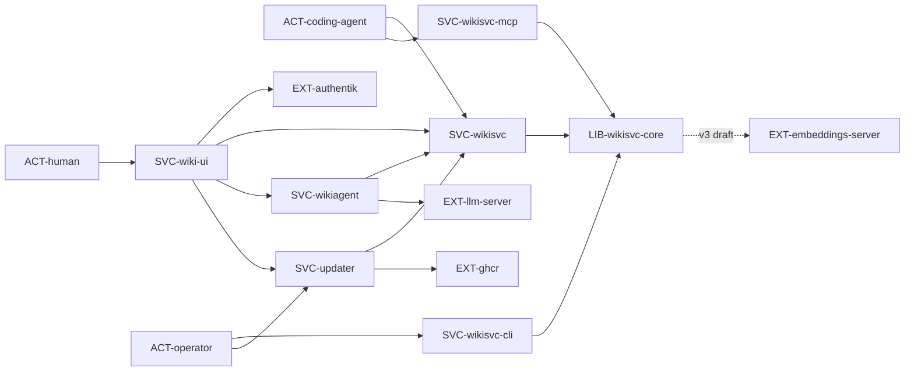

# Обзор системы: контекст

> Кто пользуется системой и с чем она связана снаружи. Внутреннее устройство — в `components/`.

llm-wiki — корпоративная база знаний и правил разработки в git-репозитории Markdown-страниц.
Люди и агенты читают её и предлагают правки; принимает правки только человек-ревьюер
(`INV-human-decides`). Из активных правил собирается блок политик для проектов (`FLOW-policy-compile`).
Вся система работает на одном хосте (`INV-single-node`, `RES-host`).
v3 (planned): слой знаний `kb/` — факты, хабы, технологии и вопросы по доменам (`ENT-fact`, `ENT-topic`, `ENT-tech`,
`ENT-question`, `ENT-domain`); правила по-прежнему навязываются блоком, знания выдаются по запросу
(`INV-rules-pushed-knowledge-pulled`, `FLOW-knowledge-brief`, `FLOW-ask`); векторы — от `EXT-embeddings-server`.

## Контекст (C4, уровень 1)

`SVC-wikisvc`, `SVC-wikisvc-mcp` и `SVC-wikisvc-cli` — три входа в одну библиотеку `LIB-wikisvc-core`;
`SVC-wikiagent` ходит в `SVC-wikisvc` только по HTTP. `SVC-wiki-ui` проксирует браузер к
`SVC-wikisvc`, `SVC-wikiagent` и `SVC-updater` (unix-сокет).

## Акторы

| id | кто | как взаимодействует | через что | status |
|---|---|---|---|---|
| ACT-human | сотрудник в браузере: читатель, автор, ревьюер, администратор | читает страницы и правила, ведёт чат с агентом, загружает книги, принимает и отклоняет предложения, запускает самолечение, сверку документации и обновление (v3 planned: ревью фактов списком claims по классам `STATE-fact-review-class`, разбор пар `contradicts`, запуск `FLOW-novelty-scan`) | `SVC-wiki-ui` (`API-wiki-ui.*`) → `API-wikisvc.*`, `API-wikiagent.*`, `API-updater.*`; вход — `FLOW-oidc-login` | implemented |
| ACT-coding-agent | ИИ-агент разработки или утилита (в т.ч. `wk`) со своим токеном `kind=agent` | получает политики и контекст, ищет страницы, создаёт и отправляет предложения, сообщает о нарушениях правил; решать не может (v3 planned: brief в начале задачи и `ask` по ходу, ссылается на факты по id — `INV-cite-by-id`; новые факты и связи — `API-wikisvc-mcp.propose_fact`, `API-wikisvc-mcp.propose_link`) | `SVC-wikisvc-mcp` (`API-wikisvc-mcp.*`, stdio или `/mcp`) или `SVC-wikisvc` (`API-wikisvc.*`) | implemented |
| ACT-operator | администратор хоста с sudo | ставит и обновляет систему, выпускает и отзывает токены, переиндексирует, запускает бэкап и проверку восстановления | `SVC-wikisvc-cli` (`CLI-wikisvc-cli.*`) через `llm-wiki-admin`, `CLI-updater.*`, systemd-юниты в `deploy/systemd/` | implemented |

## Внешние системы

### EXT-authentik — Authentik (OIDC-провайдер)
status: implemented | used_by: SVC-wiki-ui

- what: единственный способ входа человека в `SVC-wiki-ui`; группы пользователя дают роль и допуск через `FMT-wikisvc-core.roles-file`.
- protocol: OpenID Connect authorization code flow с PKCE (S256), `state` в cookie, `nonce`; discovery и JWKS (подпись RS256) — `ui/oidc.go`, `DEP-go-go-oidc`, `DEP-go-oauth2`. Шаги — `FLOW-oidc-login`.
- auth: `client_id` в `CFG-wiki-ui.WIKI_UI_OIDC_CLIENT_ID`, секрет клиента — файлом `CFG-wiki-ui.WIKI_UI_OIDC_SECRET_FILE`; издатель только HTTPS (`CFG-wiki-ui.WIKI_UI_OIDC_ISSUER`, HTTP — лишь при `CFG-wiki-ui.WIKI_UI_OIDC_INSECURE_HTTP` на loopback).
- limits: таймаут обмена кода 10s; незавершённый вход живёт 10 min; ключи обновляет `JOB-wiki-ui.oidc-refresh`.
- sla / failure: discovery недоступен → вход 503 «Вход временно недоступен»; уже выданные сессии работают до истечения (`SEC-session-cookie`); выход не ждёт IdP.
- data sent: `client_id`, redirect URI, код. Из ID-token берутся `sub`, `preferred_username`, `groups` → `SEC-pii`.
- docs: документация Authentik по OAuth2/OIDC-провайдеру (ссылку ведёт оператор).

### EXT-llm-server — OpenAI-совместимый сервер модели
status: implemented | used_by: SVC-wikiagent

- what: языковая модель для чата, плана правок, разбора книг, самолечения и сверки документации; в поставке — локальный llama-server (`RES-llama-server`) с моделью `MDL-wiki-gemma-31b`.
- protocol: HTTP JSON `POST {base_url}/chat/completions`, проверка готовности `GET {base_url}/models` (`src/wikiagent/models.py`, `src/wikiagent/check.py`); клиент `DEP-py-httpx`, редиректы запрещены. Структурированный ответ — `json_schema` или `json_object`.
- auth: необязательный Bearer из переменной, имя которой задаёт `CFG-wikiagent.models.*` (`token_env`); в поставке не используется.
- limits: таймаут вызова — `timeout_seconds` в `CFG-wikiagent.models.*` (по умолчанию 120s, в поставке 600s); повторы невалидного ответа — `CFG-wikiagent.limits.retries` (1–3); дневные лимиты вызовов — `NFR-agent-model-budget`; запрос, больше контекста, не отправляется (`ERR-model_context`).
- sla / failure: недоступен → `ERR-model_unavailable`; задача переходит в `STATE-job#failed`/`#paused` и возобновляется вручную; чат отвечает событием ошибки.
- data sent: тексты страниц и правил в пределах допуска рабочего токена агента, фрагменты книг и документов, сообщения чата, файлы сверки документации → `SEC-untrusted-external`, `SEC-pii`. Сервер в поставке слушает `127.0.0.1`.
- docs: OpenAI Chat Completions API; llama.cpp server README.
- changed: 2026-10-20 v3 (planned): + промпты слоя знаний `PRM-wikiagent.fact_extract`, `PRM-wikiagent.fact_judge`, `PRM-wikiagent.fact_links`, `PRM-wikiagent.hub_skeleton`, `PRM-wikiagent.novelty_cloze`, `PRM-wikiagent.novelty_answer`, `PRM-wikiagent.novelty_judge`, `PRM-wikiagent.fact_ground`; LLM-судья — развёрнутая Gemma на `RES-llama-server` (сейчас 12B, `MDL-gemma-12b`, `CFG-wikiagent.models.judge_llm`) — только на contradiction и парах с уверенностью < 0.7; novelty для облачной модели клиента идёт не сюда, а через официальный SDK, и только для фактов `public` (Q-kb-novelty-reference-model); в окна ingest уходят разделы книг 1–2k токенов со списком хабов домена.

### EXT-embeddings-server — OpenAI-совместимый сервер эмбеддингов и reranker
status: planned | used_by: LIB-wikisvc-core

- what: модель-кодировщик для векторов трёх уровней (`claim`, `digest`, `chunk`) и вектора запроса `ask`; reranker для `ask`, включён с этапа 2 (`CFG-wikisvc.ASK_RERANK_ENABLED`). Runtime с первого дня — `MDL-bge-m3` (GGUF F16, `--pooling cls`, контекст 8k); A/B на этапе 2 — `MDL-multilingual-e5-large`, `MDL-qwen3-embedding` (Q-kb-mdl-bge-m3, Q-kb-mdl-ab-candidates); reranker — `MDL-bge-reranker-v2-m3` (Q-kb-mdl-reranker; ADR-0018, ТЗ §5, §7.2).
- protocol: HTTP JSON `POST /v1/embeddings` (OpenAI-совместимый) и rerank-эндпоинт сервера; адрес, модель, pooling и размерность — `CFG-wikisvc.EMBEDDINGS_URL`, `CFG-wikisvc.EMBEDDINGS_MODEL`, `CFG-wikisvc.EMBEDDINGS_POOLING`, `CFG-wikisvc.EMBEDDINGS_DIM`, reranker — `CFG-wikisvc.RERANKER_URL`, `CFG-wikisvc.RERANKER_MODEL`. Реализация — llama-server, один процесс на модель: эмбеддинги — `RES-embeddings-server` (`--embeddings`, порт 18090), reranker — `RES-reranker-server` (`--reranking`, порт 18091), оба на loopback (Q-kb-embeddings-port, Q-kb-reranker-placement).
- auth: ключ не нужен — только loopback, сервер работает отдельным пользователем (Q-kb-embeddings-api-key).
- limits: таймаут 5 s и 1 повтор на вызов (`rule-arch-outgoing-call-resilience`, Q-kb-wikisvc-defaults); вход BGE-M3 до 8k токенов, mE5 — 512.
- sla / failure: недоступен или self-test не прошёл (`OBS-wikisvc.embeddings-selftest`) → `ERR-embeddings_unavailable`, `health.embeddings=failed`; `ask` работает урезанно с `degraded: true` (Q-kb-embeddings-degraded); смена модели — полный `CLI-wikisvc-cli.reindex --embeddings` (пересечение top-k между моделями 0.43–0.54, ТЗ §5).
- data sent: тексты страниц всех уровней допуска и запросы агентов → `SEC-embeddings-boundary`. Вызывает только ядро: `SVC-wikiagent` получает kNN через `API-wikisvc.knowledge.similar`.
- docs: llama.cpp server README (`--embeddings`, `--pooling`, `--reranking`); OpenAI Embeddings API.

### EXT-ghcr — GitHub Container Registry
status: implemented | used_by: SVC-updater

- what: реестр релизных образов `ghcr.io/badrabbit00/llm-wiki` (`RES-container-image`); публикует `PIPE-release`, читает `SVC-updater` и установка `deploy/install.sh`.
- protocol: OCI registry через `skopeo list-tags`/`inspect`, `podman pull` по digest, проверка аттестации `cosign verify-attestation` (тип SLSA provenance v1, издатель GitHub Actions OIDC, идентичность `release.yml@refs/tags/<тег>`) — `updater/host.go`.
- auth: чтение анонимное; публикация — `GITHUB_TOKEN` в CI.
- limits: проверка раз в `CFG-updater.check-every` (по умолчанию 6h).
- sla / failure: реестр недоступен — проверка повторится позже, установленная версия работает; подпись не сходится — обновление не предлагается.
- data sent: только запросы тегов и манифестов.
- docs: документация GitHub Packages и Sigstore cosign.

### EXT-github-releases — GitHub Releases и аттестации GitHub
status: implemented | used_by: SVC-updater

- what: в коде нет обращений к GitHub Releases API: `PIPE-release` не создаёт GitHub Release, а `SVC-updater` берёт версии только из тегов `EXT-ghcr`. От GitHub используется только подпись сборки: `actions/attest` в `.github/workflows/release.yml` и проверка этой подписи в `SVC-updater` (издатель `CFG-updater.issuer`, идентичность `CFG-updater.identity`).
- protocol: Sigstore-аттестация, привязанная к образу в `EXT-ghcr`; сетевых вызовов к api.github.com нет.
- sla / failure: аттестации нет или она от другого workflow → обновление не предлагается.
- data sent: нет.
